# 第五章：自然语言处理导论

来源：刘洋（Yang Liu），`5_Introduction_NLP_2026.pdf`，共 **129 页**，封面未注明日期。本文页码均为 **PDF 页序号**。整理日期：2026-10-20。

本章按知识点合并动画和重复图，依次整理语言任务、离散与连续词表示、语言模型、RNN、LSTM 和图神经网络。原图中的公式、矩阵、采样数值与结构均纳入正文或保留图中。必要的数学展开、复算和课件校正会明确说明。词向量、RNN 与图表示也为后续多模态应用提供语言和关系建模基础。

## 1. NLP 的目标、历史与任务

### 1.1 从字符串处理到语言理解

来源：第 2–3 页。

自然语言处理（Natural Language Processing，NLP）的基本目标是理解广泛的语言表达，包括上下文中的含义与结构。字符串处理、关键词匹配是可用手段，完整理解还需要处理词义、组合、语境和推理。

课件把希望构建的系统分为两组，表示教学中的相对复杂程度：

| 课件中的组别 | 任务及含义 |
| --- | --- |
| 较复杂、目标较远大 | 语音识别：语音转文字；机器翻译：语言间转换；信息抽取：从文本获得实体、事件或关系；对话理解：理解多轮意图与上下文；问答：根据问题和证据给出答案 |
| 相对基础 | 拼写纠错；词性标注；文本分类 |

这不是任务难度的固定排名。噪声、语言、领域、标注粒度和评价标准都会改变难度。第 2 页“人说的话与狗听到的关键词”漫画只用于引入理解与匹配的差别，装饰性漫画不另存。

### 1.2 课件中的 NLP 历史脉络

来源：第 4–8 页。这五页的正文嵌在图片中，提取文字没有获得其内容，已对照原页逐项转写。

| 阶段 | 课件强调的内容 |
| --- | --- |
| NLP 与语言学研究的早期 | 最初过于乐观，认为 NLP 容易；曾预测机器翻译约 3 年可解决；主要依赖手工规则和语言学方法；课件以一个“3 年项目延续 10 年、投入很大但结果不佳”的叙述说明预期失衡 |
| 低潮期（Dark Era） | 初期热潮消退后，人们转而认为 NLP 难以实现，相关研究一度大幅减少 |
| 缓慢复兴 | 部分研究恢复；仍强调语言学方法；经常处理小型玩具问题，实证评价较弱 |
| 统计方法兴起 | 计算能力显著提高；数据驱动的统计方法和较简单的表示，在一些任务上超过复杂的手工语言学规则 |
| 统计与语言知识结合 | 统计模型更复杂，同时关注更丰富的语言表示 |

原图时间轴从约 1950 年延伸至 2020 年以后，彩色区间是课程中的概括性分期，没有给出具体项目名称或足够依据来把每个边界当作精确历史定年。以上保留其发展逻辑及“3 年／10 年”原始例子。

### 1.3 句法任务与结构例子

来源：第 9 页。

| 任务 | 处理对象 |
| --- | --- |
| 分词（word segmentation） | 确定词的边界 |
| 形态分析（morphological analysis） | 分析词根、词缀、屈折等词内结构 |
| 词性标注（POS tagging） | 为词指定名词、动词等类别 |
| 短语组块（phrase chunking） | 找出名词短语等较浅层片段 |
| 句法分析（syntactic parsing） | 识别完整的层次结构与修饰关系 |

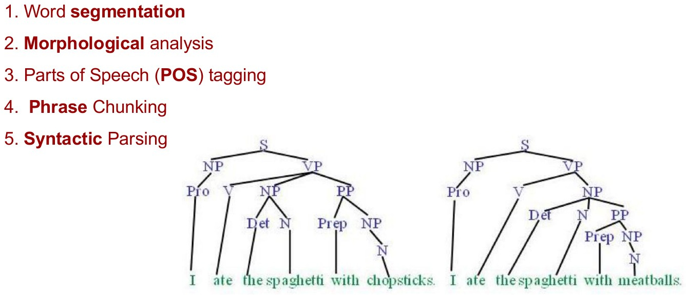

*原图：第 9 页。S 为句子，NP 为名词短语，VP 为动词短语，PP 为介词短语，Pro/V/Det/N/Prep 分别为代词、动词、限定词、名词、介词。*

例子 `I ate the spaghetti with chopsticks` 中，`with chopsticks` 描述吃的工具，PP 附着在 VP；`I ate the spaghetti with meatballs` 中，`with meatballs` 描述意大利面的组成，PP 附着在 NP。相同表面模式可以对应不同组合关系，词袋无法直接表达这种层次差别。

### 1.4 语言基础模型的五个研究维度

来源：第 10 页。课件“Recent Advance”按以下问题组织，保留为课件提出的能力维度，不当作模型已经全面解决这些问题的结论。

| 维度 | 具体问题 |
| --- | --- |
| 真实性（truthfulness） | 能否提供符合事实、真实的信息？ |
| 推理（reasoning） | 能否可靠地完成复杂推理？ |
| 适应（adaptation） | 能否获取新知识，适应新环境？ |
| 世界落地（grounding） | 能否把语言描述与现实世界联系起来并理解其指向？ |
| 自主行动（agentic AI） | 能否将语言理解转化为可靠行动？ |

## 2. 从 one-hot 到词袋与词向量

### 2.1 one-hot 编码与词表顺序

来源：第 11–12、18 页。

词表大小为 M，每个词分配一个索引，one-hot 向量仅在对应位置为 1：

```math
x_w=e_{mathrm{index}(w)}\in\mathbb R^M.
```

第 11–12 页的词表顺序是：dog=1、cat=2、person=3、holding=4、tree=5、computer=6、using=7。图中绘成 10 维，最后三格是未展开的词表位置。比如 person 为 `[0,0,1,0,0,0,0,0,0,0]`。后面的 RNN 数值例也采用这套顺序。

不同词的 one-hot 点积为 0，欧氏距离均为根号 2，因而不能凭这套表示区分同义、反义或无关词的语义远近。它简单，但维数随词表增长。实际存储可只记索引，不能把概念上的 M 维向量等同于必须存储 M 个浮点数。

### 2.2 Bag-of-Words 的完整例题

来源：第 13–16 页。这里的局部词表与前页不同，必须先固定顺序：**person、cat、dog、holding、tree、computer、using**，对应 1…7。沿用原图的 10 维画法，后三维为 0。

| 文本 | 出现词的索引 | 计数向量 |
| --- | --- | --- |
| person holding dog | {1,4,3} | [1,0,1,1,0,0,0,0,0,0] |
| person holding cat | {1,4,2} | [1,1,0,1,0,0,0,0,0,0] |
| person using computer | {1,7,6} | [1,0,0,0,0,1,1,0,0,0] |
| person using computer 与 person holding cat 合并 | 多重出现序列为 {1,1,7,6,4,2} | [2,1,0,1,0,1,1,0,0,0] |

词袋是逐词计数或其变换，最后一行 person 出现两次，值为 2。原图用花括号写索引，但涉及次数时应理解为多重集或出现序列，不能按普通集合删除重复项。

大词表时，可用非零索引和值做稀疏存储：

| 文本 | indices | values |
| --- | --- | --- |
| person holding dog | [1,4,3] | [1,1,1] |
| person holding cat | [1,4,2] | [1,1,1] |
| person using computer | [1,7,6] | [1,1,1] |
| 两句合并 | [1,7,6,4,2] | [2,1,1,1,1] |

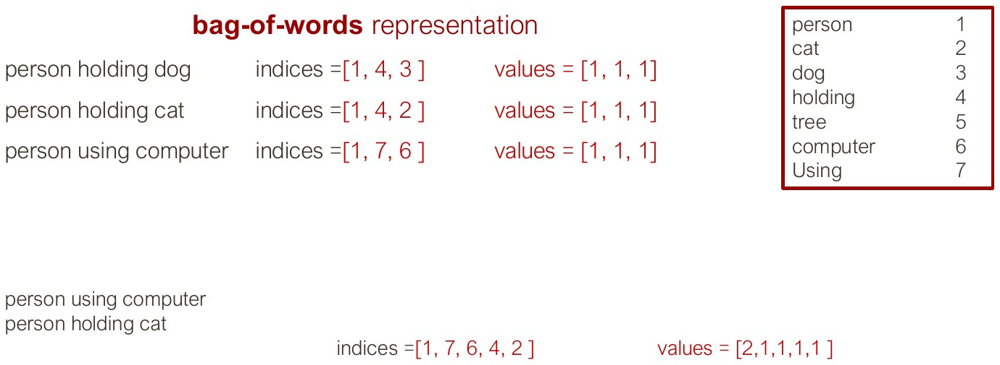

*原图：第 15 页；第 13–14 页重复的稠密向量已完整转入上表。indices 可以未排序，但必须与 values 一一对应。*

词袋容易构造，适用于短语、句子、段落和文档，可用于分类、聚类或文本距离计算。它丢弃词序：

- `my friend makes a nice meal`：我的朋友做了一顿不错的饭。
- `my nice friend makes a meal`：我那位友善的朋友做了一顿饭。

两句词频相同，词袋相同，但 `nice` 的修饰对象不同。

### 2.3 Bag-of-Bigrams 保留局部相邻关系

来源：第 17 页。

| 句子 | 相邻二元组 | 课件示意索引 | 计数 |
| --- | --- | --- | --- |
| my nice friend makes a meal | my nice；nice friend；friend makes；makes a；a meal | [10232,43133,21342,43233,54233] | [1,1,1,1,1] |
| my friend makes a nice meal | my friend；friend makes；makes a；a nice；nice meal | [10132,21342,43233,53123,64233] | [1,1,1,1,1] |

索引只是该例的特征编号。二元组词袋可区分这两句，并保留词袋方便用于分类、聚类和距离计算的特点；它仍只统计局部相邻模式，不能保证恢复全句词序和句法结构，潜在特征空间也更大。原页重复的“难以区分相同词的句子”应理解为词袋家族的限制，不能说 bigram 对上述两句仍完全相同。

### 2.4 三种词表示的比较

来源：第 18 页。

| 表示 | 构造 | 课件强调的特点 |
| --- | --- | --- |
| one-hot | 对应词表位置为 1 | 简单；高维；不同词之间距离相同 |
| 人工词特征 | 人工定义属性，例如是否以 `-ing` 结尾 | 可固定为 300 维等大小，与词表大小区分开；需要人工选特征 |
| 学习得到的词向量 | 从数据学习稠密数值 | 紧凑；希望几何关系反映语义或语言规律 |

300 维是例子，不是所有词向量必须使用的维数。向量长度 d 可独立设定，嵌入表整体仍有 M×d 个参数。学习出的相似性受训练目标、语料和评价方法影响；反义词可能因上下文相近而接近，不能把“向量距离就是语义”当作无条件保证。

## 3. 分布假设、共现与相似度

### 3.1 从未知词的上下文推断含义

来源：第 19–22 页。

分布假设认为，词义的某些方面取决于词在语言环境中的分布，两个表达的语义相似程度与其可出现上下文的相似程度相关。课件引用 Lenci（2008），并用 Paul Horwich 的“意义的使用理论”说明：理解并预测一个词在何种语境出现，可以帮助理解其含义。

未知词 `bardiwac` 的六条线索完整保留如下：

| 课件句子 | 提供的语境线索 |
| --- | --- |
| He handed her glass of bardiwac. | 可以装在杯中、递给别人，像饮料 |
| Beef dishes are made to complement the bardiwacs. | 与牛肉菜肴搭配 |
| Nigel staggered to his feet, face flushed from too much bardiwac. | 过量后步履不稳、脸红，暗示酒精 |
| Malbec, one of the lesser-known bardiwac grapes, responds well to Australia’s sunshine. | 与葡萄品种、日照和产地有关 |
| I dined off bread and cheese and this excellent bardiwac. | 可与面包和奶酪同食 |
| The drinks were delicious: blood-red bardiwac as well as light, sweet Rhenish. | 是饮品，可呈血红色，并与浅色甜酒并列 |

结合线索可推断它指向**葡萄酿造的含酒精饮料，即葡萄酒一类**。这是语境推断，不是单独查一个已知字符串。第 21 页答案把词写成 `bardic`，按题目上下文统一为 `bardiwac`；第 20 页 `flflushed` 按第 21 页修正为 `flushed`。

### 3.2 共现矩阵：用一行描述一个词的使用方式

来源：第 23、27 页，重复矩阵合并。

行表示目标名词，列表示上下文动词，元素为示例共现次数。每个行向量可看作高维欧氏空间中的一个点。

| 词 | get | see | use | hear | eat | kill |
| --- | --- | --- | --- | --- | --- | --- |
| knife | 51 | 20 | 84 | 0 | 3 | 0 |
| cat | 52 | 58 | 4 | 4 | 6 | 26 |
| dog | 115 | 83 | 10 | 42 | 33 | 17 |
| boat | 59 | 39 | 23 | 4 | 0 | 0 |
| cup | 98 | 14 | 6 | 2 | 1 | 0 |
| pig | 12 | 17 | 3 | 2 | 9 | 27 |
| banana | 11 | 2 | 2 | 0 | 18 | 0 |

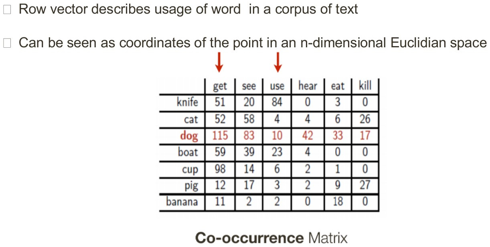

*原图：第 23 页。这里只展开六种动词上下文；一般语料的上下文特征远多于六维，因此第 27 页强调“维数过高”。*

### 3.3 欧氏距离会受到频率和向量长度影响

来源：第 24–25 页。

图取的两维是 **get 与 use**，不是表格相邻的 get 与 see。因此 cat=(52,4)、dog=(115,10)、boat=(59,23)、knife=(51,84)。

```math
d(u,v)=\|u-v\|_2.
```

```math
d(\mathrm{dog},\mathrm{cat})
=\sqrt{(115-52)^2+(10-4)^2}\approx63.3,
```

```math
d(\mathrm{dog},\mathrm{boat})
=\sqrt{(115-59)^2+(10-23)^2}\approx57.5.
```

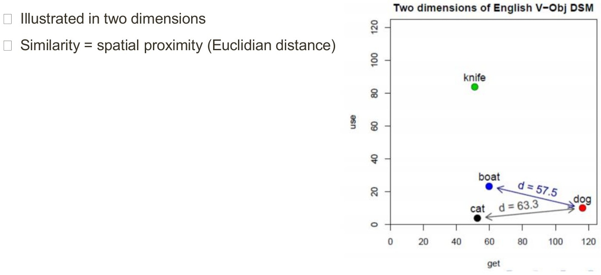

*原图：第 24 页。按原表独立复算，与图中数值一致。*

仅按这里的原始欧氏距离，dog 反而更接近 boat。第 25 页称语料中 dog 总频率约为 cat 的 27 倍，用于说明词频影响位置；该总频率没有给出完整语料统计，不能把六个展示列相加后当作 27 倍的证据。

### 3.4 归一化与余弦相似度

来源：第 26 页。

方向往往比原始计数的绝对长度更有意义，可以先归一化，或比较夹角：

```math
\widehat v=\frac{v}{\|v\|_2},\qquad
\cos(u,v)=\frac{u^\top v}{\|u\|_2\|v\|_2}.
```

上述两维中，cos(dog,cat)≈0.99995，cos(dog,boat)≈0.95967，方向判断与未归一化的欧氏距离不同。对单位向量：

```math
\|\widehat u-\widehat v\|_2^2=2-2\cos(u,v).
```

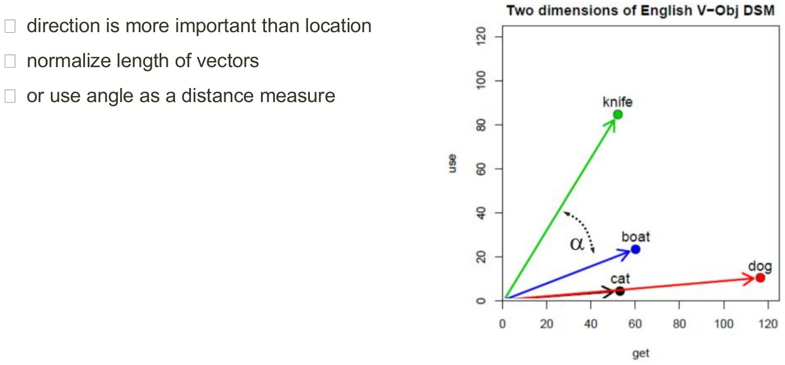

*原图：第 26 页。归一化可减少长度影响；它不会自动消除所有频率偏差，也不能使六维例子涵盖完整词义。零向量不能直接做此归一化。*

## 4. word2vec：CBOW、Skip-gram 与类比

### 4.1 两种预测方向

来源：第 28–43 页。

word2vec 通过局部上下文预测任务学习连续词向量。课件强调其训练较高效、便于随语料更新；增加一个全新词仍须处理词表和向量学习，不能理解为没有训练就自动得到新词语义。

| 模型 | 输入 | 训练时预测的对象 |
| --- | --- | --- |
| CBOW（Continuous Bag of Words，连续词袋） | 窗口内上下文词的向量聚合 | 中心词 |
| Skip-gram | 中心词 | 窗口内各个上下文词 |

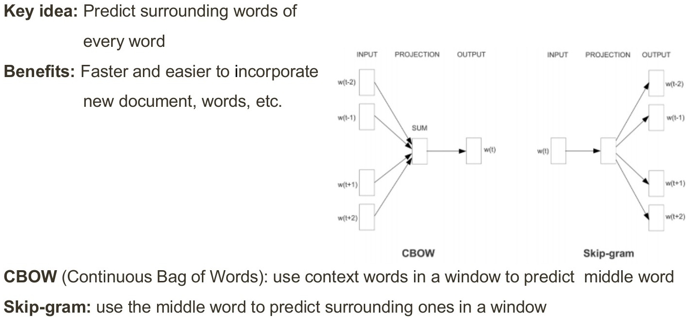

*原图：第 28 页。页首“预测周围词”主要对应 Skip-gram；CBOW 的方向相反。出处：[Mikolov 等，2013](https://arxiv.org/html/1301.3781v3)。*

### 4.2 CBOW 的窗口与参数尺寸

来源：第 29–34、37–41 页。

课件用 `The cat sat on floor`，窗口半径 2，以 the、cat、on、floor 预测 sat。随后为了画清矩阵，只使用 cat、on 两个上下文。前者是四词窗口，后者是两词计算示意，平均时分母应分别是 4 和 2。

为统一原图中 W、Wᵀ 与下标的换用，设词表大小 M、向量维数 d，采用列向量：

```math
E\in\mathbb R^{d\times M},\qquad
U\in\mathbb R^{M\times d},\qquad
v_c=Ex_c\in\mathbb R^d.
```

E 为输入嵌入表，U 为输出嵌入表。所有上下文位置共享 E。令上下文多重集为 C：

```math
h_C=\frac1{|C|}\sum_{c\in C}Ex_c,\qquad
z=Uh_C\in\mathbb R^M,\qquad
p=\mathrm{softmax}(z).
```

聚合后的“hidden/projection layer”在该 CBOW 图中是向量求和或平均，没有额外画出非线性激活。平均使上下文内部词序丢失，但组合统计仍可支持缺词预测。不计偏置，E、U 共 2Md 个参数，d 可取课件例中的 300。

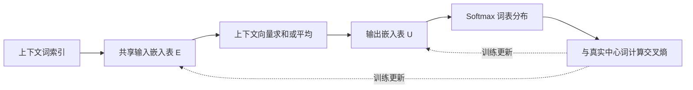

### 4.3 one-hot 乘矩阵就是查表：全部可见数值

来源：第 35–37 页。

原图只展开嵌入表的一部分，省略号位置没有实际数值，不能补造。可见的三行如下：

| 嵌入坐标 | 列1 | 列2：cat | 列3 | 列4：on | 列5 | 列6 | 中间列 | 最后展示列 |
| --- | --- | --- | --- | --- | --- | --- | --- | --- |
| 第1坐标 | 0.1 | 2.4 | 1.6 | 1.8 | 0.5 | 0.9 | … | 3.2 |
| 第2坐标 | 0.5 | 2.6 | 1.4 | 2.9 | 1.5 | 3.6 | … | 6.1 |
| 最后展示坐标 | 0.6 | 1.8 | 2.7 | 1.9 | 2.4 | 2.0 | … | 1.2 |

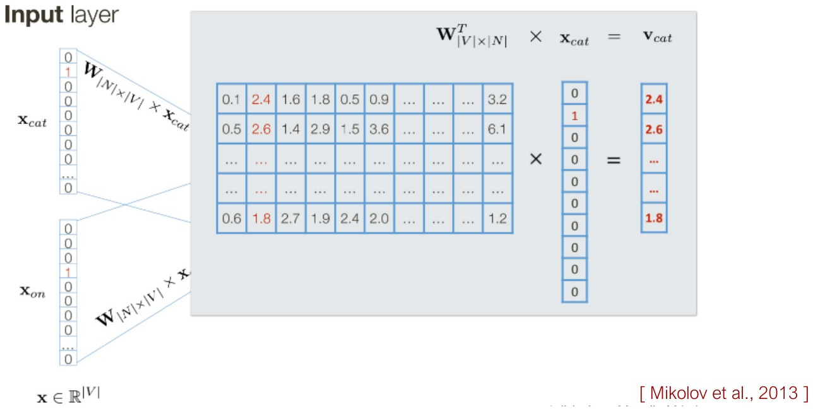

*原图：第 35 页。v_cat=[2.4,2.6,…,1.8]ᵀ。*

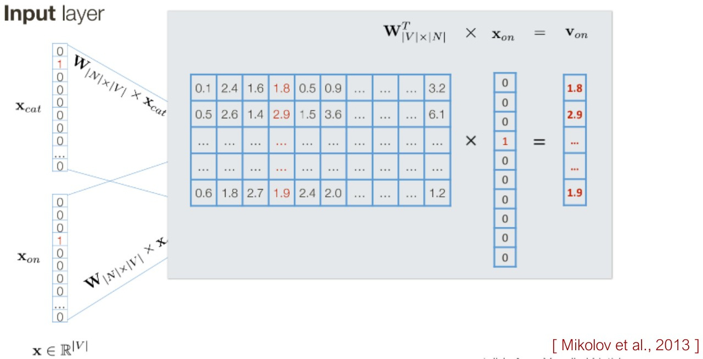

*原图：第 36 页。v_on=[1.8,2.9,…,1.9]ᵀ。原图顶部 Wᵀ 的尺寸标签与实际乘法不一致，统一使用前述 E 的 d×M 约定。*

两词平均的可见坐标复算为：

```math
h_C=\frac{v_{\mathrm{cat}}+v_{\mathrm{on}}}{2}
=[2.1,\ 2.75,\ \ldots,\ 1.85]^\top.
```

词向量各坐标从损失中学习，不预先赋予“猫的大小”等固定语义。

### 4.4 Softmax、训练目标与两套词表示

来源：第 38–42 页。

令输出词 w 对应 U 的一行为 u_wᵀ，则标准 CBOW 概率为：

```math
p(w\mid C)=
\frac{\exp(u_w^\top h_C)}
{\sum_{j=1}^{M}\exp(u_j^\top h_C)}.
```

训练中心词为 w*，用交叉熵使分布接近其 one-hot 标签：

```math
L=-\log p(w^*\mid C)
=-u_{w^*}^\top h_C+
\log\sum_{j=1}^{M}\exp(u_j^\top h_C).
```

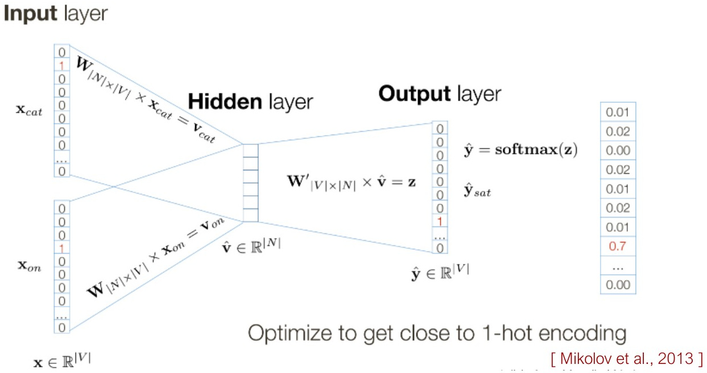

*原图：第 39 页。展示的概率片段为 [0.01,0.02,0.00,0.02,0.01,0.02,0.01,0.70,…,0.00]ᵀ，sat 对应约 0.70；中间省略部分未给出，不能由这些数值恢复完整分布。第 40–41 页重复结构合并。*

同一个词有两套可学习表示：输入向量 v_w 是 E 的列，输出向量 u_w 是 U 的行转置；它们不是必须相同或互为转置的同一组参数。训练共享的是上下文各位置使用同一个 E，而不是强制 E=Uᵀ。

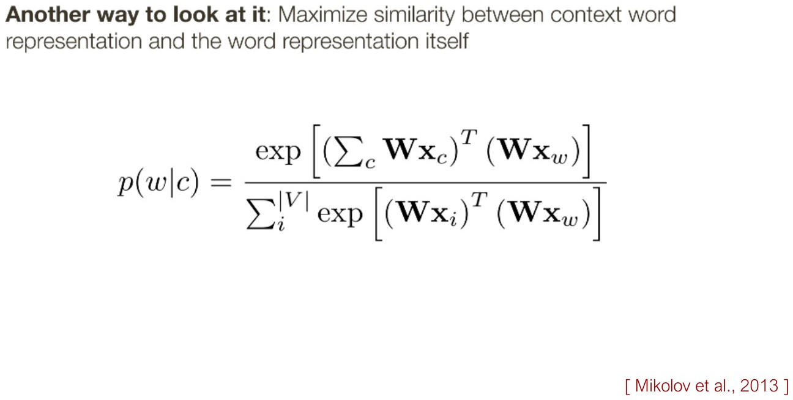

*原图：第 42 页。保留原式便于逐项核对，正确概率以正文为准。*

原式分子用上下文向量总和与目标词向量做点积，但分母却把“词表候选 x_i”和固定目标 x_w 做点积，未保持上下文不变，也把输入、输出两套向量都写成 W。应固定 h_C，在分母遍历输出候选 u_j。若采用求和而非平均，必须在分子和分母始终使用同一个上下文总和；第 37 页明确使用平均。此处依据前面的网络尺寸和 [word2vec 原论文第3节](https://arxiv.org/html/1301.3781v3) 统一记号。

### 4.5 Skip-gram 的多上下文预测

来源：第 43 页。

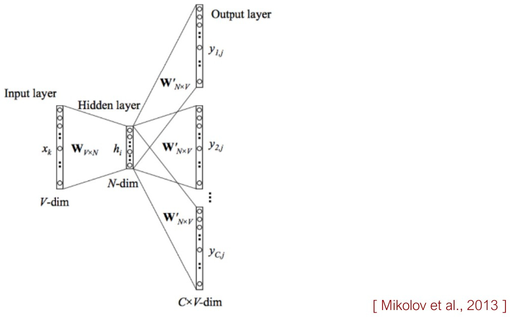

*原图：第 43 页。词表维数 V、嵌入维数 N 对应本文 M、d；多个输出对应窗口中的 C 个上下文词，不是 C 个不同词表。*

中心词向量 v_w=Ex_w，针对每个上下文目标 c：

```math
p(c\mid w)=\frac{\exp(u_c^\top v_w)}
{\sum_{j=1}^{M}\exp(u_j^\top v_w)},\qquad
L_{\mathrm{SG}}=-\sum_{c\in C}\log p(c\mid w).
```

图中多个输出使用相同词表预测参数。CBOW 聚合上下文后预测一次中心词；Skip-gram 把中心词与各上下文词形成训练对。课件未展开负采样、层次 Softmax 的算法推导，这里保留其所画的完整 Softmax 版本。

### 4.6 词类比：关系方向的近似线性结构

来源：第 44–45 页。

对关系 a:b::c:?，先计算 q=v_b−v_a+v_c，再在候选词中找余弦相似度最高者：

```math
d^*=\underset{w\notin\{a,b,c\}}{\arg\max}
\frac{q^\top v_w}{\|q\|_2\|v_w\|_2}.
```

原图公式只写了分母中的 ‖q‖，隐含候选词向量已单位化；未单位化时应补上 ‖v_w‖。排除题目输入词是类比检索的常见约定，[原论文第4节](https://arxiv.org/html/1301.3781v3) 也明确说明。

```math
v_{\mathrm{king}}-v_{\mathrm{man}}+v_{\mathrm{woman}}
=[0.30,0.70]-[0.20,0.20]+[0.60,0.30]
=[0.70,0.80].
```

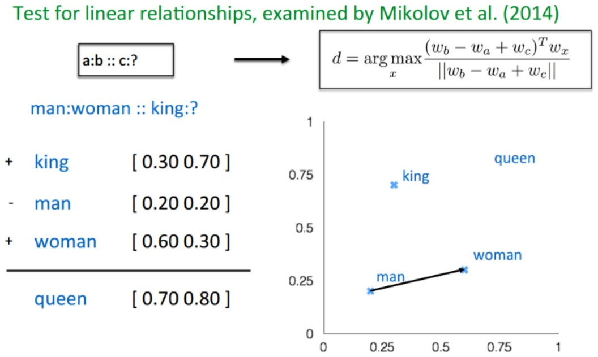

*原图：第 44 页。结果标为 queen。数值是教学二维示意，并不意味着真实高维词向量一定严格满足该等式。图中文字引用 Mikolov 等的相关类比工作，模型介绍的出处为2013年论文。*

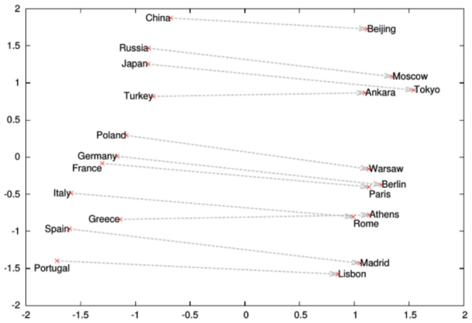

*原图：第 45 页。完整保留二维投影及各箭头，坐标是词向量的示意投影，不是地理位置。*

全部配对为：中国—北京、俄罗斯—莫斯科、日本—东京、土耳其—安卡拉、波兰—华沙、德国—柏林、法国—巴黎、意大利—罗马、希腊—雅典、西班牙—马德里、葡萄牙—里斯本。图展示某类关系方向可能近似一致；不能由投影断言每条高维偏移完全相同。

## 5. 语言模型与有限上下文

### 5.1 句子概率与语音识别中的语言先验

来源：第 46–47 页，重复公式合并。

语言模型给词序列分配概率，理想情况下还可采样生成合理句子。在传统概率式语音识别中，设声学观测为 a、候选词序列为 w：

```math
\widehat w=\underset{w}{\arg\max}\ P(w\mid a)
=\underset{w}{\arg\max}\ \frac{P(a\mid w)P(w)}{P(a)}
=\underset{w}{\arg\max}\ P(a\mid w)P(w).
```

P(a) 对所有候选 w 相同，可以从 argmax 中省去。P(a|w) 是声学似然，P(w) 是语言先验；课件高亮的正是后者。该分解说明本页的概率建模角色，不要求所有语音系统都以相同方式显式拆分。

### 5.2 概率链式法则与 N-gram 近似

来源：第 48–50 页。

给定 w₁:ₙ=[w₁,…,wₙ]，链式法则严格成立：

```math
P(w_{1:n})=\prod_{t=1}^{n}P(w_t\mid w_{1:t-1})
=P(w_1)P(w_2\mid w_1)\cdots P(w_n\mid w_{1:n-1}).
```

bigram 只保留前一个词：

```math
P(w_{1:n})\approx\prod_{t=1}^{n}P(w_t\mid w_{t-1}).
```

N-gram 保留前 N−1 个词，句首用约定的起始符补齐：

```math
P(w_{1:n})\approx\prod_{t=1}^{n}
P(w_t\mid w_{t-N+1:t-1}).
```

近似发生在“条件只看有限历史”这一步。课件第 49 页在近似栏仍写等号，这里明确改为近似号。完整可变长句子的建模还需要终止符或长度约定，不能只给无限延伸的前缀概率而忽略停止规则。

用语料频数做最大似然估计：

```math
\widehat P(w_t\mid w_{t-1})=
\frac{C(w_{t-1},w_t)}{C(w_{t-1})},
```

```math
\widehat P(w_t\mid w_{t-N+1:t-1})=
\frac{C(w_{t-N+1:t})}{C(w_{t-N+1:t-1})}.
```

这里 C 表示相应序列的计数，并采用一致的句界统计约定。第 50 页 N-gram 的条件起点误写为 n−N−1，应为 t−N+1：N-gram 总共包含 N 个词，其中历史长度 N−1。分母历史未出现时不能直接相除；平滑或回退需要另行规定，课件没有展开其算法。

### 5.3 单词输入的前馈网络与序列建模需求

来源：第 51–59 页。

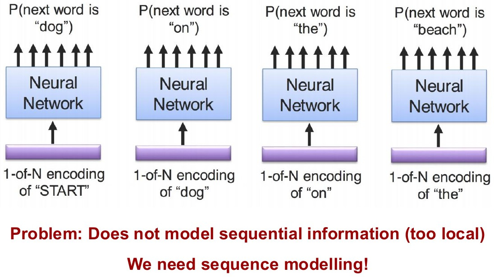

*原图：第 52 页，合并第 51 页。流程是 START→dog、dog→on、on→the、the→beach。*

图中的网络只看到前一个词的 one-hot，缺少显式循环状态，无法区分前一个词相同但更早历史不同的情况。按标准阶数命名，它在图中建模的是 P(w_t|w_{t−1})，相当于**神经 bigram 条件模型**；原题“Neural-based Unigram”不准确。真正 unigram 不依赖前词，使用 P(w_t)。原页“没有序列信息”应理解为没有累积长程历史，仍保留了一个相邻词条件。

第 53 页以手写 `Foreign minister.` 和音频波形说明，字符、笔画、语音帧等具有序列结构。需要能处理可变长度的模型，同时避免参数量随长度无限增加；第 59 页给出的关键办法是**跨时间共享参数**。

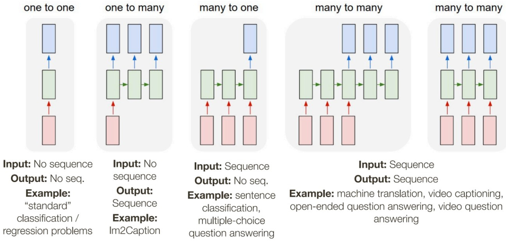

*原图：第 57 页，合并第 54–56 页逐步增加的任务类型。红色为输入，绿色为状态处理，蓝色为输出。*

| 形式 | 输入与输出 | 课件例子 |
| --- | --- | --- |
| one-to-one | 固定输入、固定输出 | 普通分类、回归 |
| one-to-many | 固定输入、序列输出 | 图像描述 Im2Caption |
| many-to-one | 序列输入、固定输出 | 句子分类、选择题问答 |
| many-to-many，延迟输出 | 先读取输入，再生成输出序列，长度可不同 | 机器翻译、视频描述、开放式问答、视频问答 |
| many-to-many，逐步对齐 | 每个输入时间步都有输出 | 对齐的序列标注等；原图右侧给出这种结构 |

输出是固定类别选择还是开放序列，由具体任务定义决定，不能仅凭“问答”二字确定形式。

## 6. RNN：共享参数与累积状态

### 6.1 循环状态与普通 RNN 方程

来源：第 60–68 页，循环图及方程的逐步出现合并。

RNN 在每个时间步使用同一个状态转移函数：

```math
h_t=f_W(h_{t-1},x_t).
```

普通 tanh RNN 的具体形式：

```math
a_t=W_{hh}h_{t-1}+W_{xh}x_t+b_h,\qquad
h_t=\tanh(a_t),\qquad
s_t=W_{yh}h_t+b_y.
```

第 66 页把最后一式写作 y_t，这里用 s_t 强调它首先是分数或 logits。若用于词表分类，还需 p_t=softmax(s_t)。状态 h_t 汇总“到目前为止”的信息；也可以理解为当前元素在所有此前元素提供的上下文中的表示。输入可为字母、词、视频帧等向量。

输入维数 p、状态维数 d、输出维数 q 时：

| 参数 | 尺寸 |
| --- | --- |
| W_hh | d×d |
| W_xh | d×p |
| b_h | d |
| W_yh | q×d |
| b_y | q |

同一层所有时间步复用这些参数，参数数量 d²+dp+d+qd+q 不随序列长度 T 增长；计算量和保存计算图所需内存仍会随 T 增长。h₀ 需要初始化，例如置零。固定维状态不意味着可以无损存储任意长的全部输入。

### 6.2 单位矩阵例题：为什么旧信息会变弱

来源：第 69–77 页。

课件固定 W_hh=I、W_xh=I、b_h=0，初始 h₀=0，输入为 10 维 one-hot。此时状态维数与输入维数相同：

```math
h_t=\tanh(h_{t-1}+x_t).
```

词表使用第 12 页顺序，person 在第 3 维、holding 在第 4 维、dog 在第 1 维。输入短语 `person holding dog`，课件动画实际展开到 holding：

| 时刻 | 当前输入 | person 坐标 | holding 坐标 | dog 坐标 |
| --- | --- | --- | --- | --- |
| 0 | 无 | 0 | 0 | 0 |
| 1 | person | tanh(1)=0.761594… | 0 | 0 |
| 2 | holding | tanh(0.761594…)=0.642015… | tanh(1)=0.761594… | 0 |

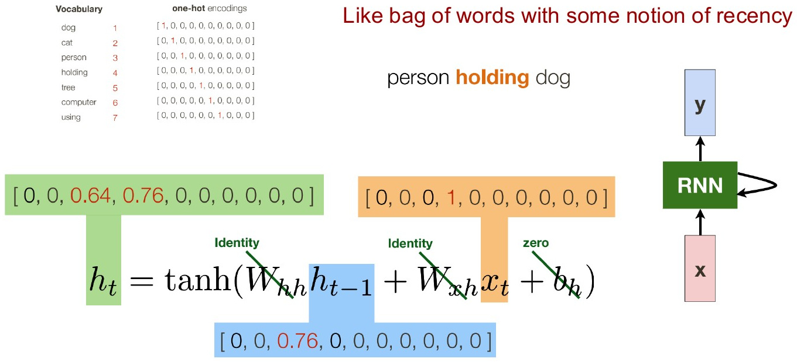

*原图：第 77 页。对应 h₁=[0,0,0.76,0,…]，h₂=[0,0,0.64,0.76,0,…]，其余零坐标与完整 10 维向量保留在图中。合并第 69–76 页逐步着色的计算。*

**补充演算**：若继续输入 dog，同一公式得到 dog=0.761594…、person=0.566270…、holding=0.642015…，其余坐标为零。可见即使循环矩阵为 I，tanh 的重复作用仍会改变旧信息。课件“像带有新近性概念的词袋”是对这个特殊例子的直觉描述；一般可学习的 RNN 不等于固定衰减的词袋。

### 6.3 时间展开、输出位置与损失

来源：第 78–86 页。

时间展开把一个循环单元画为多个计算节点，各节点代表不同时间的计算，权重 W 仍是同一组。

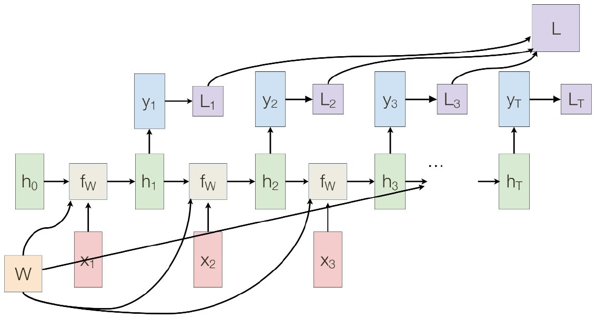

*原图：第 84 页，合并第 78–83 页逐步加上时间步、权重、输出及损失的图。*

逐步输出时，各 y_t 对应损失 L_t，总损失可以求和：

```math
L=\sum_{t=1}^{T}L_t.
```

也可按有效 token 数平均；带补齐位置的批次应只统计有效位置。第 85 页 many-to-one 只在最后状态接输出和损失；第 86 页 one-to-many 在最初输入条件后连续生成输出。它们共享循环状态更新思想，监督出现的位置不同。

## 7. 字符语言模型：训练、采样与 Teacher Forcing

### 7.1 `hello` 的完整训练例子

来源：第 87–89 页，逐层加图合并。原图注明来自 Stanford CS231n，Fei-Fei Li、Justin Johnson、Serena Yeung。

词表为 `[h,e,l,o]`，四个 one-hot 分别为 [1,0,0,0]、[0,1,0,0]、[0,0,1,0]、[0,0,0,1]。用 `hello` 构造下一字符训练对：输入 h/e/l/l，目标 e/l/l/o。

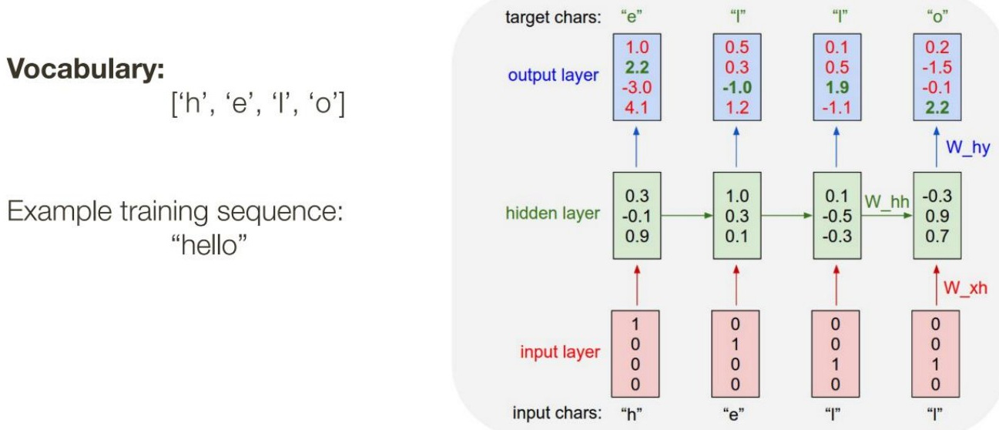

*原图：第 89 页。绿框为三维隐藏状态，蓝框为四维输出分数，不能把可为负数或大于1的输出分数当作概率。*

| 时间步 | 输入 | 隐藏状态 h_t（图示） | 输出 logits，顺序[h,e,l,o] | 目标 |
| --- | --- | --- | --- | --- |
| 1 | h | [0.3,−0.1,0.9] | [1.0,2.2,−3.0,4.1] | e |
| 2 | e | [1.0,0.3,0.1] | [0.5,0.3,−1.0,1.2] | l |
| 3 | l | [0.1,−0.5,−0.3] | [0.1,0.5,1.9,−1.1] | l |
| 4 | l | [−0.3,0.9,0.7] | [0.2,−1.5,−0.1,2.2] | o |

状态里的 1.0 是示意或四舍五入值，tanh 对有限输入严格小于1。课件没有给出三组权重矩阵的所有元素，不能从图中假装精确复算隐藏状态；可以独立复算给定 logits 的 Softmax 和损失。

```math
p_t(j)=\frac{\exp(s_{t,j})}{\sum_{k=1}^{4}\exp(s_{t,k})},\qquad
L_t=-\log p_t(w_{t+1}).
```

按原 logits 精算，使用自然对数：

| 步 | P(h) | P(e) | P(l) | P(o) | 目标字符交叉熵 |
| --- | --- | --- | --- | --- | --- |
| 1 | 0.037684 | 0.125116 | 0.000690 | 0.836510 | 2.078517 |
| 2 | 0.246572 | 0.201876 | 0.055018 | 0.496535 | 2.900102 |
| 3 | 0.113088 | 0.168708 | 0.684143 | 0.034061 | 0.379588 |
| 4 | 0.107382 | 0.019617 | 0.079550 | 0.793451 | 0.231364 |

四步损失合计约 5.589571，按四个目标平均约 1.397393。这是对课件数值的补充复算。原图两位小数概率是手工近似，显示 0.00 不表示 Softmax 的有限 logit 概率严格为零。

### 7.2 自回归采样与三种解码方式

来源：第 90–93 页。

推断时没有后续真实字符。先输入一个起始条件，得到分布，选择一个字符，将该字符编码后反馈为下一步输入，同时传递隐藏状态。

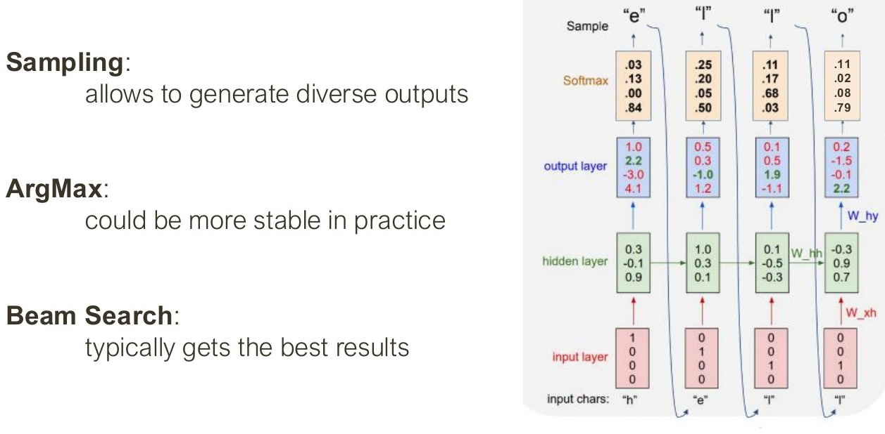

*原图：第 93 页，合并第 90–92 页逐步增加的采样和反馈箭头；来源为 CS231n。*

图中四列近似概率分别为 [0.03,0.13,0.00,0.84]、[0.25,0.20,0.05,0.50]、[0.11,0.17,0.68,0.03]、[0.11,0.02,0.08,0.79]，示例选出 e/l/l/o。第一步采样 e，虽然最大概率字符是 o，说明“采样”并非每步都选最大者。若生成路径变化，后续状态及分布也相应变化。

| 方法 | 做法 | 课件表述与适用条件 |
| --- | --- | --- |
| 随机采样 | 按当前条件概率抽取下一个 token | 可产生多样输出；结果随随机性变化 |
| Argmax／贪心 | 每步选择最大概率 token | 给定模型与起始条件时通常更稳定；局部最优不保证全序列最优 |
| Beam Search／束搜索 | 每步扩展多个候选前缀，只保留有限个较高累计分数者 | 课件称“通常效果最好”，这是特定任务经验，不能当作所有生成任务的通则，也不保证有限束宽找到全局最优 |

束搜索可按累计对数概率评分，必要展开为：

```math
\log P(w_{1:T})=\sum_{t=1}^{T}\log P(w_t\mid w_{<t}).
```

实际还需指定结束符、最大长度及是否做长度修正；本例图未给出这些设置。

### 7.3 Teacher Forcing 的训练与推断差别

来源：第 94–95 页，重复的训练／采样图合并到本节前两张图。

训练时用**真实前缀**作为输入，监督下一 token 的交叉熵；推断时输入的是模型自己此前选出的 token。因此一步错误会改变后续输入，使模型进入训练时较少见的状态，错误可能累积，常称为 exposure bias（暴露偏差）。

原页写“training and testing objectives are not consistent”，这里更精确地表述为**训练与推断所接触的前缀分布、运行方式存在差异**。Teacher Forcing 的逐 token 交叉熵仍是自回归序列负对数似然的标准分解，不能据此判定它在数学上不是序列建模。

### 7.4 Scheduled Sampling

来源：第 96 页，Bengio 等，NIPS 2015。

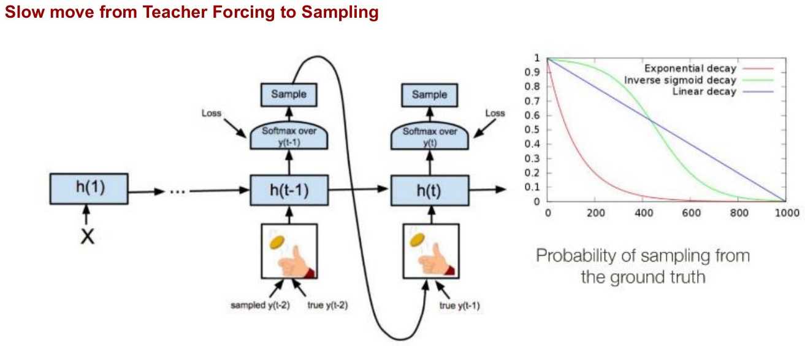

*原图：第 96 页。硬币表示每步选择真实 token 或模型输出；右图纵轴是真实前词被采用的概率，横轴为训练进度，不是词表 Softmax。*

训练初期较多使用真实前词，随后逐渐增加模型输出的使用比例。令 ε_i 为第 i 个训练批次使用真实前词的概率，则以 ε_i 选择真实 token，以 1−ε_i 选择模型预测／采样 token。

课件显示指数、逆 Sigmoid、线性三种衰减曲线。为明确曲线含义，补充 [原论文第2.4节](https://arxiv.org/html/1506.03099v3) 的形式：

```math
\begin{aligned}
\text{线性：}\quad &\epsilon_i=\max(\epsilon_{\min},k-ci),\\
\text{指数：}\quad &\epsilon_i=k^i,\quad 0<k<1,\\
\text{逆 Sigmoid：}\quad &\epsilon_i=\frac{k}{k+\exp(i/k)},\quad k\geq1.
\end{aligned}
```

各行 k 的意义按该行定义，ε_min 为线性日程的最低真实输入比例。ε_i=1 退化为完全 Teacher Forcing，ε_i=0 完全使用模型输出。该方法改变训练输入的选择，不是简单调整学习率。离散采样决策的梯度需要额外处理，原论文实验没有通过该决策反传；效果须由任务评价确定。

## 8. BPTT、截断与梯度问题

### 8.1 完整 BPTT 与截断 BPTT

来源：第 97–100 页。

完整时间反向传播（Backpropagation Through Time，BPTT）先对整段序列前向计算总损失，再沿展开图反向传播。共享参数从所有相关时间位置接收梯度。

截断 BPTT 把长序列分成短块，对每块执行前向和反向。**数值状态可以跨块继续传递，梯度图则在块边界切断**，即下一块把前一块末状态作为给定输入，常用 detach 表达这种边界。

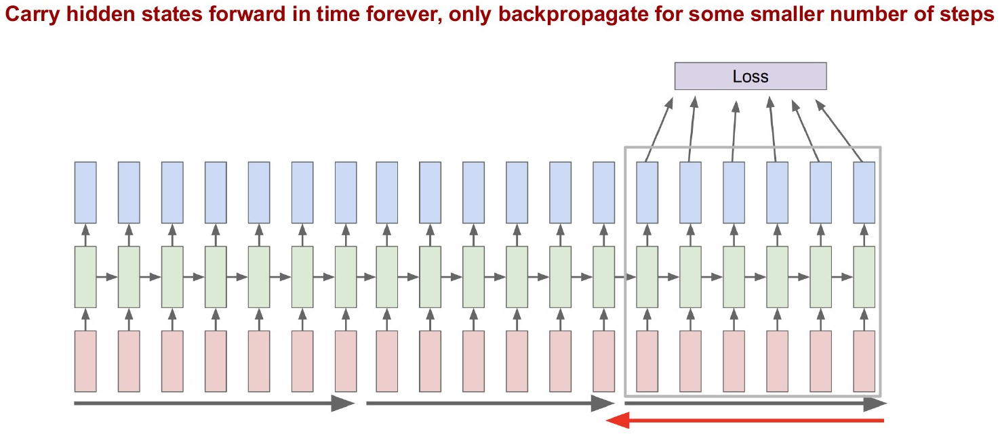

*原图：第 100 页，合并第 98–99 页移动窗口的动画。红色前向箭头可跨越更多历史，黑色反向箭头只覆盖当前截断范围。*

截断减少保存计算图的内存和反向跨度，但不会直接教会模型跨越被截断边界的任意远程信用分配。“一直携带状态”也要遵守序列边界；无关样本之间是否重置需按任务规定，不能无条件串接所有样本。

### 8.2 梯度中的雅可比连乘

来源：第 101–106 页。

将 h_{t−1} 与 x_t 拼接，可以把 W_hh 和 W_xh 合并为一张矩阵，便于画单元内部计算。采用列向量，令 D(v)=diag(v)：

```math
J_t=\frac{\partial h_t}{\partial h_{t-1}}
=D(1-h_t\odot h_t)W_{hh}.
```

课件 tanh′(·)W_hh 是这种对角雅可比的简写；反向传递列梯度时使用 J_tᵀ，不能省略矩阵维度和转置约定。

```math
\frac{\partial h_T}{\partial h_k}
=J_TJ_{T-1}\cdots J_{k+1}.
```

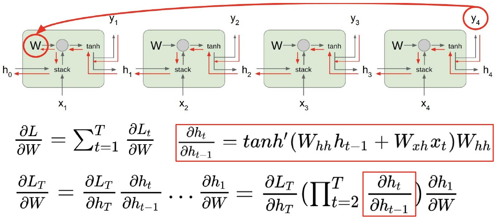

*原图：第 104 页，合并第 101–105 页逐步标出反向路径和乘积的图。红箭头突出从末时刻回到较早循环参数的一条路径。*

总损失的梯度有时间求和：

```math
\frac{\partial L}{\partial\theta}
=\sum_{t=1}^{T}\frac{\partial L_t}{\partial\theta}.
```

但即使只看末时刻损失 L_T，**共享循环参数在每一步都出现**，也必须汇总所有出现位置的贡献。对循环参数 θ，完整展开为：

```math
\frac{\partial L_T}{\partial\theta}
=\sum_{k=1}^{T}
\frac{\partial L_T}{\partial h_T}
\left(J_T\cdots J_{k+1}\right)
\left.\frac{\partial h_k}{\partial\theta}\right|_{h_{k-1}\ \mathrm{fixed}}.
```

k=T 时空乘积为 I，最后一项是把前一状态暂时固定后，该时间节点对 θ 的直接导数。输出头自身参数还会产生相应直接梯度。课件第 103–106 页只写“经 h₁ 回传”的一条长路径，适合解释梯度问题，不能直接等同于共享参数的全部梯度。

若去掉非线性，状态跨 T−1 步的导数为：

```math
\frac{\partial h_T}{\partial h_1}=(W_{hh})^{T-1}.
```

指数 T−1 是时间步数，转置用符号 ⊤ 表示；该式是长路径因子，不是全部参数梯度。第 106 页原式的适用条件为“假设没有非线性”，不能直接套到 tanh RNN。

### 8.3 梯度消失、爆炸与裁剪

来源：第 107、119 页。

长时间反传反复乘以雅可比，某些方向可能快速缩小或放大。范数满足：

```math
\|J_T\cdots J_{k+1}\|_2
\leq\prod_{t=k+1}^{T}\|J_t\|_2.
```

对 tanh，导数绝对值不超过1；循环矩阵的最大奇异值小于1会造成长路径收缩。第 107 页把“最大奇异值>1”直接对应爆炸，这是风险提示，**不足以单独保证实际梯度一定爆炸**，还要看激活导数、连乘方向与状态。更精确的条件和梯度裁剪可见 [Pascanu、Mikolov、Bengio，ICML 2013](https://proceedings.mlr.press/v28/pascanu13.html)。

全局范数裁剪的必要公式：

```math
g_{\mathrm{clip}}=g\min\left(1,\frac{\tau}{\|g\|_2}\right).
```

超过阈值 τ 时等比例缩小整个梯度，保留方向；零梯度保持为零。例如 g=[3,4]、τ=2，得到 [1.2,1.6]。裁剪控制过大的更新，不会恢复已经消失的长程梯度。课件建议通过改变循环结构、采用加性记忆路径改善消失问题。

## 9. LSTM：门控与加性记忆

### 9.1 Cell state、hidden state 与完整方程

来源：第 108–114 页。课件引用 Hochreiter、Schmidhuber 的 Long Short-Term Memory（Neural Computation，1997）；后续图示注明 Christopher Olah。

普通 RNN 只维护 h_t；LSTM 额外维护细胞状态 c_t，用门控决定遗忘、写入和输出。常见无 peephole 形式如下，令 r_t=[h_{t−1};x_t]：

```math
\begin{aligned}
f_t&=\sigma(W_fr_t+b_f),\\
i_t&=\sigma(W_ir_t+b_i),\\
g_t&=\tanh(W_gr_t+b_g),\\
o_t&=\sigma(W_or_t+b_o),\\
c_t&=f_t\odot c_{t-1}+i_t\odot g_t,\\
h_t&=o_t\odot\tanh(c_t).
\end{aligned}
```

课件也把候选内容 g_t 写成 C̃_t，把 cell state 写成大写 C_t；本文统一为小写 c 和 g，二者意义一致。⊙ 表示逐元素乘，不是矩阵乘法。

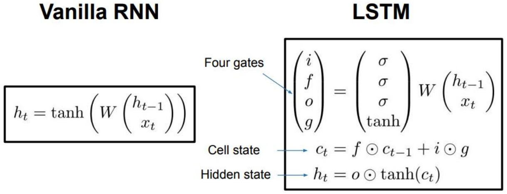

*原图：第 108 页。图把 i/f/o/g 统称 four gates；更精确地说是三个 Sigmoid 门和一个 tanh 候选内容，g_t 不是第四个取值0到1的 Sigmoid 门。合并矩阵写法省略了偏置，正文补全。*

若状态维数为 d、输入维数为 p，每张 W_f/W_i/W_g/W_o 为 d×(d+p)，四张可打包为 4d×(d+p) 矩阵与 4d 维偏置。不计输出头，参数为 4d(d+p)+4d；具体框架也可能把输入／循环矩阵和偏置分开存放。

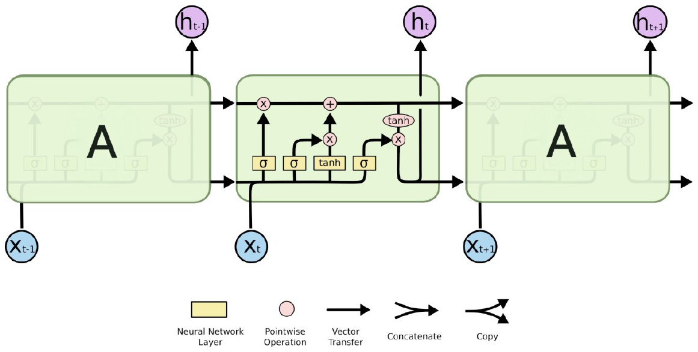

*原图：第 109 页。黄色矩形表示可学习变换，圆形表示逐元素运算；箭头传递向量，合流表示拼接，分叉表示复制到多条路径。图示作者 Christopher Olah。*

### 9.2 各门的作用

来源：第 110–114 页，分门高亮动画按方程合并。

| 量 | 原页问题 | 对应操作 |
| --- | --- | --- |
| c_t | cell state／memory | 跨时间传递的内部记忆 |
| f_t，遗忘门 | 这部分信息还要记住吗？ | 逐坐标调节旧状态 f_t⊙c_{t−1}；接近0强遗忘，接近1多保留 |
| i_t，输入门 | 是否写入新内容？ | 调节候选写入的比例 |
| g_t／C̃_t | 应该记住什么？ | tanh 生成候选内容，可正可负；原页“Gate gate(?)”按候选内容解释 |
| c_t 的更新 | 忘掉该忘的，再记住该记的 | 旧状态保留项与新写入项相加 |
| o_t，输出门 | 是否把这部分信息输出给下游或更深层？ | 调节 o_t⊙tanh(c_t) |

课件用“bit”作比喻，状态和门是连续向量，通常不只取二进制0或1。cell state 与 hidden state 的职责不同，不能把遗忘门直接当成“清空整个 h_t”的单一开关。

### 9.3 加性通路为何有利于梯度传播

来源：第 115–118 页。

只沿 cell state 的直接边、把门值和候选内容暂时固定时：

```math
\left.\frac{\partial c_t}{\partial c_{t-1}}\right|_{\mathrm{direct\ edge}}
=D(f_t).
```

这条路径不需要反复乘 W_hh，门值接近1时可较好地保留信息和梯度。跨多步该直接路径仍包含遗忘门逐元素连乘，若长期显著小于1，依旧可能衰减。

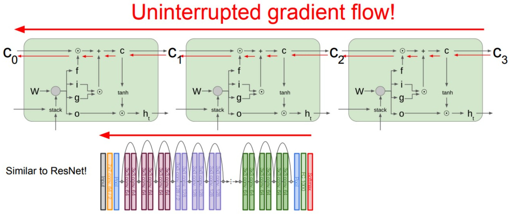

*原图：第 118 页，合并第 115、117 页的局部及跨步路径图。来源 Christopher Olah。原页“Uninterrupted gradient flow”说明存在更直接的通道，不保证全部梯度永远不消失。与ResNet的关系是加性支路的类比，LSTM还包含门控。*

**完整计算图还有间接路径**：前一细胞状态影响 h_{t−1}，h_{t−1} 又影响当前的遗忘门、输入门和候选内容。第 116 页正是在补充这些路径，不能只保留“导数就是 f_t”一句。

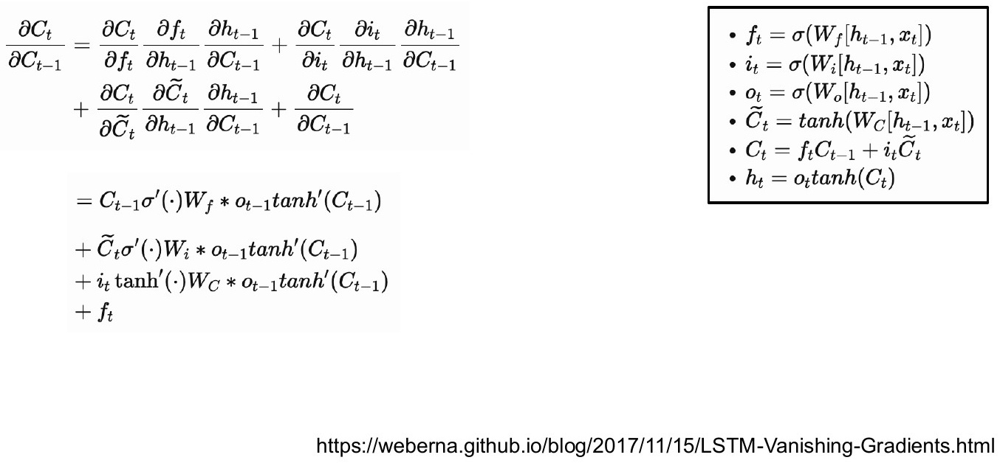

*原图：第 116 页。保留每一项链式展开及右侧六个状态方程；原式是标量化记号，向量情形需使用对角矩阵，并取各门矩阵作用在 h_{t−1} 上的子块。*

下面把原页四类项用尺寸一致的矩阵写法展开。定义 W_f=[U_f,V_f]，其余门同理，U_* 作用于 h_{t−1}。a_f/a_i/a_g 为当前相应预激活。令：

```math
R_{t-1}=D\!\left(o_{t-1}\odot
\left[1-\tanh^2(c_{t-1})\right]\right),
```

```math
\begin{aligned}
F_t&=D(c_{t-1})D(\sigma'(a_f))U_f,\\
I_t&=D(g_t)D(\sigma'(a_i))U_i,\\
G_t&=D(i_t)D(1-g_t\odot g_t)U_g.
\end{aligned}
```

将上一时刻 h 的依赖代入，并按图中局部路径保持 o_{t−1} 和更早节点固定，有：

```math
\frac{\partial c_t}{\partial c_{t-1}}
=D(f_t)+(F_t+I_t+G_t)R_{t-1}.
```

四项依次是：旧 cell 的直接保留、通过遗忘门变化、通过输入门变化、通过候选内容变化。σ′(a)=σ(a)(1−σ(a))，tanh′(a)=1−tanh²(a)。这是对第 116 页局部路径的向量化说明；完整 BPTT 还须按整个状态计算图汇总梯度，包含输出门及更早时间的依赖。此处讨论的无 peephole 结构中，当前门不直接以 c_{t−1} 为另一个显式输入。

图示及基本门控定义可对照 [原图作者 Christopher Olah 的说明](https://colah.github.io/posts/2015-08-Understanding-LSTMs/)。课件第 119 页同时提到 GRU，强调 LSTM／GRU 的加性交互能改善梯度流；没有展开完整 GRU 单元方程。梯度爆炸仍可能需要裁剪，加性结构也不构成所有训练问题的保证。

## 10. 图表示与图神经网络

### 10.1 为什么引入图

来源：第 120–123 页。

图表示对象间的关系，课件的六类例子完整保留：社交网络、经济网络、生物医学网络、信息网络（网页与引用）、互联网、神经元网络。

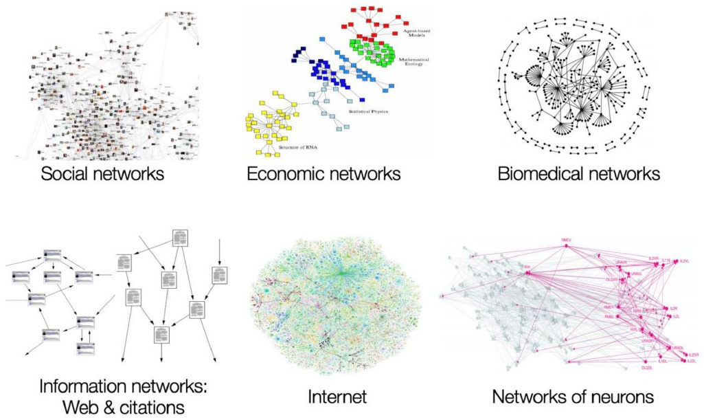

*原图：第 120 页。节点和连边代表各领域的对象与关系；图的布局本身不等同于学习到的嵌入。*

定义图 G，V 为节点集合，A 为二值邻接矩阵，X 为节点特征矩阵，Y 为可选节点标签。节点特征可以是类别属性、文本、图像或社交用户资料。若节点数为 n、特征维数为 p，则 A 为 n×n，X 为 n×p。

| 任务 | 目标 | 课件例子／记号 |
| --- | --- | --- |
| 监督或部分标签监督 | 从一部分或全部节点的标签学习预测 | 社交用户是人类还是机器人；对已标注节点训练，对待测节点分类 |
| 无监督嵌入 | 学习编码 ENC(v)=z_v，使图上的某种相似性在向量空间体现 | similarity(u,v)≈z_vᵀz_u |

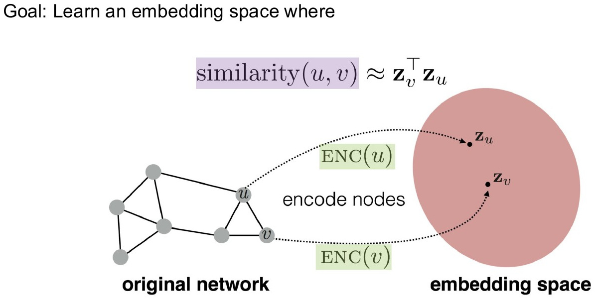

*原图：第 122 页。需要先定义要保持的相似性，例如邻接或某种上下文关系；点积只是一种打分，未归一化时不等于余弦。课件未指定该无监督目标的具体损失，不能补写成唯一算法。*

### 10.2 邻居聚合与每个节点的计算图

来源：第 124–126 页。

核心思想：依据局部邻居递归生成节点表示。第0层是输入特征 x_v；一层把一跳邻居的表示聚合进来，多层可将更远的关系传播到目标节点。抽象写法为：

```math
h_v^{(0)}=x_v,\qquad
m_v^{(k)}=\mathrm{AGG}_k
\left(\{h_u^{(k-1)}:u\in N(v)\}\right),
```

```math
h_v^{(k)}=\mathrm{UPDATE}_k
\left(h_v^{(k-1)},m_v^{(k)}\right).
```

聚合通常不应依赖邻居被任意列出的顺序。课件用六个节点 A…F 展示：边为 A–B、A–C、A–D、B–C、C–E、C–F、E–F。

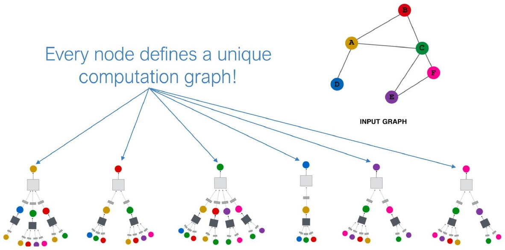

*原图：第 125 页，合并第 124 页针对A的单个计算图。每个目标展开不同邻域，原图可以有环，展开成计算图并不把原图变成树。重复出现同一节点时仍使用该节点相应层的表示。*

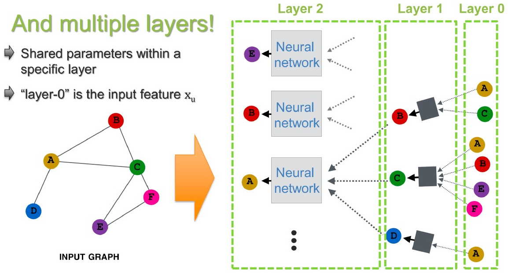

*原图：第 126 页。A的第一跳为B/C/D；B继续依赖A/C，C依赖A/B/E/F，D依赖A。同一层的网络参数在所有节点间共享。*

第 k 层可有自己的参数，不同层默认无需共享；后面的门控图网络则展示跨传播步共享的情况。多层扩大依赖范围，但不保证不同结构一定被区分，也不保证任意加深都改善表示。


### 10.3 节点分类的监督损失

来源：第 127 页。

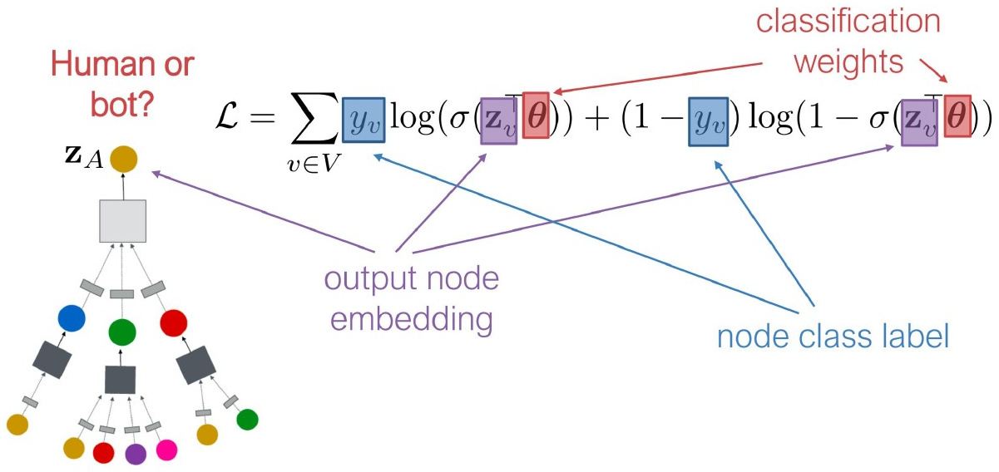

*原图：第 127 页。紫色是节点嵌入 z_v，红色是分类权重 θ，蓝色是节点标签 y_v，神经网络从局部关系生成嵌入。原式省略了最小化损失所需的负号。*

令 z_v 为 d 维列向量、θ 也为 d 维，p_v=σ(θᵀz_v)，标签 y_v∈{0,1}。最小化二元交叉熵应写为：

```math
L_{\mathrm{BCE}}=-\sum_{v\in V_L}
\left[y_v\log p_v+(1-y_v)\log(1-p_v)\right].
```

V_L 是有训练标签的节点集合，只有全部节点都用于训练时才等于 V。没有负号的课件式子可解释为**要最大化的对数似然**，不能一边无负号、一边说最小化交叉熵。原图 z_vθ 是行向量约定，本文统一为 θᵀz_v；含义相同。梯度经分类头回传到节点嵌入和共享聚合参数。

### 10.4 三种邻域聚合：平均、GCN、门控

来源：第 128 页。

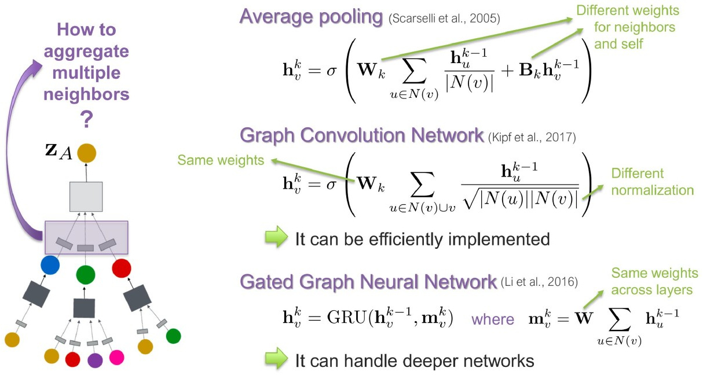

*原图：第 128 页，保留三个公式和各项差异标注。层索引 k 与序列时间 t 是不同语境中的迭代索引。*

**一、平均聚合**。课件标注 Scarselli 等（2005），写为：

```math
h_v^{(k)}=\sigma\left(
W_k\frac1{|N(v)|}\sum_{u\in N(v)}h_u^{(k-1)}
+B_kh_v^{(k-1)}\right).
```

W_k 用于邻居，B_k 用于节点自身，两者可不同。B_k 是自节点的权重矩阵，不是标量偏置。求和再除以邻居数是均值，可降低邻居数量直接影响尺度的问题；没有邻居时需要规定聚合为零或加入自环，不能除以零。该行保留课件给出的平均形式和归属，不把它扩展为所有早期 GNN 的唯一更新式。

**二、Graph Convolutional Network（GCN）**。课件引用 Kipf 等（2017），自节点和邻居使用同一 W_k，并用两端度数归一化。为避免原图“求和含自己、度数是否含自己”的歧义，定义：

```math
\widetilde N(v)=N(v)\cup\{v\},\qquad
\widetilde d_v=|\widetilde N(v)|,
```

```math
h_v^{(k)}=\sigma\left(
W_k\sum_{u\in\widetilde N(v)}
\frac{h_u^{(k-1)}}{\sqrt{\widetilde d_u\widetilde d_v}}
\right).
```

度数与求和必须一致地包含自环。把节点表示按行堆叠，向量式中的权重相应转置，标准矩阵形式为：

```math
\widetilde A=A+I,\qquad
\widetilde D_{vv}=\sum_u\widetilde A_{vu},
```

```math
H^{(k)}=\sigma\left(
\widetilde D^{-1/2}\widetilde A\widetilde D^{-1/2}
H^{(k-1)}\Theta_k\right),\qquad \Theta_k=W_k^\top.
```

该形式适合用稀疏矩阵乘法实现。上式讨论课件的无向、二值邻接例；原论文也讨论相应加权情形。自环和归一化依据：[Kipf、Welling 原论文公式2](https://arxiv.org/html/1609.02907v4)。

**三、Gated Graph Neural Network（门控图网络）**。课件引用 Li 等（2016），先聚合消息，再用 GRU 将消息和旧状态结合：

```math
m_v^{(k)}=W\sum_{u\in N(v)}h_u^{(k-1)},\qquad
h_v^{(k)}=\mathrm{GRU}\left(h_v^{(k-1)},m_v^{(k)}\right).
```

这里 GRU 参数顺序沿用原图的数学记法，表示“旧状态、当前消息”，不指定软件接口的调用顺序。与前两行 W_k 不同，此图强调**跨传播步共享 W 及门控更新参数**；通过门控加性交互支持更深的传播。课件采用简化的同质邻居求和，不能当作 [Li 等原论文](https://arxiv.org/html/1511.05493v4) 对不同边类型、方向的全部处理。“能够处理更深网络”是结构动机，不保证无限加深都有效。

| 对照 | 邻居与自身权重 | 归一化／状态更新 | 跨层／步共享 |
| --- | --- | --- | --- |
| 本页平均形式 | W_k 与 B_k 分开 | 邻居求均值后与自节点线性项组合 | 同一层跨节点共享；各层可不同 |
| GCN | 自身与邻居共用 W_k | 含自环的对称度数归一化，再激活 | 同一层跨节点共享；各层可不同 |
| 门控图网络 | 消息变换加门控旧状态 | 求和消息后用 GRU 更新 | 图中强调跨传播步共享 |

## 11. 章节联系、校正与来源

词向量把离散符号变成可计算的连续表示；语言模型为序列分配概率；RNN通过时间共享累积状态；LSTM用门控加性记忆改善长程传播；GNN把“从邻域获得上下文”推广到图结构。它们学习的表示、预测目标和参数共享范围各不相同。

第 129 页是课程后续方向页，仅指向多模态应用，没有展开新的算法，已从正文知识点中删除。前章的损失、优化、CNN、残差不重复推导，相关定义见 [深度学习导论](02-深度学习导论.md) 与 [卷积与视觉骨干](03-计算机视觉导论-卷积与视觉骨干.md)。

本章主要校正包括：各例独立的词表顺序；CBOW矩阵尺寸、两套向量及分母；类比式的候选向量归一化；N-gram近似与历史下标；“Unigram”图的实际条件；logits与概率；Teacher Forcing的前缀分布差异；共享RNN参数的全路径梯度；最大奇异值条件的适用范围；LSTM直接与间接梯度；图分类损失负号和标签范围；GCN自环度数约定。

完整逐页去向见 [内容覆盖表](../COVERAGE.md)，32张原图的页码、裁剪、尺寸与校验值见 [图片来源清单](../assets/manifest.json)，验证范围见 [检查记录](../CHECKS.md)。原图中引用的 CS231n 与 Christopher Olah 已在相应图注保留来源。论文链接用于校正与必要解释，未把外部论文中课件未讲的实验结果扩充成课程内容。

返回 [总目录](../README.md) · 前一章：[目标检测与分割](04-计算机视觉导论-检测与分割.md)。
