# 第六章：多模态表示学习——融合、协调与分解

来源：刘洋（Yang Liu），`6_Introduction_MML_part1_26.pdf`，共 **89 页**，封面未注明日期。本文页码均为 **PDF 页序号**；课件从第 8 页起部分页脚比 PDF 页序号大 1。整理日期：2026-10-23。

本章对应 Lecture 6: Introduction to Multimodal Machine Learning, Part 1 Representation。正文保留图中公式、全部情绪判断例子、Pearson 数值例题、CLIP 与 RotNet 实验表、MAE 掩码比例曲线等教学信息；动画逐步展示合并。课件中的记号简写和错误在相应位置注明，必要推导与复算标为补充。

## 1. 表示学习与跨模态交互

### 1.1 在课程中的位置

来源：第 2–5、35、63、89 页；总体任务与五项挑战也见[第一章](01-多模态学习导论.md)。

多模态机器学习从语言、视觉、声学等多种输入中学习表示，或输出任务预测。第 3 页以一句 “I really like this tutorial”、说话人视频帧、同步语音波形说明三种模态；第 4 页把无监督、自监督、有监督、强化学习等列为可采用的学习范式。五项挑战为表示（Representation）、对齐（Alignment）、翻译（Translation）、融合（Fusion）、协同学习（Co-learning）。本讲聚焦第一项。

**多模态表示学习**：学习能够反映不同模态内部元素之间跨模态交互的表示。它是大多数多模态问题的基础构件。

| 路线 | 目标 | 课件中的表示数量示意 |
| --- | --- | --- |
| 融合 Fusion | 多个模态形成一个联合表示 | 模态数大于表示数 |
| 协调 Coordination | 各模态保留各自表示，通过交互约束相互协调 | 模态数等于表示数 |
| 分解 Fission | 学习反映内部因子、共享／私有结构或聚类的新表示集合 | 模态数小于表示数 |

数量关系用于解释图中的典型结构，不是对全部方法的严格定义；例如一个联合表示也可含多个 token。

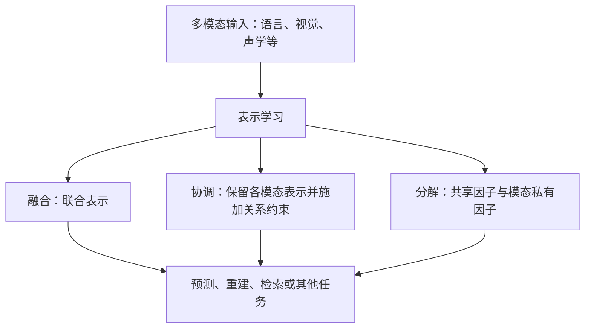

### 1.2 从元素到交互响应

来源：第 6–8、13 页。

输入元素经过推理模块，可以产生表示、预测值或新的元素。多模态的意义在于研究组合输入如何改变响应，而不只是把更多输入放到一起。

课件问：“这是客厅吗？”图像单独给出“是”；文字 “A teacup on the right of a laptop in a clean room.”（整洁房间内，笔记本右侧有茶杯）单独给出“不，大概是书房”。这说明单模态响应可以不同，属于**非冗余**。图文联合判断为“是”时，示例中视觉证据主导联合响应，称为**模态主导**。这是一组解释交互的示意判断，不是房间识别模型的实测准确率。

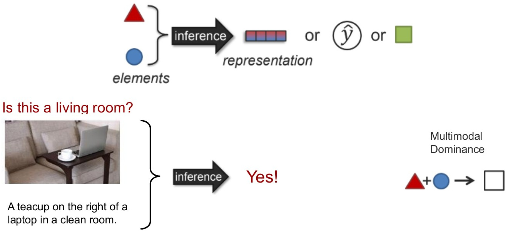

第 8 页借用 Partan 与 Marler（2005）的行为科学分类。设两种信号为 a、b：

| 单信号响应关系 | 组合响应类型 | 解释 |
| --- | --- | --- |
| 冗余：a、b 引发同类响应 | 等价 Equivalence | a+b 仍产生同类、相近强度的响应 |
| 冗余 | 增强 Enhancement | 组合产生更强的同类响应 |
| 非冗余：a、b 引发不同响应 | 独立 Independence | 两种响应在组合后都保留 |
| 非冗余 | 主导 Dominance | 一种响应占主导，另一个不明显 |
| 非冗余 | 调制 Modulation | 一种信号改变另一种响应的强度或形式 |
| 非冗余 | 涌现 Emergence | 联合响应具有单信号响应中没有的新性质 |

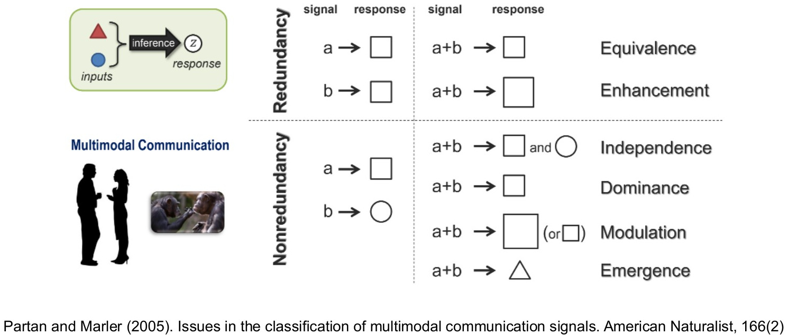

输入可以是单、双、三或更多模态；交互函数可为加性、乘性、多项式、门控、非线性等。**响应类型**描述最终现象，**交互函数**描述模型如何计算，两者不应直接一一对应。

### 1.3 完整情绪判断例子

来源：第 9–12 页；四页逐步展示合并为下表。`?` 表示歧义，`+`／`−` 的个数仅表示图示情感方向和强度。

| 输入 | 课件响应 | 说明 |
| --- | --- | --- |
| “This movie is sick” | ? | sick 可表达贬义，也可作俚语赞扬 |
| “This movie is fair” | + | 此例设为较弱正面 |
| 微笑 Smile | + | 单模态正面线索 |
| 大声说话 Loud voice | ? | 仅音量不能决定褒贬 |
| sick + 微笑 | ++ | 双模态交互消除歧义，偏强正面 |
| sick + 皱眉 Frown | −− | 双模态交互消除歧义，偏强负面 |
| sick + 大声 | ? | 组合后仍有歧义 |
| sick + 微笑 + 大声 | +++ | 三模态产生更强正面响应 |
| fair + 微笑 + 大声 | + | 同样表情与音量在另一句子中只得到较弱正面 |

最后两行说明交互可能取决于**全部模态的联合上下文**，不能把每个模态贡献设成固定常数后永远相加。

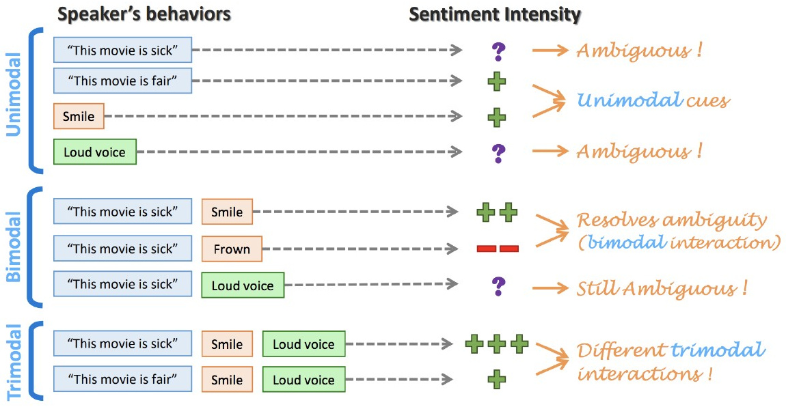

## 2. 表示融合：从加法到动态交互

### 2.1 联合表示、编码器与融合阶段

来源：第 14–16、33–34 页。

表示融合学习联合表示，以建模不同模态元素间的交互。课件区分：**基本融合**处理已经向量化、相对同质的表示；**原始模态融合**面对像素、波形等异质输入。

通常先用单模态编码器，将输入映射到较接近的表示空间，再融合。图像编码器可用 CNN、ViT；语言编码器可用 Word2Vec、BERT 等。编码器可以和融合网络联合训练，也可以预训练；预训练后是否继续微调需另行决定。

```math
x_A=f_A(a),\qquad x_B=f_B(b),\qquad z=F(x_A,x_B),\qquad \hat y=p(z).
```

| 历史划分 | 运算位置 | 图中流程 |
| --- | --- | --- |
| 早期融合 Early fusion | 预测前合并特征 | 拼接 A、B 表示，再作一次预测 |
| 后期融合 Late fusion | 合并各模态预测 | A、B 各自预测，再整合结果 |

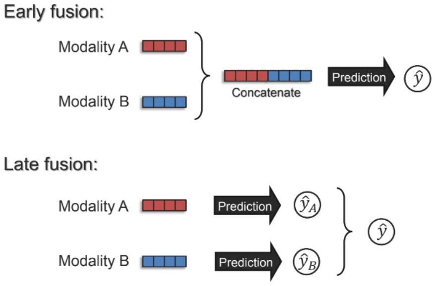

第 33 页以视觉数字“3”和声学时频图分别编码、拼接为例，标注 Early Fusion。它仍用了各模态编码器；“早期”是相对于最后预测而言。课件把更贴近原始异质输入的融合列为开放挑战，不能把特征拼接直接说成已解决原始模态统一建模。

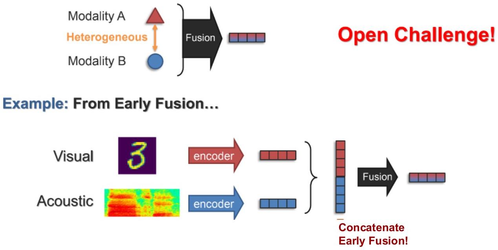

### 2.2 加性项与乘性交互项

来源：第 17–20 页。

先用标量回归说明交互：

```math
z=w_0+w_1x_A+w_2x_B+w_3x_Ax_B+\epsilon.
```

其中 $`w_0`$ 为截距／偏置，$`w_1x_A+w_2x_B`$ 为加性项，$`w_3x_Ax_B`$ 为乘性交互项，$`\epsilon`$ 为残差。课件依次展示仅加性、仅乘性、两者兼有的模型。残差是统计建模记号，部署的确定性网络不必另采样一个残差。

**加性融合**对两个编码结果逐元素相加，要求相同维数：

```math
z=f_A(a)+f_B(b).
```

**简单乘性融合**可先把两路投影到相同维度，再逐元素相乘；**双线性融合**允许一条模态的任一维度与另一条的任一维度交互。统一用列向量，可写为：

```math
z=W(x_A\odot x_B),\qquad
O=x_Ax_B^\top,\qquad
z_k=x_A^\top W_kx_B.
```

这里 $`\odot`$ 为逐元素积；$`O`$ 为外积，尺寸 $`d_A\times d_B`$；每个 $`W_k`$ 对全部跨模态坐标配对加权。课件写 $`x_A^\top\cdot x_B`$ 并画成二维格点，是按行向量约定表示外积；本笔记统一列向量，避免与标量内积混淆。

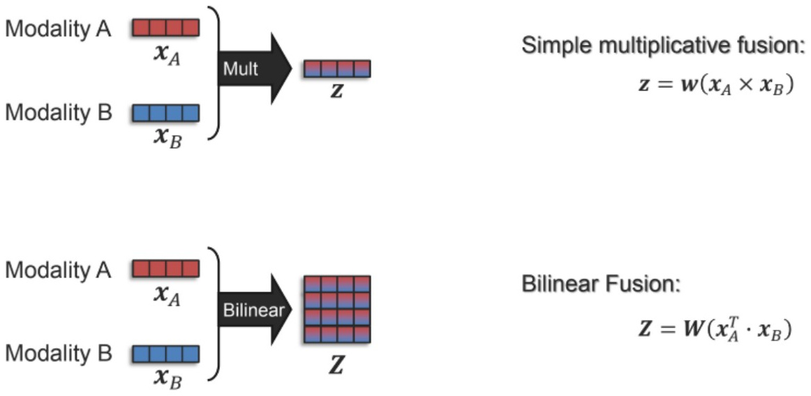

第 20 页示例先将文本 X、图像 Y 编为 $`h_x,h_y`$，双线性交互得到 $`h_m`$，最后经分类层与 Softmax 判断情感；图中二维交互块强调所有特征配对。

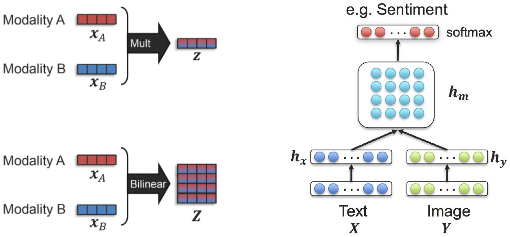

### 2.3 张量融合：显式保留各阶交互

来源：第 21 页。

给每个模态向量追加常数 1，然后作外积，可以同时包含偏置、单模态项和跨模态项。双模态情形为：

```math
\tilde x_A=\begin{bmatrix}x_A\\1\end{bmatrix},\qquad
\tilde x_B=\begin{bmatrix}x_B\\1\end{bmatrix},\qquad
Z=\tilde x_A\tilde x_B^\top
=\begin{bmatrix}x_Ax_B^\top&x_A\\x_B^\top&1\end{bmatrix}.
```

将 $`Z`$ 展平后线性映射即可得到融合表示。三模态张量为 $`\tilde x_A\otimes\tilde x_B\otimes\tilde x_C`$，含 1 个常数块、3 组单模态项、3 组双模态交互和 1 组三模态交互。

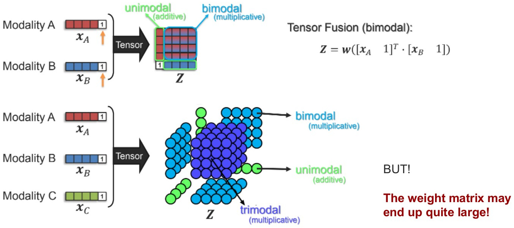

补充尺寸：M 个模态对应的显式张量元素数为 $`\prod_{m=1}^{M}(d_m+1)`$；输出维度若为 $`d_h`$，全连接映射约需 $`d_h\prod_m(d_m+1)`$ 个权重。模态数增加时，开销可能呈乘积增长，这是下一节低秩化的动机。

### 2.4 低秩融合：分解权重，避免显式张量化

来源：第 22–28 页。第 22 页是原始张量融合，23 页加入低秩对照，24–27 页分三步解释，28 页推广到三模态。

三步分别是：① 把权重张量分解为模态专属因子；② 输入张量本身也是各模态向量的外积；③ 重排收缩运算，在每条模态支路先投影，再组合，避免实际生成庞大的输入张量。

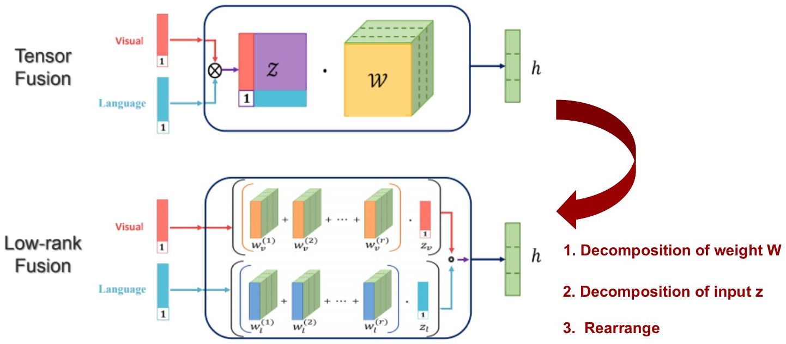

为使各个下标可检查，设追加 1 后的第 m 路输入为 $`\tilde x_m\in\mathbb R^{D_m}`$，输出为 $`h\in\mathbb R^{d_h}`$，选定分解秩 r。对每个输出坐标 k：

```math
\mathcal W_{j_1,\ldots,j_M,k}
\approx\sum_{i=1}^{r}\prod_{m=1}^{M}A_{m,j_m,k}^{(i)}.
```

代入完整张量收缩并交换有限求和顺序，得到：

```math
\begin{aligned}
h_k
&=\sum_{j_1,\ldots,j_M}\mathcal W_{j_1,\ldots,j_M,k}
   \prod_{m=1}^{M}\tilde x_{m,j_m}\\
&\approx\sum_{i=1}^{r}\prod_{m=1}^{M}
   \left(\sum_{j_m=1}^{D_m}A_{m,j_m,k}^{(i)}\tilde x_{m,j_m}\right).
\end{aligned}
```

令 $`q_m^{(i)}=(A_m^{(i)})^\top\tilde x_m\in\mathbb R^{d_h}`$，最终计算为：

```math
h=\sum_{i=1}^{r}\left(q_1^{(i)}\odot q_2^{(i)}\odot\cdots\odot q_M^{(i)}\right).
```

参数量约为 $`r d_h\sum_m D_m`$，用各模态维数的和代替全模态维数乘积。低秩是建模约束／近似，不保证任意权重张量都能在很小 r 下精确表示。

**课件校正**：第 26–27 页把“同一秩 i 内跨模态相乘，再对 i 求和”写成“每个模态先对 i 求和，再跨模态相乘”。一般不等价，后者产生不同秩之间的额外交叉项。这个换序也出现在 [LMF 原论文](https://aclanthology.org/P18-1209.pdf)的式 (6)–(7)，因此不能仅因来自论文就当作代数恒等式；[作者实现的 forward](https://github.com/Justin1904/Low-rank-Multimodal-Fusion/blob/master/model.py)实际先保留 rank 轴逐模态相乘，再沿 rank 轴加权归约，与上面的下标展开一致。这里是对公式的独立代数校正。

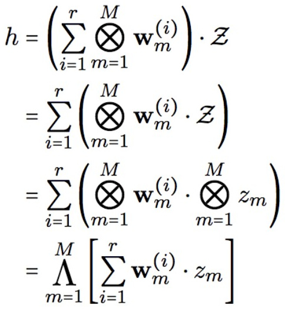

补充最小反例：两模态、两秩的投影值分别为 (1,2)、(3,4)，同秩乘积求和是 $`1\times3+2\times4=11`$；各路先求和再乘为 $`(1+2)(3+4)=21`$。三模态依然应保留同一 rank 索引，并在模态乘积之后归约。

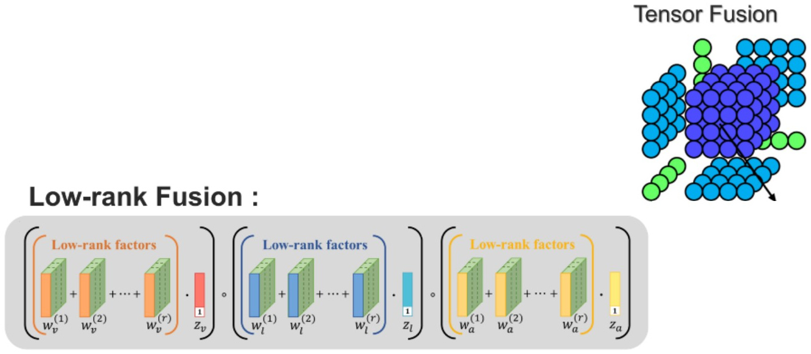

### 2.5 门控、注意力与动态融合

来源：第 29–31、57 页。

门控网络根据上下文抑制不需要的输入；注意力网络选择更应向前传递的信号。二者都可解释为内容相关的加权机制。门可以为每个特征输出一个权重，也可对整个模态只输出一个标量。

```math
z=g_A(x_A,x_B)\odot x_A+g_B(x_A,x_B)\odot x_B.
```

两路权重可同时依赖两种模态；需要求和时，两路最终表示必须同维，必要时先投影。门值是否归一化、是否互补，取决于具体实现，课件没有规定它们之和必须为 1。

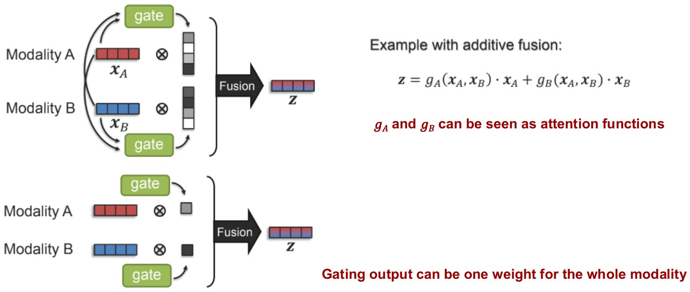

| 门控形式 | 输出与学习方式 |
| --- | --- |
| 软注意力 Soft attention | 连续权重，一般较易使用梯度学习 |
| 硬注意力 Hard attention | 离散选择，直接求导较难；课件举强化学习作为一种方法 |
| 动态融合 Dynamic fusion | 在单独使用 A、单独使用 B、加性、双线性等多条策略支路之间进行样本相关的加权或选择 |

补充统一动态式：

```math
z=\sum_{k=1}^{K}\alpha_k(x_A,x_B)F_k(x_A,x_B).
```

若 $`\alpha`$ 为 one-hot 就选择一个策略；连续权重可以混合多个策略。图中所有候选支路的输出应能进入同一个融合器。

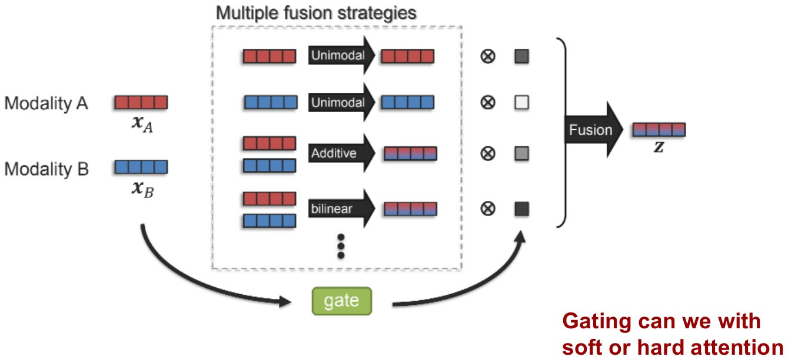

第 57 页把门控用于**协调**，保留两个输出而不相加：

```math
z_A=g_A(x_A,x_B)\odot x_A,\qquad
z_B=g_B(x_A,x_B)\odot x_B.
```

课件说明它与 Transformer 的注意力模块相关；这种门控图本身没有给出完整的 Q/K/V、Softmax 或多头结构，不能据此当作完整 Transformer 方程。

### 2.6 多模态自编码器与融合方法谱系

来源：第 32、34 页。

多模态自编码器从音频和视频进入各自编码支路，在中间形成共享表示，再分别解码重建音频和视频。重建目标迫使共享层保留输入的信息。第 32 页还给出 “Hearing to see” 实验设置：在预先学习的共享表示上，以**只有音频的有标签样本训练线性分类器**，测试时**只有视频**，利用两路可比的共享特征迁移分类能力。图中不意味着无需任何跨模态配对表示学习，也没有给出具体准确率。

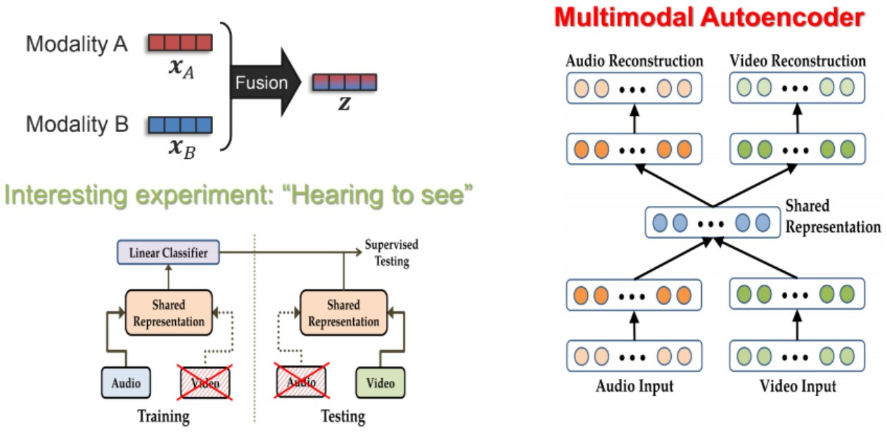

第 34 页将方法放在从较同质特征到更异质模态的示意轴上，顺序为：加性、乘性、张量、多项式、门控、动态、非线性、非常早期融合。多项式可理解为包含不同阶数交互项；非线性融合用神经网络学习更一般映射。此轴是教学组织，不是严格的性能排名或互斥分类。

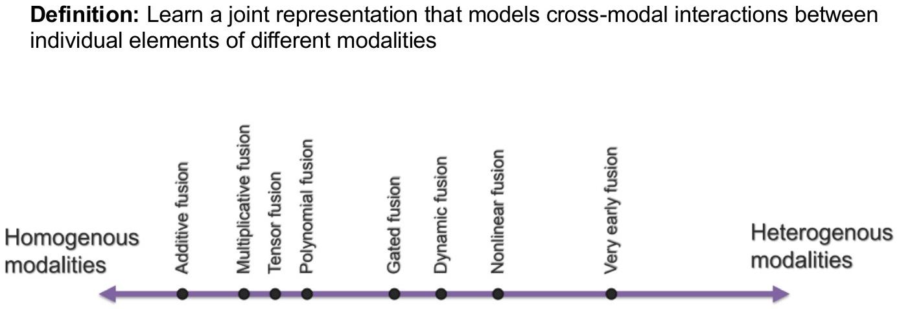

## 3. 表示协调：相似性、相关性与多视图结构

### 3.1 协调的目标与配对数据

来源：第 36–37、45、47、57–58 页。

协调学习各模态自己的表示，通过跨模态关系约束使它们具有可比较的语义。强协调使表示更接近；部分协调允许只约束部分性质、关系或子空间，保留模态差异。图中 Partial Coordination 的 “Further” 应理解为不像强协调那样把全部表示拉近，不代表训练必须无条件最大化距离。

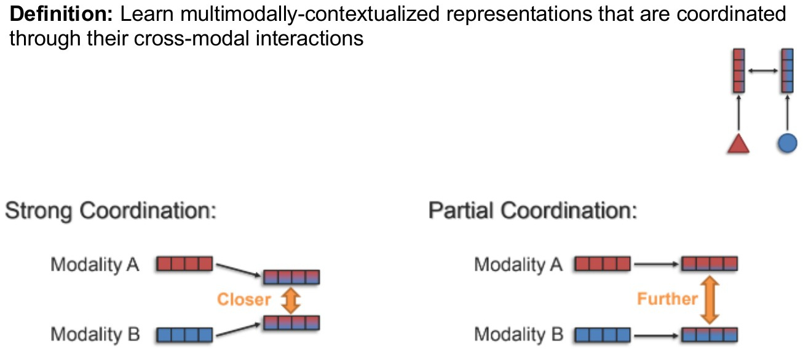

课件用编码器 $`f_A,f_B`$ 与协调函数 g 表示学习目标：

```math
z_A=f_A(a;\theta_A),\quad z_B=f_B(b;\theta_B),\quad
\mathcal L=g(z_A,z_B;\theta_g).
```

g 可以是要最小化的损失，也可以是要最大化的相似度；两种约定应明确区分。如果最大化相似度 s，最小化损失时常写 $`\mathcal L=-s`$。本讲示例依赖**配对数据**，例如同一对象的图像和文字描述。

课件依次介绍余弦相似度、核相似度、典型相关分析、深度相关自编码器、完整潜空间、门控与对比学习。

### 3.2 余弦相似度与 Pearson 相关系数

来源：第 37–44 页。

余弦相似度衡量两个非零向量的夹角：

```math
\mathrm{cos}(z_A,z_B)=\frac{z_A^\top z_B}{\|z_A\|_2\|z_B\|_2}.
```

Pearson 系数衡量两个随机变量的**线性相关性**：

```math
\rho_{X,Y}=\frac{\mathrm{Cov}(X,Y)}{\sigma_X\sigma_Y}
=\frac{\mathrm{Cov}(X,Y)}{\sqrt{\mathrm{Var}(X)\mathrm{Var}(Y)}}.
```

对同一组 n 个成对观测，样本形式为：

```math
r=\frac{\sum_{i=1}^{n}(x_i-\bar x)(y_i-\bar y)}
{\sqrt{\sum_{i=1}^{n}(x_i-\bar x)^2}\sqrt{\sum_{i=1}^{n}(y_i-\bar y)^2}}.
```

**校正**：第 38 页和第 51–52 页的部分行把分母写成两个方差直接相乘，应为两个**标准差**的乘积；第 40 页顶部求和式的 Y 中心化下标也应为 $`\mu_Y`$。课件页脚说 normalized inputs 的余弦等于 Pearson，准确条件是先对各向量**减去其坐标均值**，再算余弦；仅做 L2 单位化并不够。若任一路为常数、标准差为 0，Pearson 未定义。

### 3.3 完整数值例题：尺度改变，相关性不变

来源：第 39–40 页。两种情况只把 X 缩小 10000 倍：

| 观测位置 | 1 | 2 | 3 | 4 | 5 | 6 | 7 |
| --- | --- | --- | --- | --- | --- | --- | --- |
| 情况一 X | 100 | −100 | −200 | −100 | 100 | 200 | 0 |
| 情况二 X′ | 0.01 | −0.01 | −0.02 | −0.01 | 0.01 | 0.02 | 0 |
| 两种情况的 Y | 70 | −70 | −200 | −70 | 70 | 200 | 0 |

三组样本均值都为 0。采用样本协方差、样本标准差，分母统一为 $`n-1=6`$：

```math
\begin{aligned}
\sum_i x_iy_i&=108000,& s_{XY}&=108000/6=18000,\\
\sum_i x_i^2&=120000,& s_X&=\sqrt{120000/6}\approx141.4214,\\
\sum_i y_i^2&=99600,& s_Y&=\sqrt{99600/6}\approx128.8410,\\
r_{XY}&=\frac{18000}{141.4214\times128.8410}\approx0.987878.
\end{aligned}
```

```math
s_{X'Y}=1.8,\qquad s_{X'}\approx0.0141421,\qquad
r_{X'Y}=\frac{1.8}{0.0141421\times128.8410}\approx0.987878.
```

课件显示 141.42、128.84 和 0.9879，与复算一致。协方差受量纲、尺度影响；相关系数消去了正比例缩放。负比例缩放会改变相关系数符号。第 40 页把总体期望形式与样本分母 $`n-1`$ 放在同一等号链，笔记按总体／样本分别使用，避免混用。

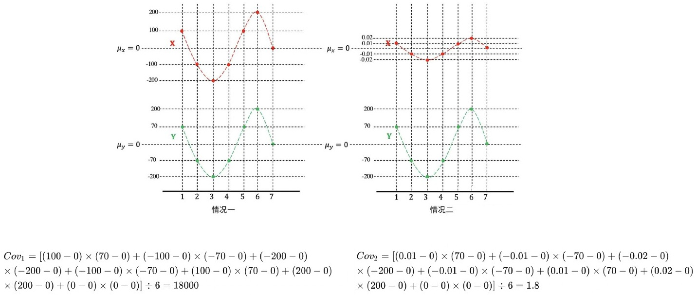

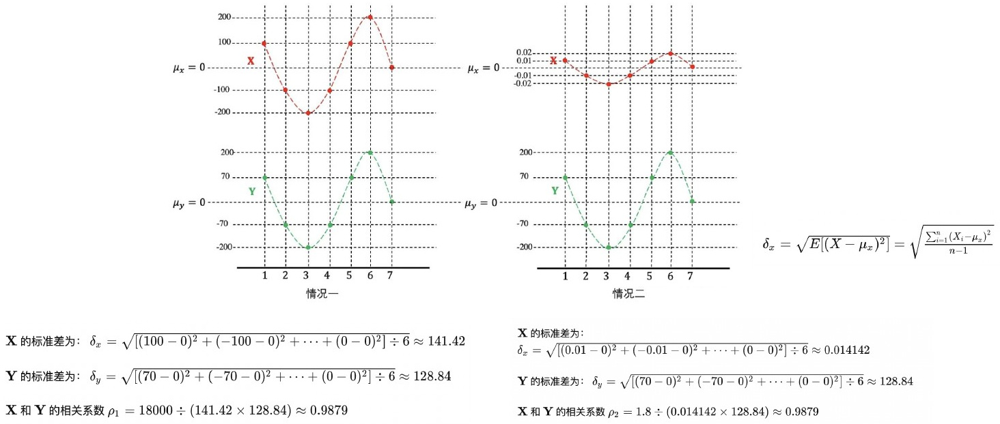

第 41–44 页逐步揭示散点图的相关系数，合并保留完整答案：第一行依次为 1、0.8、0.4、0、−0.4、−0.8、−1；第二行不同斜率的直线，正斜率均为 1、负斜率均为 −1，中央水平常数线没有可定义的 Pearson；第三行 W 形、旋转方块、菱形、U 形、交叉曲线、圆环、四团簇均标为 0。

第三行强调“零线性相关”仍可存在强非线性依赖；图中的数值是对示意分布的说明，不是可从低分辨率散点图复原出的逐点测量值。

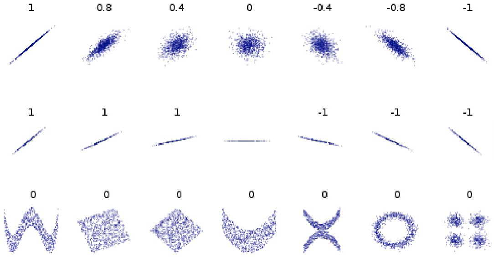

### 3.4 核函数：隐式高维特征中的内积

来源：第 45–46 页。

核函数可把数据点的相似性写为某个特征映射空间中的内积：

```math
K(x_i,x_j)=\phi(x_i)^\top\phi(x_j)=\langle\phi(x_i),\phi(x_j)\rangle.
```

映射可进入高维甚至无限维空间，计算核值时不一定要显式形成这些坐标。原空间不可线性分的红蓝点，在映射后可被一个平面分开。课件列出 Linear、Polynomial、Exponential、RBF 核；下列前三个明确式是便于理解的常见形式，Exponential 在原页没有给定参数化：

```math
K_{\mathrm{linear}}(x,y)=x^\top y,\qquad
K_{\mathrm{poly}}(x,y)=(\gamma x^\top y+c)^p,\qquad
K_{\mathrm{RBF}}(x,y)=\exp\left(-\frac{\|x-y\|_2^2}{2\sigma^2}\right).
```

作为内积核使用时需要满足相应半正定条件；“similarity metric”在这里是相似性含义，不等于满足距离度量全部公理。跨模态原始特征若尺寸或含义不同，应先映射到可比较的特征空间。

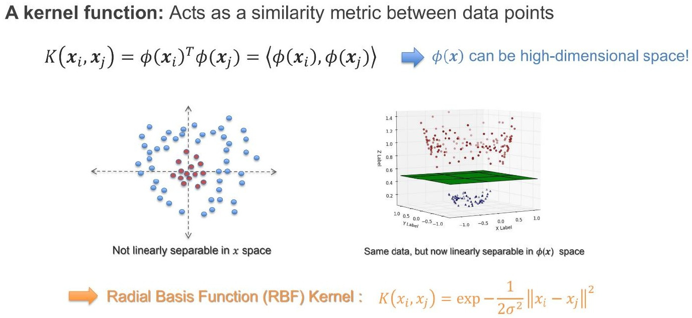

### 3.5 期望、方差、协方差矩阵

来源：第 48–49 页；也是后续 CCA 的记号基础。

```math
\mathbb E[X]=\sum_i x_iP(X=x_i),\qquad
\mathrm{Var}(X)=\mathbb E[(X-\mu_X)^2],\qquad
\mathrm{Cov}(X,Y)=\mathbb E[(X-\mu_X)(Y-\mu_Y)].
```

等概率观测的期望等于算术平均，方差为标准差的平方。令 $`\bar X=X-\mathbb E[X]`$、$`\bar Y=Y-\mathbb E[Y]`$，随机列向量 $`X\in\mathbb R^M`$、$`Y\in\mathbb R^N`$ 的矩阵定义为：

```math
\Sigma_{XX}=\mathbb E[\bar X\bar X^\top],\qquad
\Sigma_{YY}=\mathbb E[\bar Y\bar Y^\top],\qquad
\Sigma_{XY}=\mathbb E[\bar X\bar Y^\top]\in\mathbb R^{M\times N}.
```

交叉协方差第 i 行第 j 列为 $`\mathrm{Cov}(X_i,Y_j)`$，且 $`\Sigma_{YX}=\Sigma_{XY}^\top`$。课件第 49 页列出的矩阵按 Y 分行、X 分列，实际对应本约定的 $`\Sigma_{YX}`$，需要转置，才能与下一节的 $`u^\top\Sigma_{XY}v`$ 维度相符。

若采用中心化样本矩阵 $`X_c\in\mathbb R^{M\times n}`$、$`Y_c\in\mathbb R^{N\times n}`$，则样本交叉协方差为 $`X_cY_c^\top/(n-1)`$。课件略写 $`XY^\top`$；一致地省略公共比例不改变相关系数的商，但做单位方差约束时应固定协方差约定。

### 3.6 典型相关分析 CCA 的完整推导

来源：第 47、50–54 页，逐步推导合并。

CCA（Canonical Correlation Analysis）从两种视图学习成对线性投影，使投影变量最相关。同颜色点代表同一个样本在两视图中的观测，目的是找到方向 u、v，让同一对象的两个投影对应起来。

```math
(u^*,v^*)=\underset{u,v}{\mathrm{argmax}}\ \mathrm{corr}(u^\top X,v^\top Y)
=\underset{u,v}{\mathrm{argmax}}\
\frac{u^\top\Sigma_{XY}v}
{\sqrt{u^\top\Sigma_{XX}u}\sqrt{v^\top\Sigma_{YY}v}}.
```

这是将投影后的协方差和方差展开；课件第 51 页第二行的 var 乘积依然应开平方。

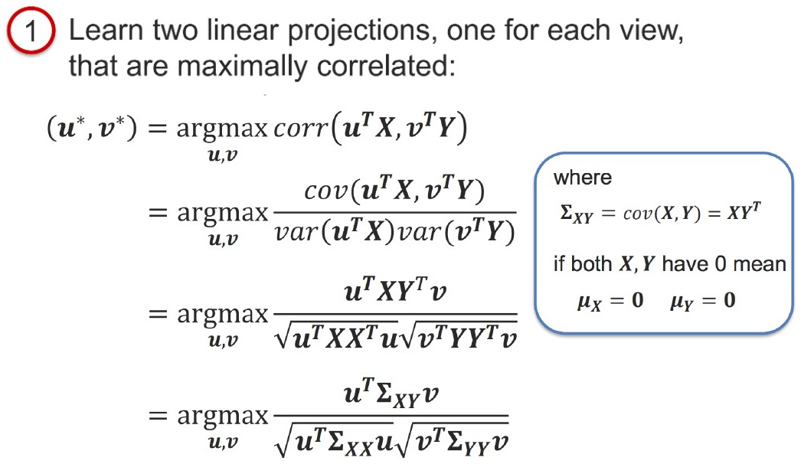

希望获得 k 对投影时，令 $`U=[u_1,\ldots,u_k]`$、$`V=[v_1,\ldots,v_k]`$。由于相关系数对投影方向的正比例缩放不变，可把每个投影变量的方差固定为 1，并使同视图各投影不相关：

```math
\max_{U,V}\ \mathrm{tr}(U^\top\Sigma_{XY}V),\qquad
U^\top\Sigma_{XX}U=I_k,\qquad V^\top\Sigma_{YY}V=I_k.
```

在典型方向的选择下，不同序号的跨视图投影也可对角化：

```math
u_i^\top\Sigma_{XY}v_j=0\quad(i\ne j),\qquad
U^\top\Sigma_{XY}V=\mathrm{diag}(\rho_1,\ldots,\rho_k).
```

三个核心要求：① 线性投影最大化相关性；② 不同典型变量相互不相关；③ 投影后的随机变量有单位方差。课件的 “orthogonal projections” 应按协方差内积理解，不要求投影系数向量在原坐标下普通欧氏正交；“unit variance of projection vectors”准确说是**投影变量**单位方差。

第 53 页把 $`|U\Sigma_{XY}V|`$ 与迹写成相等，还漏掉 U 的转置。一般矩阵的行列式与迹不相等，目标应直接写上面的迹／相关系数之和。

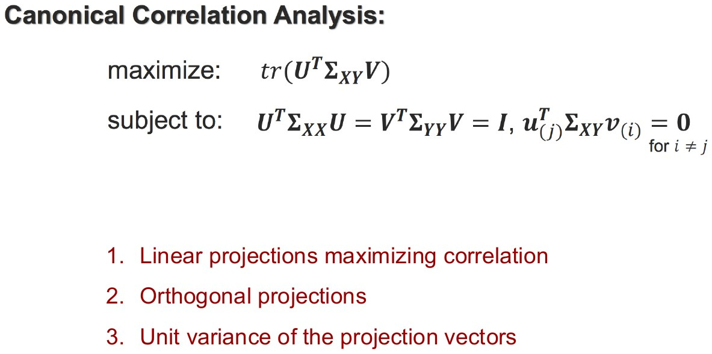

补充求解视角：当两边协方差正定时，令白化后的交叉协方差为 $`T=\Sigma_{XX}^{-1/2}\Sigma_{XY}\Sigma_{YY}^{-1/2}`$，对 T 做 SVD，奇异值给出典型相关系数；再把奇异向量映回原坐标。奇异或数值不稳定时常加入对角正则。这个补充用于解释“先归一化各自方差，再找跨视图共同方向”。理论与深度推广可参阅 [DCCA 原论文](https://proceedings.mlr.press/v28/andrew13.pdf)。

### 3.7 深度相关自编码器与完整潜空间

来源：第 55–56 页。

**DCCAE（Deep Canonically Correlated Autoencoders）** 将文本 X、图像 Y 分别经深度编码器变为 $`H_X,H_Y`$，在其上学习典型相关方向 U、V；两路解码器再重建 $`X',Y'`$。既让两路特征相关，也保留各视图的重建信息。

课件图只写最大化相关项，但标题中的 Autoencoders 还要求重建项。补充一个统一的最小化写法：

```math
\mathcal L_{\mathrm{DCCAE}}
=-\mathrm{tr}(U^\top\Sigma_{H_XH_Y}V)
+\lambda_X\mathbb E\|X-d_X(H_X)\|_2^2
+\lambda_Y\mathbb E\|Y-d_Y(H_Y)\|_2^2,
```

并满足两路投影白化／去相关约束。相关项、重建项的权重约定可不同；若只保留相关最大化，应称 DCCA 型目标。[DCCAE 原论文](https://proceedings.mlr.press/v37/wangb15.pdf)明确结合相关学习与两个自编码器。

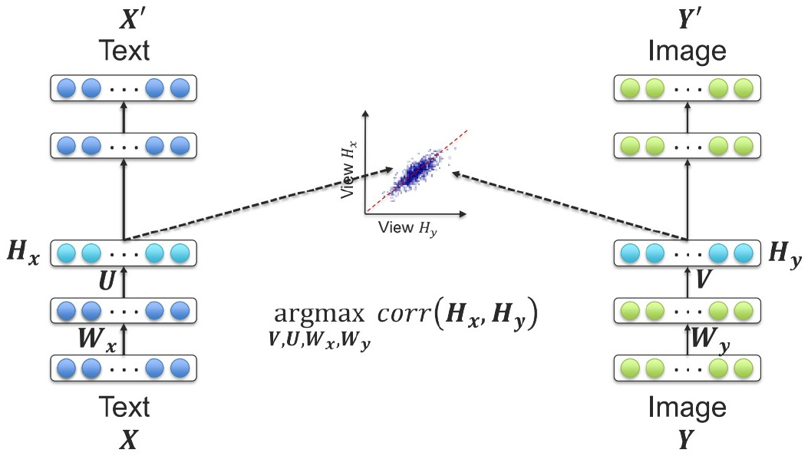

**Multi-view Latent “Intact” Space**假设同一对象存在完整、未损坏的潜在表示；各视图只是该表示的部分观测，甚至有信息退化。图中完整空间分别经 $`W_1,\ldots,W_5`$ 映射到五个视图，提醒我们不能把任意一个视图当作全部真实信息。课件引用 Xu 等的 Multi-View Intact Space Learning（TPAMI 2015），未提供具体损失或优化步骤。

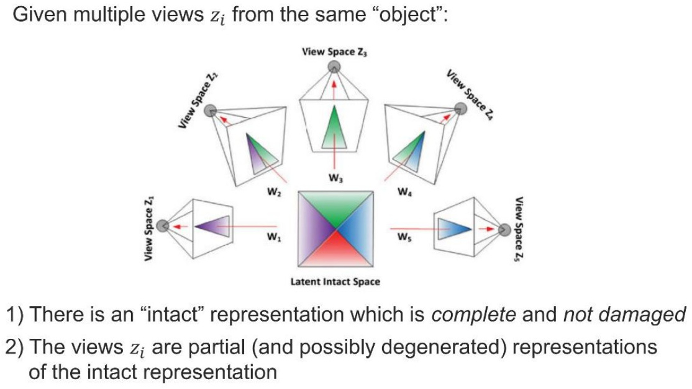

## 4. 对比协调与 CLIP

### 4.1 正负对、间隔损失与 InfoNCE

来源：第 58–59、76–78 页。

配对图文是正对，不匹配图文是负对。对比学习希望正对更近、负对更远，相似度经常用余弦。以相似度 s 为分数时，正确的间隔损失为：

```math
\mathcal L_{\mathrm{margin}}
=\max\{0,\alpha-s(z_A,z_B^+)+s(z_A,z_B^-)\},\qquad \alpha>0.
```

当正对相似度至少比负对大 $`\alpha`$ 时损失为 0。**第 58 页的相似度正负号写反**，最小化原式会惩罚正对更相似；若改用距离，则相应为“正对距离 − 负对距离 + 间隔”。

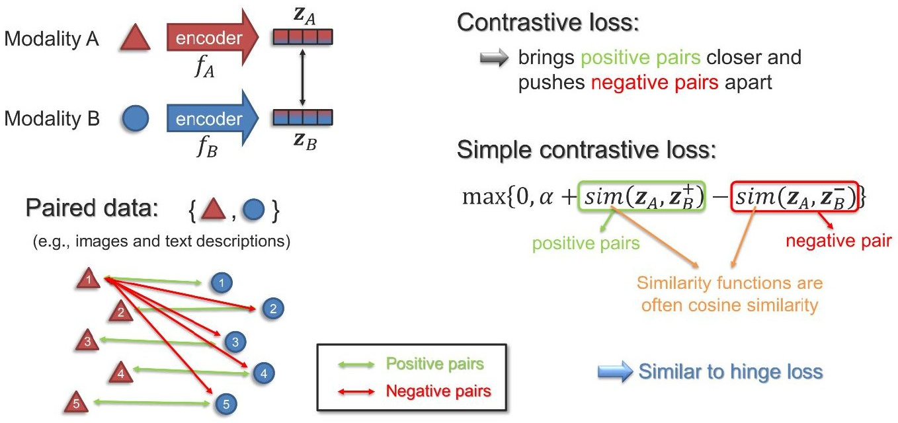

N 个配对样本的单向 InfoNCE 通常为：

```math
\mathcal L_{A\to B}
=-\frac1N\sum_{i=1}^{N}\log
\frac{\exp(s(z_A^i,z_B^i)/\tau)}
{\sum_{j=1}^{N}\exp(s(z_A^i,z_B^j)/\tau)},\qquad \tau>0.
```

每一行是一个 N 类分类问题，对角线为正对，分母含正对和负对。第 59、76–77 页将相似度直接放进对数比例，并说可用 cosine；但原始余弦可能非正，不能直接作为概率权重。应先指数化或明确 sim 已是正值打分核；温度控制分布尖锐程度。

### 4.2 CLIP 的训练结构与伪代码要点

来源：第 59–60 页。

CLIP（Contrastive Language–Image Pre-training）用文本编码器和图像编码器分别处理配对图文，投影至同一维度并做 L2 归一化，对批内所有图文组合计算相似度。两路表示是**协调的**，不要求完全相同，也没有先把图文拼成一个联合向量。

设图像与文本特征矩阵分别为 $`I_f\in\mathbb R^{N\times d_I}`$、$`T_f\in\mathbb R^{N\times d_T}`$，投影矩阵为 $`W_I\in\mathbb R^{d_I\times d_e}`$、$`W_T\in\mathbb R^{d_T\times d_e}`$：

```math
I_e=\mathrm{normalize}(I_fW_I),\qquad
T_e=\mathrm{normalize}(T_fW_T),\qquad
S=\exp(t)I_eT_e^\top\in\mathbb R^{N\times N}.
```

其中 t 是学习的对数尺度，$`\exp(t)=1/\tau`$ 为正的逆温度。对每行、每列都以匹配下标为标签，取对称交叉熵：

```math
\mathcal L_{I\to T}=-\frac1N\sum_i\log\frac{e^{S_{ii}}}{\sum_j e^{S_{ij}}},\qquad
\mathcal L_{T\to I}=-\frac1N\sum_i\log\frac{e^{S_{ii}}}{\sum_j e^{S_{ji}}},\qquad
\mathcal L=\frac{\mathcal L_{I\to T}+\mathcal L_{T\to I}}2.
```

课件伪代码的输入图像为 `[N,H,W,C]`、文本为 `[N,L]`；图像编码器列出 ResNet／Vision Transformer，文本注释列出 CBOW／Text Transformer；真正的 CLIP 文本编码器采用 Transformer。代码流程为：提特征 → 与可学习投影矩阵相乘 → 按行单位化 → 得到 N×N logits → 标签 `arange(N)` → 两个轴的交叉熵求平均。

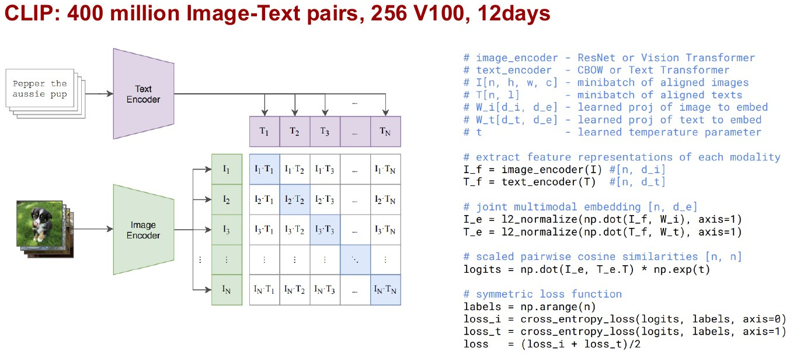

课件记录 **4 亿图文对、256 张 V100、12 天**。更准确的范围是：4 亿图文对为预训练数据规模，256 V100／12 天对应论文中最大的 Vision Transformer 训练；并非所有 CLIP 变体都用同一资源配置。[CLIP 原论文](https://proceedings.mlr.press/v139/radford21a/radford21a.pdf)给出该区分。

### 4.3 零样本分类、提示模板与少样本评估

来源：第 61–62 页。

零样本分类步骤：将 plane、car、dog、bird 等类别名放进 “A photo of a {object}.” 模板，经文本编码器得到各类别文本向量；将待分类图像编码；选择相似度最高的类别。图中的狗图像与 dog 文本最匹配。

课件强调：直接输入一个词和输入完整句子效果可能不同；可平均 **80 个提示模板**；可以引入细粒度类别等任务先验。这里展示的是模板构造与集成，并未给出可学习连续 prompt 参数的训练算法，因此不把页标题 “Prompt Learning”扩写成已进行参数化提示学习。

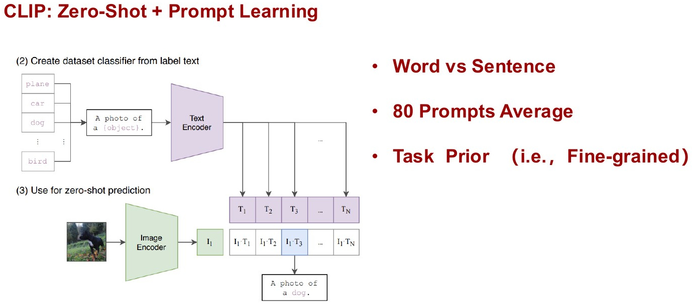

第 62 页左图为 27 个数据集上“零样本 CLIP − ResNet-50 线性探测”的得分差，按图标出的百分点记录：

| 数据集 | 差值（百分点） | 数据集 | 差值（百分点） |
| --- | --- | --- | --- |
| StanfordCars | +28.9 | Country211 | +23.2 |
| Food101 | +22.5 | Kinetics700 | +14.5 |
| SST2 | +12.4 | SUN397 | +7.8 |
| UCF101 | +7.7 | HatefulMemes | +6.7 |
| CIFAR10 | +3.9 | CIFAR100 | +3.0 |
| STL10 | +3.0 | FER2013 | +2.8 |
| Caltech101 | +2.0 | ImageNet | +1.9 |
| OxfordPets | +1.1 | PascalVOC2007 | +0.5 |
| Birdsnap | −3.2 | MNIST | −10.0 |
| FGVCAircraft | −11.3 | RESISC45 | −11.9 |
| Flowers102 | −12.5 | DTD | −16.6 |
| CLEVRCounts | −18.2 | GTSRB | −18.4 |
| PatchCamelyon | −19.5 | KITTI Distance | −34.0 |
| EuroSAT | −37.1 | — | — |

图中 16 个数据集差值为正，包括 ImageNet；11 个为负。说明迁移优势依赖具体任务，不能只保留优势样例。

右图比较每类 0、1、2、4、8、16 个有标签训练样本时的平均得分，曲线包含 Linear Probe CLIP、BiT-M（ImageNet-21k）、SimCLRv2、ResNet50。零样本 CLIP 的星号约在 62%–63%；CLIP 特征上的线性探测随着有标签样本增加而提高，在这组曲线中最高。右图没有逐点印出数值，故保留原图，不把按像素读出的近似值当作精确实验记录。Linear probe 指固定特征、训练线性分类器；与完全零样本不同。

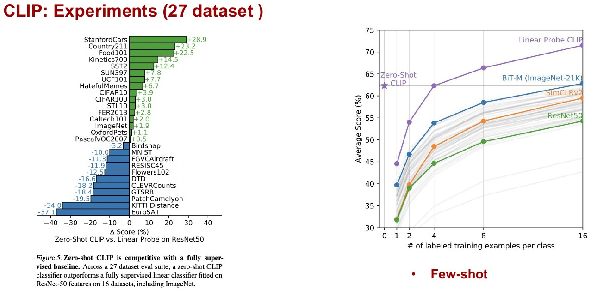

## 5. 表示分解：共享信息与模态私有信息

### 5.1 分解的层次

来源：第 64–65 页。

Fission 学习一组新的表示，使其反映多模态内部结构，例如数据因子分解、聚类。课件图示两种粒度：

| 粒度 | 所表示的结构 |
| --- | --- |
| 模态级分解 Modality-level | 将 A 特有、A/B 共享、B 特有的信息分别表示，例如语言私有、语言与视觉共享、视觉私有 |
| 细粒度分解 Fine-grained | 把模态内部再拆为多个局部或细粒度因子；共享／私有关系可以更复杂 |

这种共享／私有 Venn 图是建模意图，不保证训练后的任意三条向量自动对应理想因素。

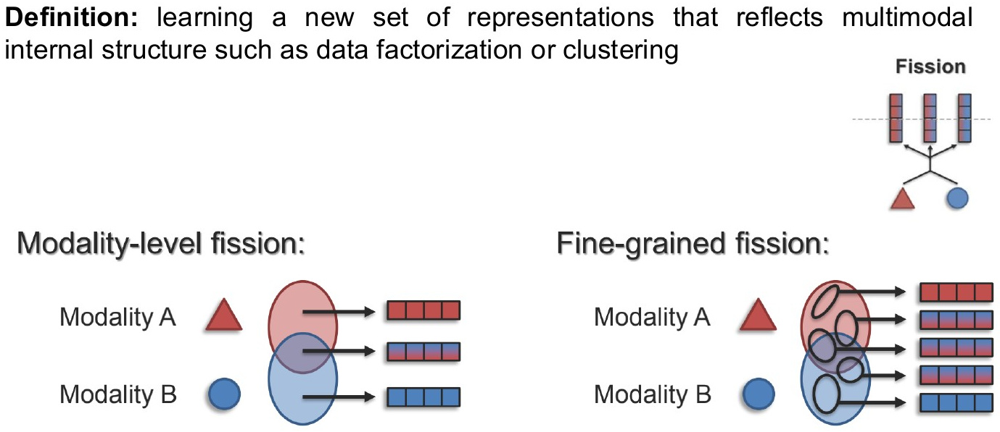

### 5.2 为什么只用判别目标不够

来源：第 66–67 页。

两种模态分别编码为私有 $`z_A,z_B`$，再经共享编码支路得到 $`z_Y`$；三者共同送入预测器，用下游标签 y 计算判别损失。问题是：只约束预测正确，不能保证共享支路真共享、私有支路真私有，模型可以复制同一信息或把全部信息塞入某条支路。

第 67 页增加生成重建和分离约束：

```math
\mathcal L=\mathcal L_1+\mathcal L_2+\mathcal L_3.
```

| 项 | 课件含义 | 作用 |
| --- | --- | --- |
| $`\mathcal L_1`$ | 判别 Discriminative | 用共享信息进行任务预测 |
| $`\mathcal L_2`$ | 生成 Generative | 从 $`(z_A,z_Y)`$ 重建 A，从 $`(z_B,z_Y)`$ 重建 B |
| $`\mathcal L_3`$ | No overlap | 使共享与各私有因子分离；图中注明为它们设置独立的先验 |

课件未给出 $`\mathcal L_3`$ 的具体散度、正交或独立性估计式，因此不能把某种特定正则当作课件已定义的算法。实际多项损失也常加权；仅指定分离先验不自动证明学到可辨识、统计独立的真实因素。

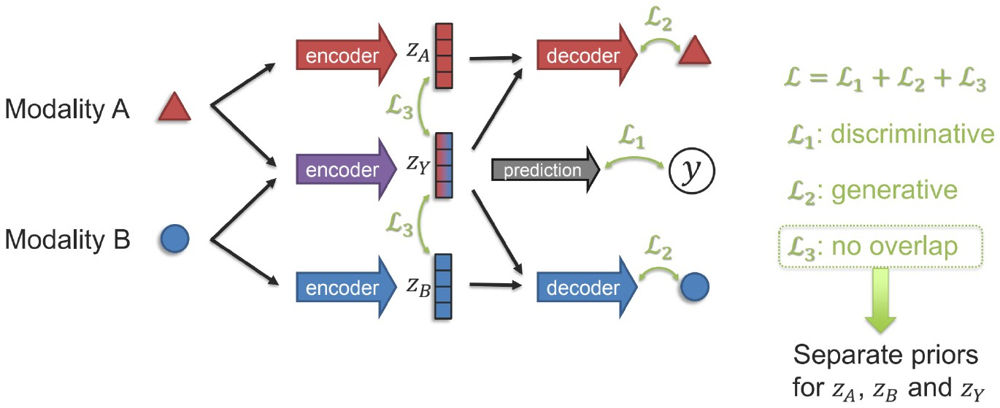

## 6. 用信息论理解多模态表示

### 6.1 自信息、熵与联合熵

来源：第 68–71 页。

消息越罕见、越出乎意料，自信息越大。课件先用 $`1/p(x)`$ 作直觉，再用对数将独立事件的乘积概率转为可加信息量：

```math
\imath(x)=-\log p(x)=\log\frac1{p(x)},\qquad
H(X)=\mathbb E[-\log p(X)]=-\sum_xp(x)\log p(x).
```

本笔记用 $`\imath(x)`$ 区分单个事件自信息与后面的互信息 $`I(X;Y)`$。以 2 为底单位为 bit，以自然对数为底单位为 nat；约定 $`0\log0=0`$。离散随机变量的熵为所有可能结果自信息的概率加权平均。

课件说连续随机变量也可定义熵；准确地说为**微分熵**，用概率密度积分表示。微分熵可为负、依赖坐标尺度，不能直接套用离散“非负信息面积”的全部直觉。

对两种模态 A、B：若独立且无共享统计信息，则 $`H(A,B)=H(A)+H(B)`$；现实中模态常有关联，如图像中的茶杯与文字 “teacup” 指向同一对象，不能假定互不相关。这里“不相交”应对应统计独立，而非物理上使用不同传感器。

### 6.2 条件熵、互信息与 KL 散度

来源：第 72–73 页。

条件熵表示观察 X 后对 Y 剩余的不确定性：

```math
H(Y\mid X)=-\mathbb E_{(X,Y)}[\log p(Y\mid X)]
=-\mathbb E_{(X,Y)}\left[\log\frac{p(X,Y)}{p(X)}\right].
```

互信息是两路共同的统计信息：

```math
\begin{aligned}
I(X;Y)
&=H(X)-H(X\mid Y)=H(Y)-H(Y\mid X)\\
&=H(X)+H(Y)-H(X,Y)\\
&=\mathbb E_{(X,Y)}\left[\log\frac{p(X,Y)}{p(X)p(Y)}\right]\\
&=D_{\mathrm{KL}}\bigl(p_{XY}\,\|\,p_Xp_Y\bigr)\ge0.
\end{aligned}
```

互信息为 0 当且仅当两路独立（在通常的分布定义条件下）。图中两圆的非重叠部分为 $`H(X\mid Y)`$、$`H(Y\mid X)`$，交叠部分为 $`I(X;Y)`$。**课件第 73 页中间展开式的第一项分母误写 $`P_Y(x)`$，应为 $`P_X(x)`$**，最终框中比值式是正确的。

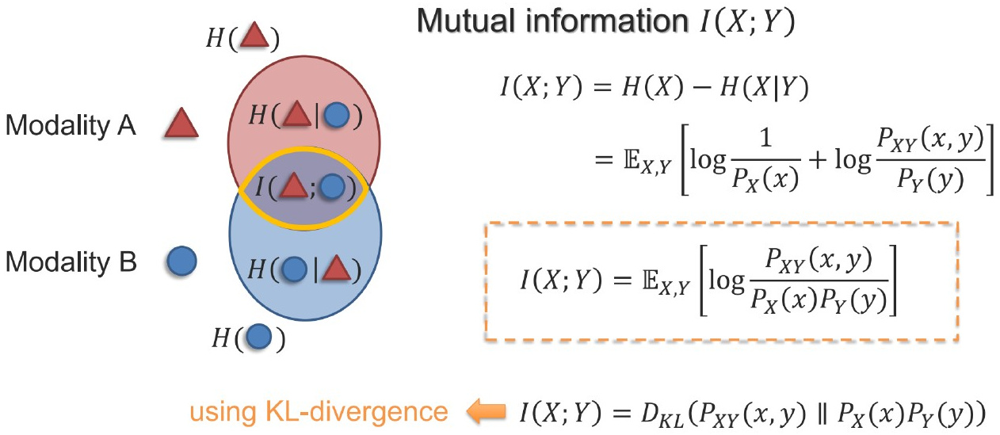

### 6.3 互信息目标的假设与范围

来源：第 74–75 页。

第 74 页让融合表示 z 同时接受下游任务目标 $`\mathcal L_{\mathrm{down}}`$ 和互信息相关目标 $`\mathcal L_{\mathrm{MI}}`$。前提是：**两模态共同拥有的信息对下游任务最重要**。这是一个建模假设；有些任务依赖单模态独有信息，或依赖必须合看才能出现的协同信息，单纯追求两模态共享部分可能损失它们。

第 75 页把同一数据 X 的两个增强视图当作两种输入：希望表示 z 保留与两视图的共同信息，使 $`I(z;v_1)`$、$`I(z;v_2)`$ 较大，也讨论减小 $`H(z\mid v_1)`$、$`H(z\mid v_2)`$。这连接多模态协调与单模态多视图自监督。

需要保留条件：由 $`I(z;v)=H(z)-H(z\mid v)`$ 可知，只有在 $`H(z)`$ 被固定或防塌缩机制维持时，降低条件熵才对应提高互信息。常数表示也能有零条件熵，但没有有用信息；不能只优化条件熵而忽略表示塌缩。

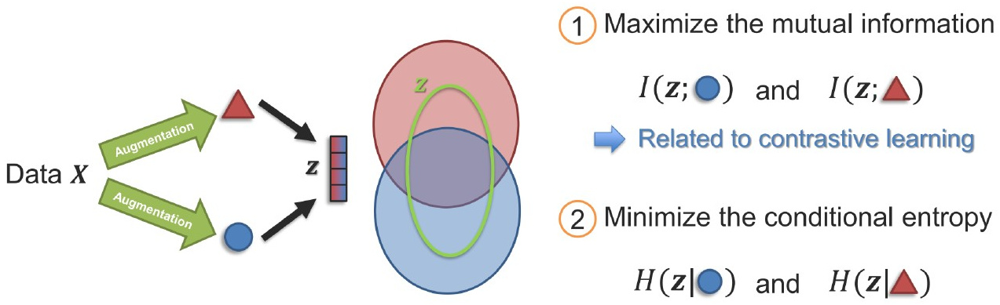

## 7. 自监督表示：SimCLR、DINO 与 MAE

### 7.1 增强视图与 SimCLR 批内对比

来源：第 76–78 页。

课件用同一只猫的遮挡／补全、旋转、拼图、灰度等变换作正视图 $`x^+`$，用另一张狗图作负样本 $`x^-`$，以 Pull／Push 表示拉近／推远。并非任意变换都应保持语义：增强定义了模型应忽略哪些差异，必须适合目标任务。

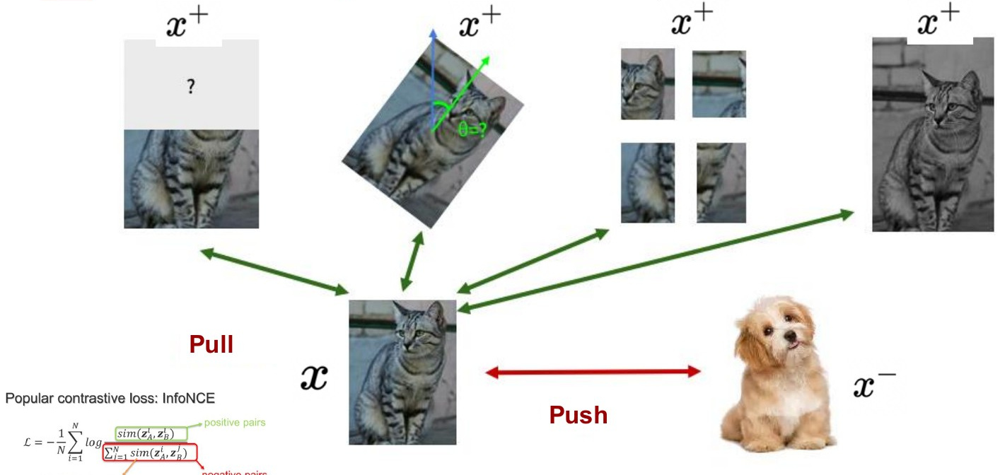

SimCLR：一个 batch 有 N 张原始图，每张生成两个增强视图，共 $`2N`$ 条表示，形成 $`Z\in\mathbb R^{2N\times D}`$。采用交错存放时，课件图中的 0 起始下标 2k、2k+1 是一对；用 1 起始则为 2k−1、2k。模型对每条视图从其余视图中辨认正对。

```math
\ell_{i,j}=-\log\frac{\exp(\mathrm{cos}(z_i,z_j)/\tau)}
{\sum_{k=1}^{2N}\mathbf{1}_{k\ne i}\exp(\mathrm{cos}(z_i,z_k)/\tau)},\qquad
\mathcal L=\frac1{2N}\sum_{k=1}^{N}(\ell_{2k-1,2k}+\ell_{2k,2k-1}).
```

分母必须排除自己，含 1 个正视图和 $`2N-2`$ 个负视图；相似度矩阵主对角不能当作正标签。补充原方法使用编码器后的非线性投影头作对比，迁移时使用编码器表示，参见 [SimCLR 原论文](https://proceedings.mlr.press/v119/chen20j.html)。课件将编码与投影简画为一条 encoder。

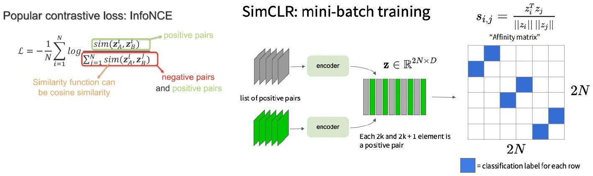

### 7.2 InfoNCE 与互信息下界

来源：第 78 页。

令 N 表示**候选总数**，包括 1 个正样本和 N−1 个负样本；这与上一节 N 张原图的 batch 记号不同。s 是打分函数，可包含温度。损失可写为：

```math
\mathcal L_{\mathrm{NCE}}
=-\mathbb E\log\frac{\exp(s(f(x),f(x^+)))}
{\exp(s(f(x),f(x^+)))+\sum_{j=1}^{N-1}\exp(s(f(x),f(x_j^-)))}.
```

在正对来自联合分布、负样本按相应边缘分布独立抽取等标准条件下：

```math
I(f(X);f(X^+))\ge\log N-\mathcal L_{\mathrm{NCE}}.
```

**课件不等式本身是上述形式的等价移项，并没有方向错误**：$`I-\log N\ge-\mathcal L`$。需要校正的是课件将 N 称为“负样本数量”，其公式实际含 N−1 个负样本；以及“越多负样本就一定越紧”的无条件表述。下界上限为 $`\log N`$，增加候选可提高可估计信息的上限，但有限数据、打分函数、采样与优化都会影响实际松紧和学习效果。[Poole 等的互信息界论文](https://proceedings.mlr.press/v97/poole19a/poole19a.pdf)讨论这一范围。

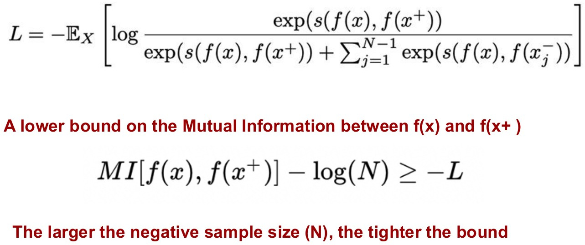

补充边界核对：若正负打分全相同，正对概率为 1/N，则 $`\mathcal L=\log N`$，下界为 0，不能得到有用依赖信息。若损失趋于 0，有限候选的下界至多达到 $`\log N`$。

### 7.3 DINO：教师学生自蒸馏

来源：第 79 页。

课件把 DINO 放在 Contrastive Learning 标题下，但图示方法是**无标签自蒸馏**，不使用 SimCLR 式显式负样本。相同图像生成两种视图 $`x_1,x_2`$，学生输出 $`p_s`$，教师输出 $`p_t`$，使学生分布匹配教师分布：

```math
\mathcal L_{\mathrm{DINO}}=-\sum_kp_t^{(k)}\log p_s^{(k)},\qquad
\theta_t\leftarrow m\theta_t+(1-m)\theta_s.
```

学生通过反向传播学习；教师输出 **stop-gradient（sg）**，教师参数是学生参数的指数移动平均 EMA。教师分布进行 centering（中心化）与 sharpening（锐化／温度缩放）；两者配合抑制塌缩、提供稳定目标。图中的 $`-p_2\log p_1`$ 是分布交叉熵的简写。

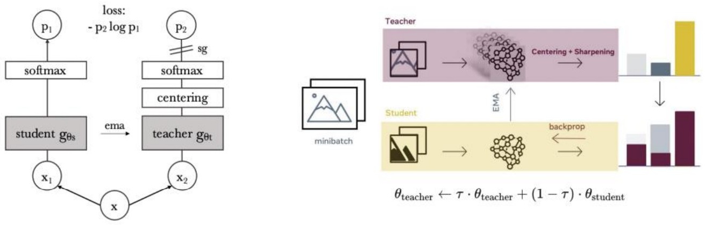

图页还列出 DINO v2、DINO v3 名称，但没有给出两代的新结构、损失或评测，笔记不为它们补造技术细节。这里解释的基础机制对应 [DINO 原论文](https://arxiv.org/abs/2104.14294)。

### 7.4 MAE：只对掩码块计算重建误差

来源：第 80 页。

MAE（Masked Autoencoders）把图像分块，只把可见块送入编码器；解码器结合可见块的表示与掩码 token，预测原图像素。课件强调：采用**像素空间均方误差 MSE**，并且**只对被掩码的 patch 计算损失**。

设被掩码块集合为 $`\mathcal M`$，每块有 P 个像素／通道坐标，补充对应均方误差写法：

```math
\mathcal L_{\mathrm{MAE}}=\frac1{|\mathcal M|P}
\sum_{p\in\mathcal M}\|\hat x_p-x_p\|_2^2.
```

其不对称编码器／解码器设计及高掩码比例动机见 [MAE 原论文](https://arxiv.org/abs/2111.06377)。课件右侧曲线的全部标注如下，70% 和 75% 的点是两个不同实验点：

| 掩码比例（%） | 微调 Fine-tuning | 线性探测 Linear probing |
| --- | --- | --- |
| 10 | 83.2 | 54.6 |
| 20 | 83.4 | 58.9 |
| 30 | 83.4 | 61.7 |
| 40 | 84.7 | 67.0 |
| 50 | 84.9 | 69.9 |
| 60 | 85.0 | 71.8 |
| 70 | 84.9 | 73.2 |
| 75 | 84.9 | 73.5 |
| 80 | 84.5 | 71.8 |
| 90 | 83.0 | 66.1 |

此图微调最高点为 60%（85.0），线性探测最高点为 75%（73.5），说明评价方式不同可产生不同最佳比例。原页纵轴未给出更完整实验配置，按课程曲线记录，不推广为所有数据与模型的普适最优值。

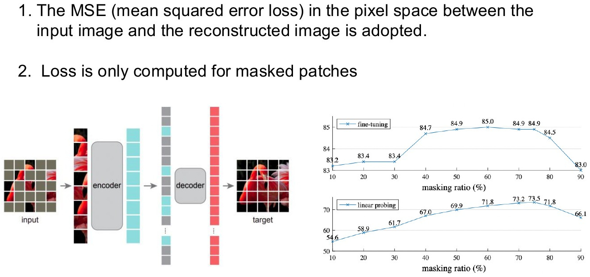

## 8. 代理任务与表示迁移

### 8.1 自监督训练流程

来源：第 81–82 页。

自监督学习希望减少大规模人工标注的需要：从数据本身构造 **Pretext Task（代理／前置任务）**，自动生成训练目标，先学表示，再迁移到有标签目标任务。迁移头可以是解码器、分类器、回归器等。它减少的是预训练人工标签需求，不意味着下游评估或监督微调也必须无标签。


第 82 页列出图像补全、旋转预测、拼图 Jigsaw、着色。解决这些任务可促使模型学习特征；是否迁移有效仍需下游实验检验。

### 8.2 旋转预测与完整迁移实验

来源：第 83–84 页。

对图像 X 人工施加四种旋转：0°、90°、180°、270°，类别标签依次为 0、1、2、3。ConvNet 预测变换类别，最大化对应类别概率；标签可直接由变换过程生成，无需人工语义标注。

```math
\mathcal L_{\mathrm{rot}}=-\frac14\sum_{r=0}^{3}
\log p_\theta(r\mid R_{90r}(X)).
```

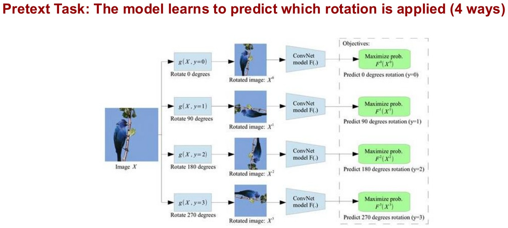

第 84 页的 Pascal VOC 表完整转写如下。“分类 fc6–8”表示仅训练该范围的分类层；all 表示训练／微调所有层。空白表示原表未报告，不能按 0 处理。

| 预训练方法 | 分类 mAP，fc6–8 | 分类 mAP，all | 检测 mAP，all | 分割 mIoU，all |
| --- | --- | --- | --- | --- |
| ImageNet labels | 78.9 | 79.9 | 56.8 | 48.0 |
| Random | — | 53.3 | 43.4 | 19.8 |
| Random rescaled（Krähenbühl 等，2015） | 39.2 | 56.6 | 45.6 | 32.6 |
| Egomotion（Agrawal 等，2015） | 31.0 | 54.2 | 43.9 | — |
| Context Encoders（Pathak 等，2016） | 34.6 | 56.5 | 44.5 | 29.7 |
| Tracking（Wang 与 Gupta，2015） | 55.6 | 63.1 | 47.4 | — |
| Context（Doersch 等，2015） | 55.1 | 65.3 | 51.1 | — |
| Colorization（Zhang 等，2016a） | 61.5 | 65.6 | 46.9 | 35.6 |
| BIGAN（Donahue 等，2016） | 52.3 | 60.1 | 46.9 | 34.9 |
| Jigsaw Puzzles（Noroozi 与 Favaro，2016） | — | 67.6 | 53.2 | 37.6 |
| NAT（Bojanowski 与 Joulin，2017） | 56.7 | 65.3 | 49.4 | — |
| Split-Brain（Zhang 等，2016b） | 63.0 | 67.1 | 46.7 | 36.0 |
| ColorProxy（Larsson 等，2017） | — | 65.9 | — | 38.4 |
| Counting（Noroozi 等，2017） | — | 67.7 | 51.4 | 36.6 |
| RotNet（原表 Ours） | **70.87** | **72.97** | **54.4** | **39.1** |

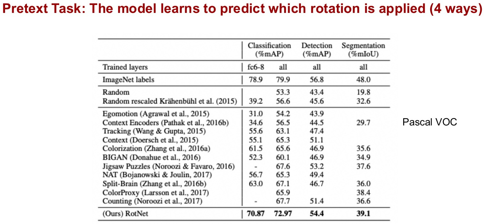

这些是课件引用的历史实验，不能与任意新骨干的结果直接比较。RotNet 的检测 mAP 比 ImageNet 有监督预训练少 2.4 个百分点，在此表中优于其他列出的自监督检测结果。来源：[旋转预测原论文](https://arxiv.org/abs/1803.07728)。

### 8.3 图像修复 Inpainting

来源：第 85–86 页，两页合并。

从图像去掉一个区域，用周围可见内容预测缺失像素。图中流程为：遮挡图像 → Encoder → 编码特征 → Channel-wise Fully Connected（逐通道全连接）→ 解码特征 → Decoder → 缺失区域重建；目标是原图对应区域。

令 $`\hat M=1`$ 表示被遮挡区域，输入为 $`(1-\hat M)\odot x`$，课件重建目标为：

```math
\mathcal L_{\mathrm{rec}}(x)
=\left\|\hat M\odot\left[x-F\bigl((1-\hat M)\odot x\bigr)\right]\right\|_2^2.
```

掩码使损失只计算缺失区域；这里原式是平方和，除以区域像素数后才是平均误差。任务使编码器必须利用物体结构与上下文，而不只复制输入。

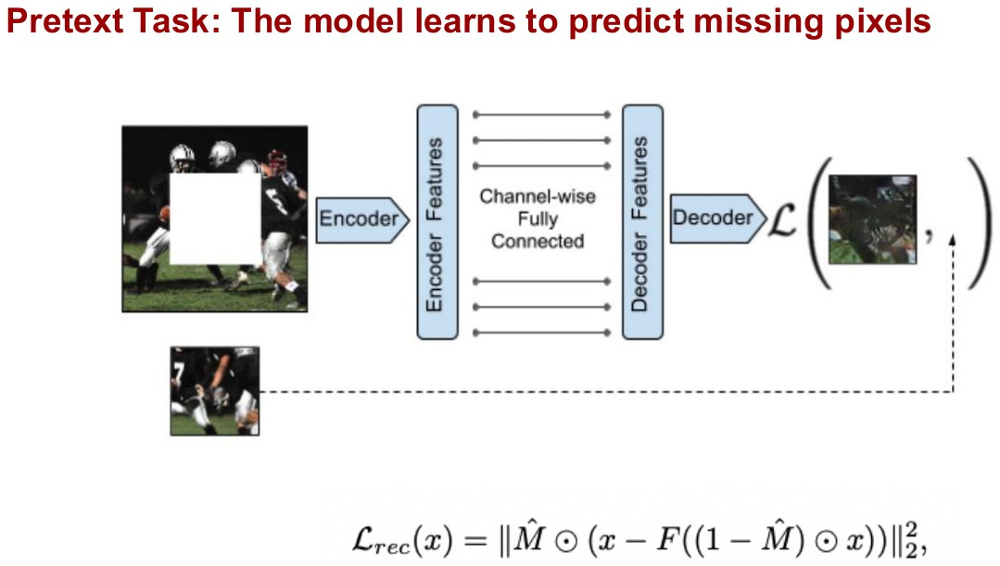

第 85–86 页页脚误沿用旋转预测链接；该结构应对应 [Context Encoders: Feature Learning by Inpainting](https://arxiv.org/abs/1604.07379)。原论文还讨论对抗损失，但本页显示的公式仅是重建项，笔记将二者范围区分。

### 8.4 着色与跨通道预测

来源：第 87–88 页。

**着色 Colorization**以 Lab 空间亮度 L 作为输入，预测色度 a、b 两个通道：

```math
X=L\in\mathbb R^{H\times W\times1},\qquad
\hat Y=F(L)\in\mathbb R^{H\times W\times2}.
```

颜色标签直接取自原彩色图像，灰度输入通过去掉颜色得到；不需要人工逐像素着色标签。单张灰度图可能对应多种合理颜色。第 87 页引用 [Colorful Image Colorization](https://arxiv.org/abs/1603.08511)（ECCV 2016）；原页没有给出其完整颜色分箱损失，不将该方法简化为必然使用连续色度 MSE。

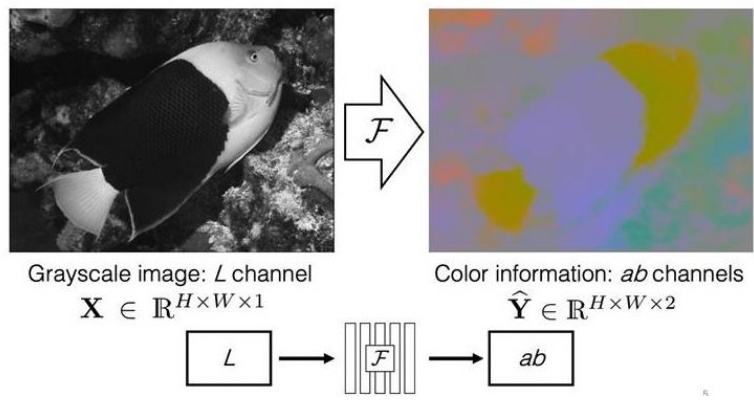

**Split-Brain 自编码器**将输入通道拆成 $`X_1,X_2`$，两条互不共享的预测支路各自预测另一组通道：

```math
\hat X_2=F_1(X_1),\qquad \hat X_1=F_2(X_2).
```

课件给出两组具体例子：① Lab 图像，L 预测 ab、ab 预测 L，再组合重建；② RGB-D 图像，RGB 预测深度的 HHA 编码，HHA 预测 RGB，再组合。补充 HHA 指水平视差、高于地面的高度、表面法向与重力方向夹角三种几何编码，见 [HHA 深度表示论文](https://arxiv.org/abs/1407.5736)。两支路学得的特征可共同覆盖完整输入信号，参阅 [Split-Brain 原论文](https://arxiv.org/abs/1611.09842)。

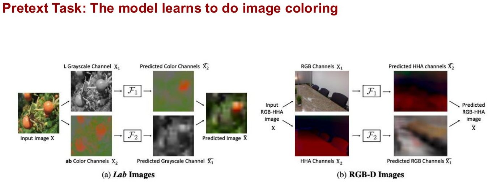

## 9. 三条表示路线的联系

来源：第 89 页与全章。

| 需要回答的问题 | 主要路线 | 本章方法与注意事项 |
| --- | --- | --- |
| 如何联合利用多路输入的互补或高阶信息？ | 融合 | 加性、乘性、张量、低秩、门控、动态；显式交互的表达能力与资源代价需要权衡 |
| 如何让不同模态的表示可比较、可检索或可迁移？ | 协调 | 余弦、核、CCA、DCCAE、CLIP；保留各模态差异，明确配对和损失方向 |
| 如何把共享和私有因素分开？ | 分解 | 模态级／细粒度分解，判别、重建和分离联合约束；准确预测不等于因素正确分离 |
| 如何减少预训练对人工标签的依赖？ | 自监督多视图学习 | 对比、蒸馏、掩码重建、变换预测、跨通道预测；任务构造决定学到哪些不变性 |

三条路线可以组合：先协调图文编码器，再融合用于预测；也可以在融合前后分出共享和私有因素。互信息解释提供统一视角，但具体方法仍需检查数据配对、张量形状、损失符号、采样假设与下游评估。

返回[课程目录](../README.md)。逐页去向与校正记录见[内容覆盖核对表](../COVERAGE.md)。
