# 第七章：多模态对齐、注意力与图像描述

来源：刘洋（Yang Liu），`7_Introduction_MML_part2_2026.pdf`，共 **97 页**，封面未注明日期。页码均为 **PDF 页序号**；部分原页页脚有偏移。整理日期：2026-11-01。

本章对应 Lecture 7, Part 2 Alignment。将逐词解码、注意力计算和 Transformer 模块的动画合并为完整流程，保留全部任务、公式、技术比较、失败案例与图中例句。补充的矩阵维度、代数证明和边界条件会明确说明。RNN、LSTM、GCN 基础见[第五章](05-自然语言处理导论.md)，表示融合与协调见[第六章](06-多模态表示学习-融合协调与分解.md)。

## 1. 多模态对齐与上下文化表示

### 1.1 对齐的定义与类型

来源：第 2–3 页。

**多模态对齐**识别和建模多个模态全部元素之间的跨模态联系，并利用数据本身的结构。课件举出媒体描述、模态翻译和多模态导航：媒体内容中的人物行为对应文字，演奏画面中的乐器区域对应声音，导航语言或目标对应环境地图中的位置。

媒体描述例句为 “Abby clasps her hands around his face and kisses him passionately.”，关键是人物、动作及其时空内容与语言片段的对应关系。

| 路线 | 对齐对象与操作 |
| --- | --- |
| 离散对齐 Discrete alignment | 离散元素及其连接，例如词与图像区域的对应 |
| 连续对齐 Continuous alignment | 对连续信号分段或作连续时间伸缩／规整，使不同采样速率或时长的内容对应 |
| 上下文化表示 Contextualized representation | 将对齐和表示学习结合，通过交互获得依赖上下文的表示 |

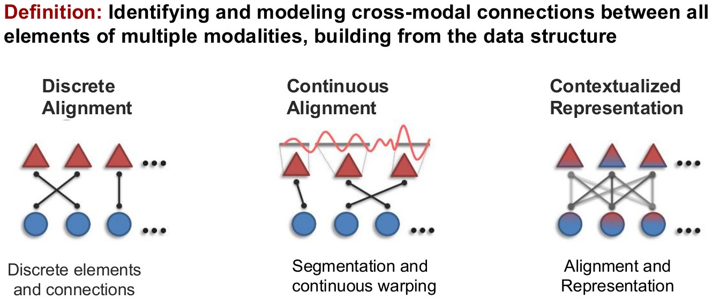

本讲主要展开上下文化表示与隐式注意力对齐，没有给出离散匹配或动态时间规整的完整优化算法，不能把后文 Transformer 方程当作所有对齐方法的定义。

### 1.2 三种序列上下文化方式

来源：第 4–10 页，重复示意合并。

输入词序列为 “I do not like it”，对应 $`x_1,\ldots,x_5`$；编码后希望每个 $`h_i`$ 都考虑其他词，尤其是 not 对 like 的否定。

| 编码方式 | 交互方式 | 课件强调的特点 |
| --- | --- | --- |
| 双向 LSTM | 正向与反向状态合并 | 能利用两侧上下文，但每个方向存在时间步依赖，难以完全并行 |
| 卷积 | 局部窗口共享滤波器 | 同层可并行，较远依赖需多层扩大感受野；此处讨论固定卷积核 |
| 自注意力 | 各位置按内容对其他位置加权 | 同层的对齐分数可并行，直接建立长距离联系，权重依输入动态变化 |

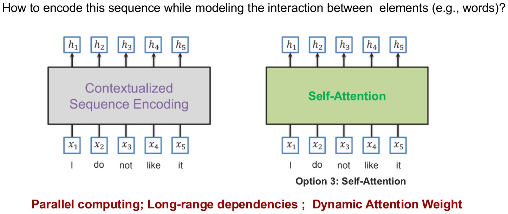

Transformer 相关构件包括自注意力、多头注意力、位置嵌入、序列到序列建模。**隐式对齐**指把对应关系作为内部潜变量或权重学习，以完成外部任务；训练不一定提供逐词／逐区域的对齐标签。

## 2. 从固定上下文 RNN 到软注意力描述

### 2.1 图像描述的输入、输出和瓶颈

来源：第 12–17 页。第 11 页为标题分隔页。

图像描述（Image Captioning）输入图像 I，输出词序列 $`y_1,\ldots,y_T`$。先用预训练 CNN 提取空间特征 $`Z\in\mathbb R^{H\times W\times D}`$，通过 MLP 得到初始状态 $`h_0=f_W(Z)`$。课件用 $`c=h_0`$ 表示固定上下文，并简记解码器为 $`y_t=g(y_{t-1},h_{t-1},c)`$。

为区分预测概率与采样出的离散词，补充完整形式：

```math
h_t=\mathrm{RNN}(E[y_{t-1}],h_{t-1},c),\qquad
p(y_t\mid y_{1:t-1},I)=\mathrm{softmax}(W_oh_t+b_o).
```

图中从 `[START]` 开始依次输出 **person → wearing → hat → [END]**。训练时可输入真实前词，推理时输入已生成的前词；这一训练／推理差异见第五章 Teacher Forcing。

固定 c 把要表达的全部内容压进一个向量；描述越长、图像越复杂，对单一向量的要求越高。课件把它称为输入瓶颈。

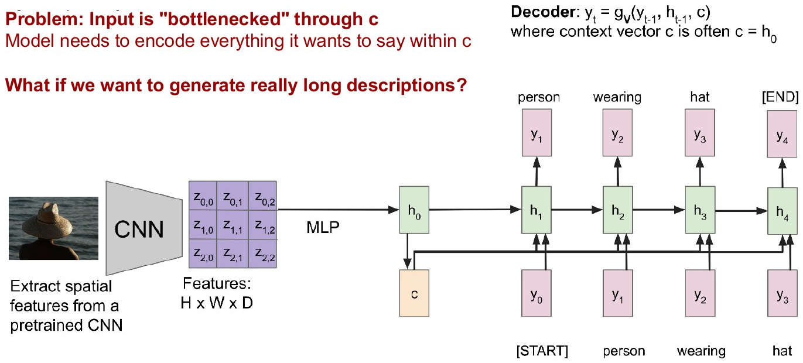

### 2.2 每个时间步重新计算上下文

来源：第 18–27 页，合并逐步出现的打分、归一化、加权与解码。

将图像位置 $`(i,j)`$ 的特征记为 $`z_{ij}\in\mathbb R^D`$，第 t 步用上一隐藏状态查询所有区域：

```math
e_{tij}=f_{\mathrm{att}}(h_{t-1},z_{ij}),\qquad
\alpha_{tij}=\frac{\exp(e_{tij})}{\sum_{u=1}^{H}\sum_{v=1}^{W}\exp(e_{tuv})},\qquad
c_t=\sum_{i=1}^{H}\sum_{j=1}^{W}\alpha_{tij}z_{ij}.
```

$`f_{\mathrm{att}}`$ 在课件中为 MLP，输出标量；每一步有 H×W 个分数和权重。有限分数下权重为正且总和为 1，$`c_t`$ 是区域特征的凸组合。不同词使用不同 $`c_t`$，例如“person”更关注人物，“hat”更关注头部区域。

**下标校正**：原页部分上下文式写成 $`z_{t,i,j}`$，但静态图像空间特征没有时间轴；时间变化的是权重与上下文。本笔记统一为 $`z_{ij}`$。图中 $`c_t`$ 是 attention context，不是 LSTM 的内部 cell state，不能混用。

```math
h_t=\mathrm{RNN}(E[y_{t-1}],h_{t-1},c_t),\qquad
\mathcal L=-\sum_{t=1}^{T}\log p_\theta(y_t^*\mid y_{1:t-1}^*,I).
```

末式为对应逐词监督的负对数似然补充。打分、Softmax、加权和都可微，因此可通过描述任务损失学习注意力，**不要求额外提供注意力位置监督**；这不等于不需要图像描述训练标签。课件显示的是确定性的软注意力；[Show, Attend and Tell 原论文](https://proceedings.mlr.press/v37/xuc15.html)也讨论随机／硬注意力，但本页没有展开其训练推导。

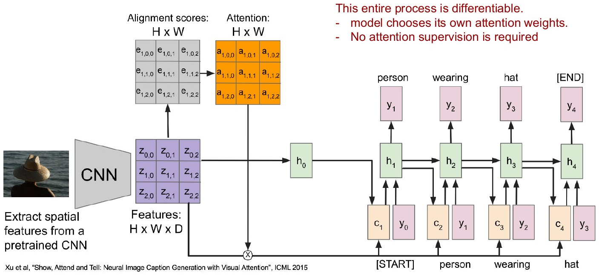

### 2.3 全部可视化例子

来源：第 28–29 页。

鸟图逐词输出 “A bird flying over a body of water.”，每个词下面给出不同注意力图，展示区域权重随词改变。

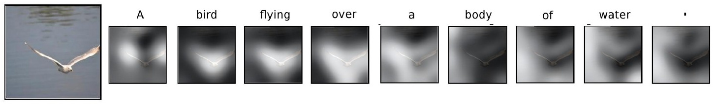

另外六组图文为：女子在公园扔飞盘；狗站在硬木地板上；道路上的停车标志、背景有山；小女孩坐在床上并有泰迪熊；一群人坐在水中的船上；长颈鹿站在森林、背景有树。原图同时保留描述与关注区域，不能只截出图片而丢掉例句。

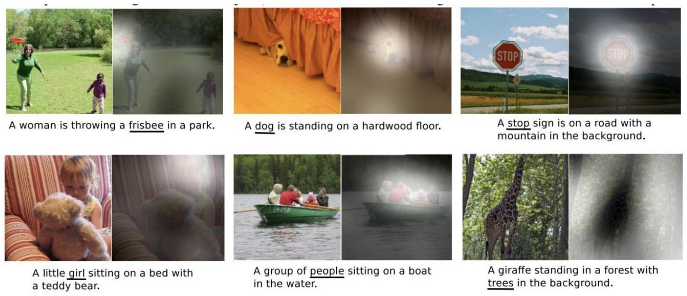

注意力可视化提供模型内部加权的线索，但单凭热力图不能证明模型的因果推理过程或保证每个对象判断正确。

## 3. 一般注意力、Q/K/V 与自注意力

### 3.1 一条查询的加权检索

来源：第 30–36 页。

把 H×W 个空间位置拉直为 N 个向量 $`X\in\mathbb R^{N\times D}`$。一条查询 $`q\in\mathbb R^D`$ 对每条输入打分、归一化，再求加权和。它可以用于图像区域，也可以用于其他集合或序列。

```math
e_i=f_{\mathrm{att}}(q,x_i),\qquad
a_i=\frac{e^{e_i}}{\sum_{j=1}^{N}e^{e_j}},\qquad
c=\sum_{i=1}^{N}a_ix_i\in\mathbb R^D.
```

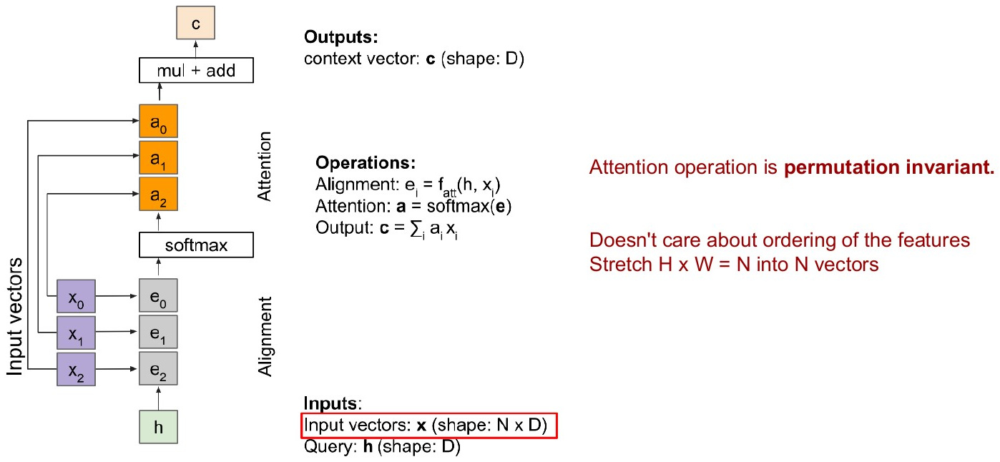

将 MLP 打分改为缩放点积，可写为 $`e_i=q^\top x_i/\sqrt D`$。课件指出：维数越大，点积包含的项越多，分数方差可能越大，Softmax 容易过尖，其他位置权重及梯度很小。

补充统计条件：若 q、k 的各坐标相互独立、均值 0、方差 1，则 $`\mathrm{Var}(q^\top k)=D`$，除以 $`\sqrt D`$ 后约为 1。缩放控制维数造成的方差增长；它不等于把任意大范数向量完全归一化。

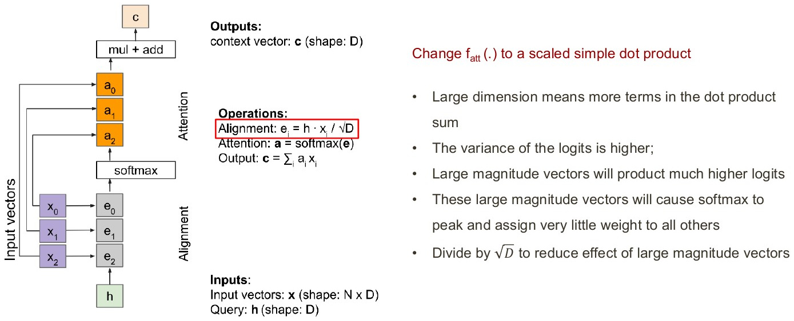

### 3.2 多条查询与键值分工

来源：第 37–41 页。

M 条查询各自输出一条上下文向量。进一步为输入加入独立的键投影、值投影：**Key**决定如何与查询匹配，**Value**决定取回哪些内容。键值不必与原始输入使用同一特征空间。

| 符号 | 形状 | 含义 |
| --- | --- | --- |
| X | N×d_in | 输入／可检索元素 |
| Q | M×d_k | 查询 |
| $`W_K`$ | d_in×d_k | 键映射 |
| $`W_V`$ | d_in×d_v | 值映射 |
| K=XW_K | N×d_k | 键 |
| V=XW_V | N×d_v | 值 |
| A | M×N | 每条查询在N个键上的概率权重 |
| Y=AV | M×d_v | 每条查询的输出 |

```math
\mathrm{Attention}(Q,K,V)
=\mathrm{softmax}_{\mathrm{keys}}\left(\frac{QK^\top}{\sqrt{d_k}}\right)V.
```

Softmax 对每一条 query 的全部 keys 归一化。课件图将 key 放在行、query 放在列，因而沿列归一化；本笔记采用常见的 query 行、key 列约定，沿行归一化，两者互为转置。缩放维数应为 $`d_k`$，不是原始输入维数或值维数；输出整体形状为 M×d_v，而不是只写一个 d_v。

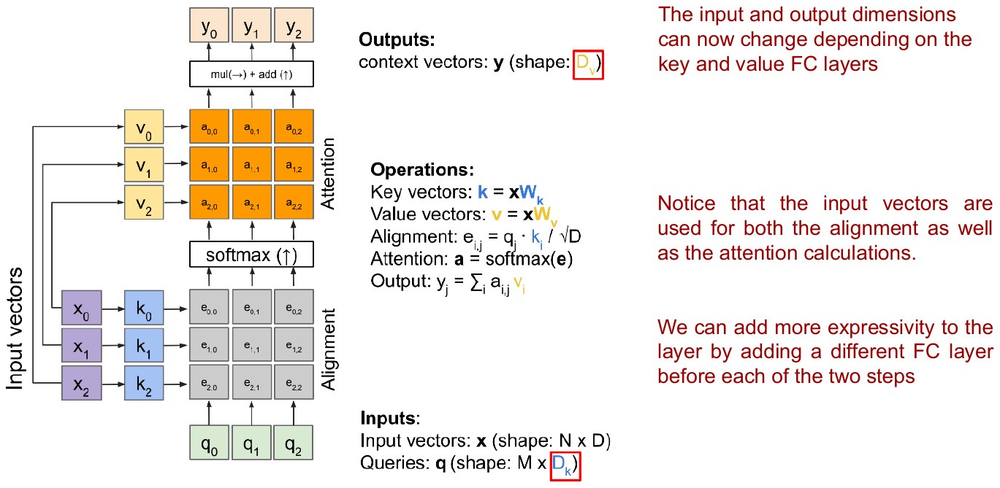

### 3.3 自注意力及置换性质的准确含义

来源：第 42–45、53 页。

自注意力让查询也由同一输入产生，因此不再需要独立的外部 query 输入：

```math
Q=XW_Q,\qquad K=XW_K,\qquad V=XW_V,\qquad
\mathrm{SA}(X)=\mathrm{softmax}\left(\frac{QK^\top}{\sqrt{d_k}}\right)V.
```

“没有输入查询向量”指不再由调用者另给 Q，内部仍然计算 Q。不同 $`W_Q,W_K,W_V`$ 学习不同角色，并非三个表示必须数值相同。

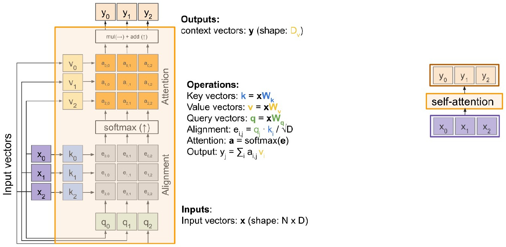

课件把不带位置编码的自注意力称为 **Permutation Invariant**。应区分两种情况：

| 情况 | 准确性质 |
| --- | --- |
| 固定外部 Q，同时用同一置换重排 K、V | 输出不变，因为可检索元素的列表顺序不影响加权结果 |
| 自注意力的 X 全部重排，输出仍逐元素保留 | **置换等变**：输出以同样方式重排，并非保持原顺序数值不变 |

令 P 为置换矩阵，补充证明：

```math
\mathrm{SA}(PX)
=\mathrm{softmax}\left(P\frac{QK^\top}{\sqrt{d_k}}P^\top\right)PV
=P\,\mathrm{SA}(X).
```

课件图中输入 $`(x_0,x_1,x_2)`$ 变为 $`(x_1,x_0,x_2)`$，输出相应变为 $`(y_1,y_0,y_2)`$，正是等变性。若最终再做对称池化，才可得到集合级不变输出。这说明仅凭内容注意力无法知道词或图像块原来的位置，需要加入位置线索。

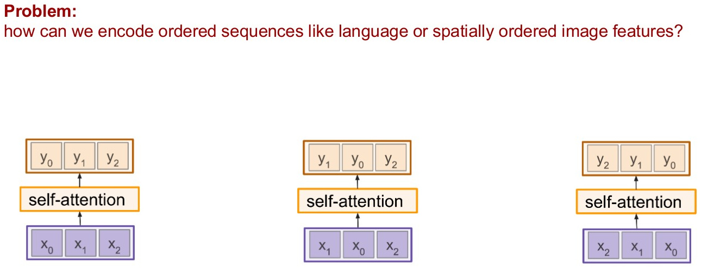

## 4. 位置、因果约束与多头

### 4.1 位置编码的要求与选项

来源：第 46–48 页。

将位置 j 映为 $`p_j=\mathrm{pos}(j)\in\mathbb R^d`$。课件提出：各位置编码应可区分；不同长度句子中的位置距离应有一致含义；应尽量推广到更长句子；取值应有界；同一位置编码应确定。

两种方案：① 学习 T×d 查表参数，覆盖 $`0\le j\lt T`$；② 设计固定函数，如正弦／余弦编码。查表本身不保证未见过的更长位置可用。课件左图使用**拼接** $`[x_j;p_j]`$，会改变维度；经典 Transformer 通常采用同维**相加** $`x_j+p_j`$，两者应区分。

采用从 0 开始的频率下标：

```math
\omega_i=10000^{-2i/d},\qquad
\mathrm{PE}(t,2i)=\sin(\omega_it),\qquad
\mathrm{PE}(t,2i+1)=\cos(\omega_it),\quad 0\le i\lt d/2.
```

课件的频率向量与 0–15 的四位二进制计数并排，意在类比不同维度以不同频率变化；位置编码本身不是离散二进制编码。

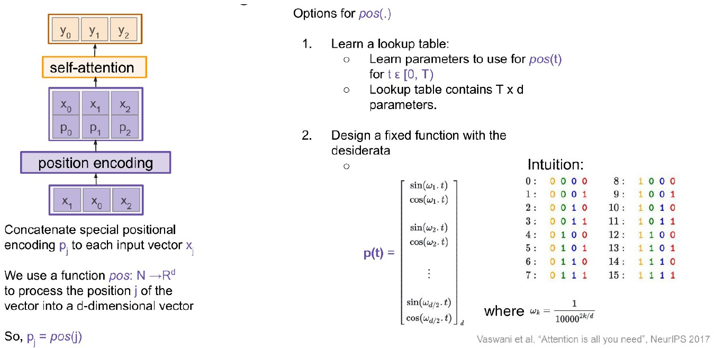

### 4.2 相对位移的线性变换与无向点积

来源：第 49 页。

对任一频率，位置平移可写为一个二维旋转形式：

```math
\begin{bmatrix}\sin(\omega(t+\Delta))\\\cos(\omega(t+\Delta))\end{bmatrix}
=\begin{bmatrix}\cos(\omega\Delta)&\sin(\omega\Delta)\\-\sin(\omega\Delta)&\cos(\omega\Delta)\end{bmatrix}
\begin{bmatrix}\sin(\omega t)\\\cos(\omega t)\end{bmatrix}.
```

把各频率块拼起来就有 $`\mathrm{PE}_{t+\Delta}=T_\Delta\mathrm{PE}_t`$。位置向量点积展开为：

```math
\begin{aligned}
\mathrm{PE}(t)^\top\mathrm{PE}(t+\Delta)
&=\sum_i[\sin(\omega_it)\sin(\omega_i(t+\Delta))
+\cos(\omega_it)\cos(\omega_i(t+\Delta))]\\
&=\sum_i\cos(\omega_i\Delta)
=\mathrm{PE}(t)^\top\mathrm{PE}(t-\Delta).
\end{aligned}
```

因此这个**未经额外投影的纯位置点积**只依赖相对距离，并对正负位移对称。它不表示整个 Transformer 无法区分前后：内容、学习的 Q/K 投影和因果掩码都可能提供方向信息。

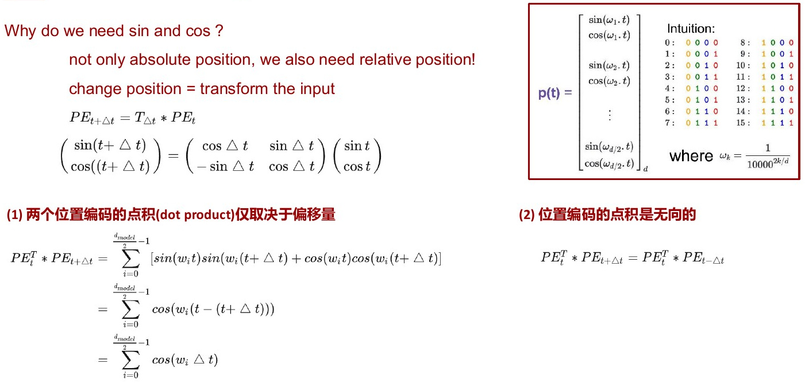

### 4.3 因果掩码防止看到未来词

来源：第 50–51 页。

描述生成时，第 t 个位置不能读取未来的真实目标词。对不可见位置把 logit 设为负无穷，再做 Softmax，使对应权重为 0：

```math
M_{tj}=\begin{cases}0,&j\le t,\\-\infty,&j>t,\end{cases}\qquad
A=\mathrm{softmax}\left(\frac{QK^\top}{\sqrt{d_k}}+M\right).
```

这里输入已右移一位，位置 t 的输入是前一个真实词，因此允许看当前位置并不会泄漏目标词。训练可一次并行计算全部位置；自回归推理仍需逐词生成。掩码方向与矩阵轴约定相关，不能只凭“上三角／下三角”名称判断。

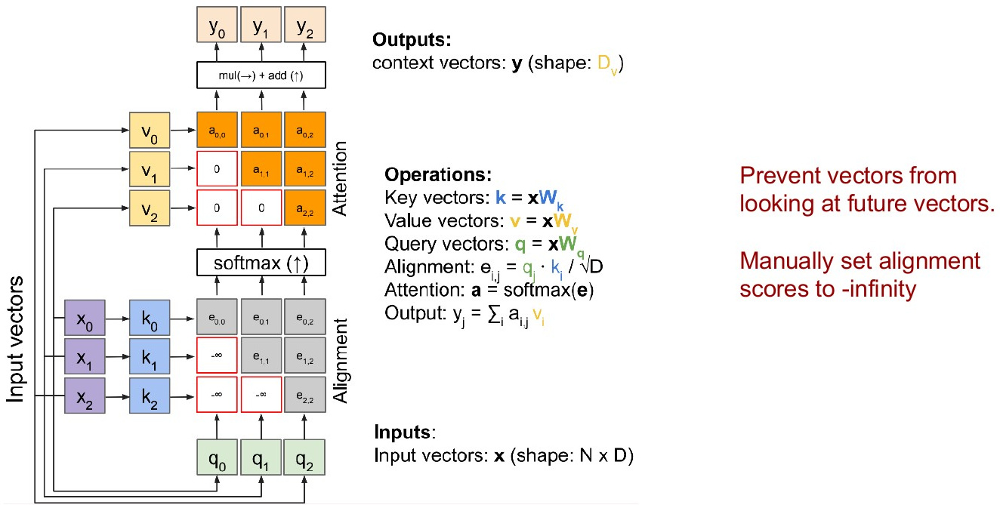

### 4.4 多头注意力

来源：第 52–53 页。

多个头采用独立投影，从不同子空间建立关系，然后合并。课件简图把输入分到各头、输出 Add or concatenate；标准多头形式为：

```math
\mathrm{head}_r=\mathrm{Attention}(X_QW_Q^{(r)},X_KW_K^{(r)},X_VW_V^{(r)}),\qquad
\mathrm{MHA}=\mathrm{Concat}(\mathrm{head}_1,\ldots,\mathrm{head}_h)W_O.
```

各头通常接收同一序列的不同可学习投影，而非只让某个头看到固定一部分词。相加是一种可选合并设计；经典 Transformer 使用拼接后输出投影。常见 $`d_k=d_v=d_{\mathrm{model}}/h`$，但不是数学必需条件。

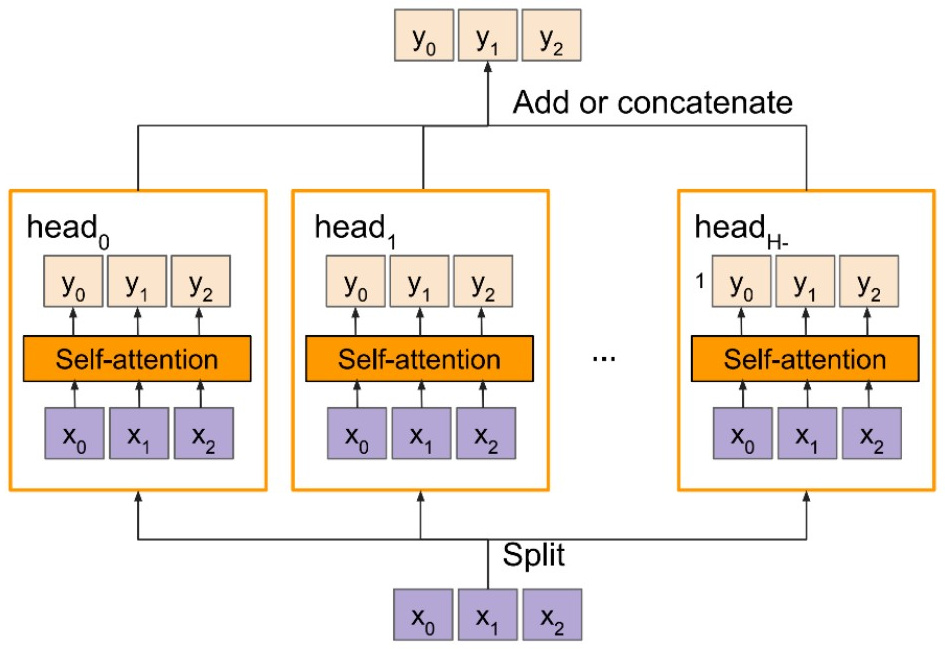

一般／交叉注意力可从不同来源获得 Q 与 K/V；自注意力三者来自同一序列。这是后文解码器读取图像上下文的关键区别。

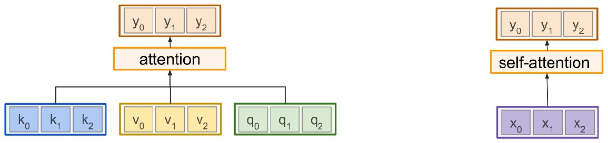

## 5. Transformer 编码器与描述解码器

来源：第 54–76 页，分步搭建图合并。

### 5.1 从循环依赖到并行计算

RNN/LSTM 按序更新隐藏状态，天然体现输入次序，也能处理较长序列；但下一步依赖上一步，训练的序列维难以完全并行。Transformer 用注意力直接连接任意可见位置，借助位置编码处理顺序。它适用于有序序列，也可构造面向无序集合的模型。全局关系、可并行训练是优势，稠密注意力的长度平方内存则是代价，不能据此断言任何任务都应替换 RNN。

图像描述的基本流程是：图像经 CNN 得到 H×W×D 网格特征，展平成视觉序列；编码器建模区域关系，解码器利用已经生成的词查询视觉特征，逐词预测描述。课件从 `[START] → person → wearing → hat` 的输入预测 `person → wearing → hat → [END]`。

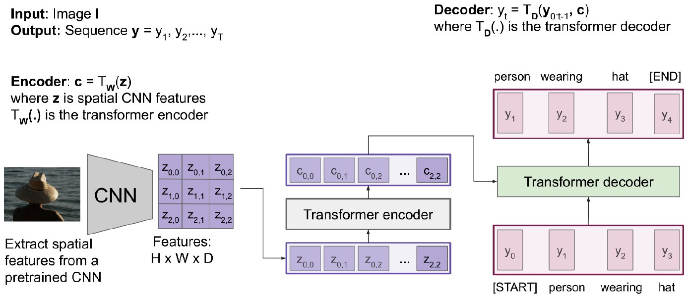

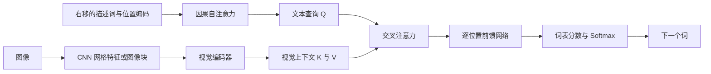

### 5.2 编码器：注意力、残差、归一化、前馈

课件使用原始 Transformer 的示意配置：堆叠 N=6 层，特征宽度 $`d_{\mathrm{model}}=512`$。这里 N 表示层数，与前面表示 token 数的 N 是不同语境。

每层先做多头自注意力，再做逐位置 MLP；每个子层后都有残差相加与 LayerNorm。按课件的 **Post-LN** 结构：

```math
H=\mathrm{LN}(X+\mathrm{MHA}(X,X,X)),\qquad
Y=\mathrm{LN}(H+\mathrm{FFN}(H)),
```

```math
\mathrm{FFN}(h)=\mathrm{ReLU}(hW_1+b_1)W_2+b_2.
```

残差分支的输出宽度须能与输入相加。LayerNorm 在单个 token 的特征维计算；FFN 对每个位置使用同一组参数，彼此不交换 token。因此本层中跨位置交换信息的是注意力。标准结构把位置编码加入初始输入一次，不是每经过一层都重新叠加一遍。图中的逐步展示不应理解成逐 token 串行执行。

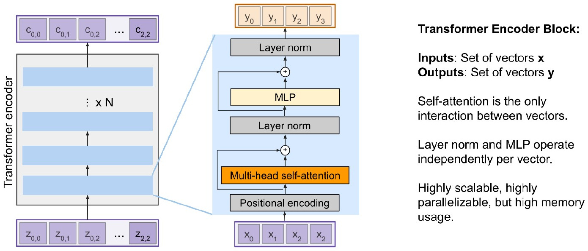

### 5.3 解码器：增加因果约束和交叉注意力

解码器同样可堆叠 6 层、使用 512 维表示。每层依次执行：

1. 对右移的文本输入做**有因果掩码的多头自注意力**，再 Add & Norm。
2. 文本隐藏状态作为 Q，编码后的图像序列作为 K/V，做**交叉注意力**，再 Add & Norm。
3. 逐位置 FFN，再 Add & Norm。

最终解码器栈的输出通过词表线性层与 Softmax，预测各位置的下一个词。词表映射位于整个解码器栈之后；不能把图的渐进叠加当成每层都必须生成最终词。训练使用全部右移真实词并行计算，推理逐步把预测词接回输入。

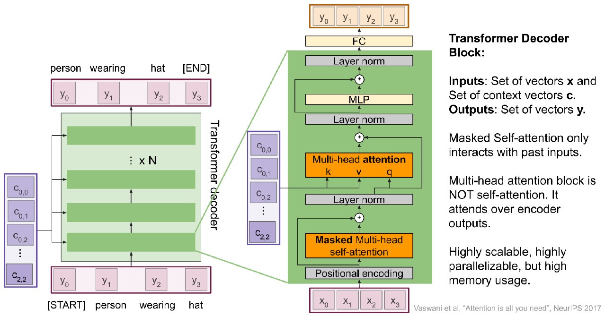

### 5.4 从 CNN 特征到直接图像块输入

第 73–75 页逐步移除 CNN，直接把图像划为块并编码成视觉序列，再接 Transformer 编码器和语言解码器。这里“直接”仍包含图像块划分、展平和向量映射；不是把未经表示的任意分辨率原始图像直接塞进词向量接口。具体图像块计算见[第八章](08-视觉Transformer与基础语言模型.md)。

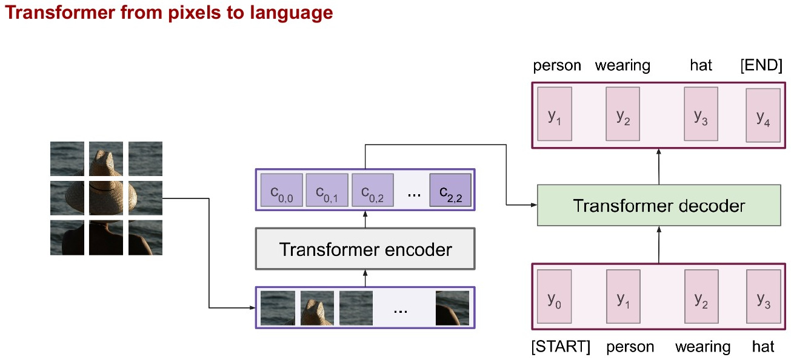

本节建立三个层次：RNN 注意力缓解固定上下文瓶颈；通用注意力成为可组合的计算模块；Transformer 以自注意力、归一化和前馈构成可扩展的序列网络。方法的实际效果仍取决于视觉特征、数据与训练。

## 6. 图像描述：区域、关系与层级结构

来源：第 77–86 页。

### 6.1 识别错误会传到语言输出

课件中的波士顿梗坐在桌前、面对蛋糕，模型却说“A dog is sitting on a couch with a toy”（狗坐在沙发上，旁边有玩具）。句子流畅并不保证被正确地视觉支撑。

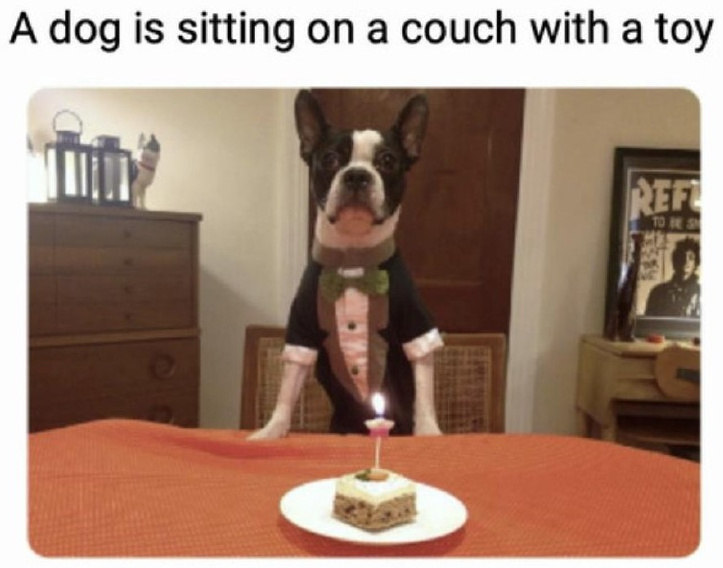

区域注意力可把均匀网格改为 Faster R-CNN 提取的候选区域特征，让描述器查询有语义的对象区域。图中即使使用了区域注意力，猫的示例仍出现 “seagull” 等错误预测，说明注意力可视化不能单独证明对象识别正确。

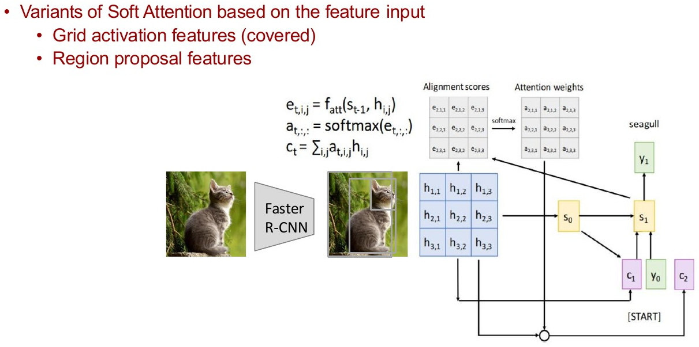

### 6.2 更好的检测有帮助，但对象与关系都要准确

毛绒熊坐在摆有餐具和食物的桌旁，原模型描述为“A close up of a stuffed animal on a plate”（盘子上毛绒玩具的特写），位置关系不正确。

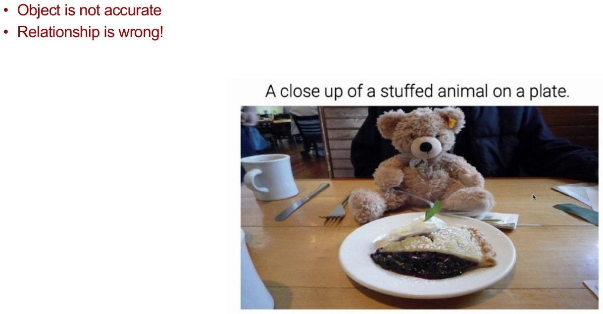

三张后续图展示检测特征如何改变描述：粗粒度检测把熊当成人，产生“一个人坐在桌前，桌上有三明治”；更密集的检测给出“泰迪熊坐在桌旁，桌上有一盘食物”；另一结果为“A Mr. Ted sitting at a table with a pie and a cup of coffee”。后一个名字是模型生成的称呼，不应据此认定图中人物／玩具的真实身份。

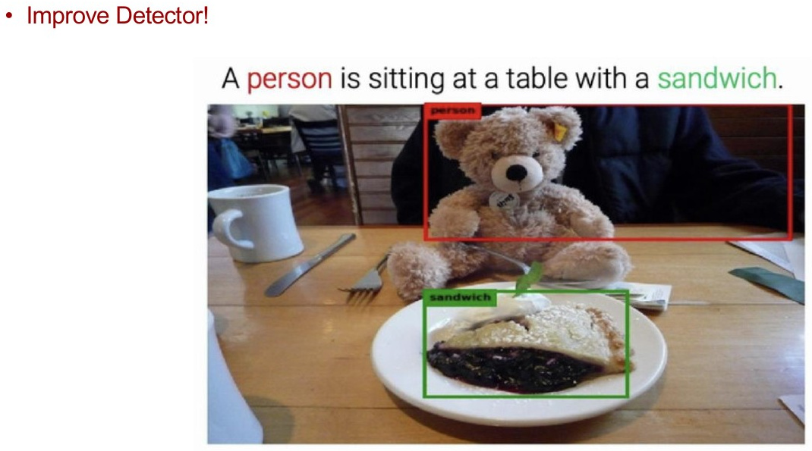

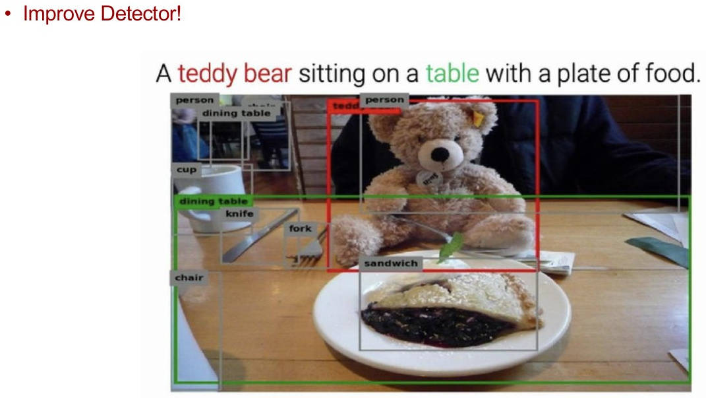

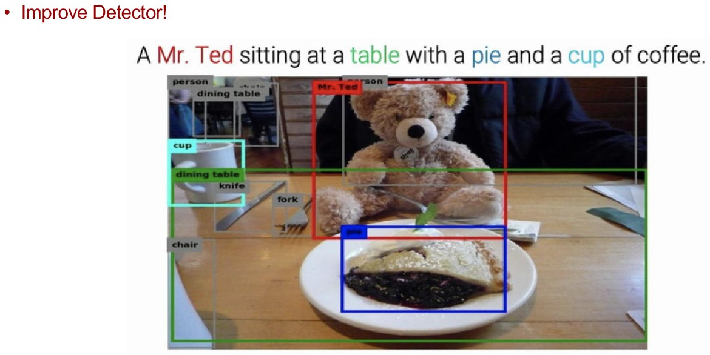

### 6.3 语义关系与空间关系图

课件按两类边组织检测对象：

- **语义关系图**：从 Visual Genome 的关系标注学习 20 类关系，例如彩虹在天空中、斑马吃草、人穿衬衫、人拿面包。关系是有方向和类型的，不能只保留“两个框相邻”。
- **空间关系图**：11 类关系。C1 表示包含在内，C2 表示覆盖／包含对方；未属于前两类且 IoU≥0.5 时归入 C3 重叠，其余情况按对象中心连线的八个方向划分 C4–C11。

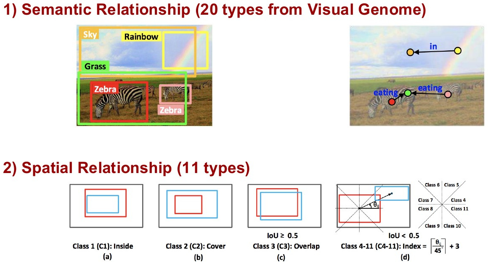

原图方向类别写为 $`\lceil\theta_{ij}/45^\circ\rceil+3`$。这需要配合 $`\theta\in(0,360^\circ]`$ 的角度约定；若允许 θ=0，该式会返回与重叠类冲突的 C3。**补充的边界写法**是先把角度归一化到 $`[0,360^\circ)`$，再令方向类别为 $`4+\lfloor\theta/45^\circ\rfloor`$；角度零方向和顺逆时针必须与训练标注一致。

### 6.4 关系 GCN 接描述器

Faster R-CNN 先得到对象区域，然后分别建立语义图与空间图；对应 GCN 传播对象间的关系，输出含上下文的区域表示。描述器既使用平均池化的全局向量，也以当前隐藏状态对区域向量加权注意。图中两层 LSTM 结合词嵌入 $`w_t`$、前一时刻高层隐藏状态、全局特征和注意力结果，预测下一个词 $`w_{t+1}`$。GCN 的归一化与邻域聚合基础见[第五章](05-自然语言处理导论.md)。

示例图包含 man、shirt、bread、kitchen 等节点，以及 wearing、holding、in 等关系；目标描述是“一个穿白衬衫的男人正在厨房做食物”。把对象间关系显式编码，目的是减少“检测到词，却连接成错误事件”的情况。

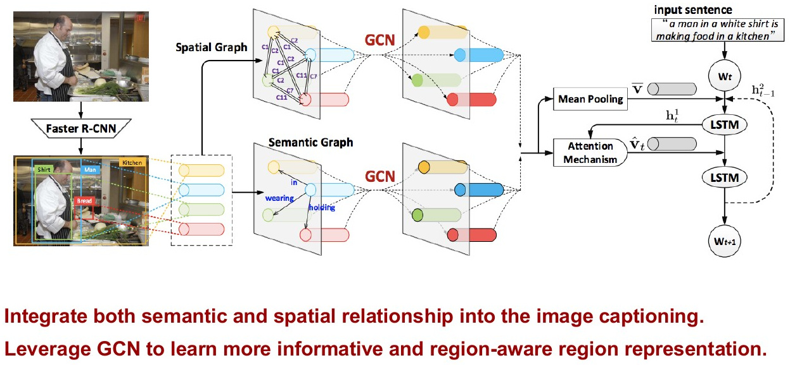

第 85 页的三组完整对比如下，原图保留英文逐词结果：

| 场景 | 人工参考 | 普通 LSTM | Up-Down | GCN-LSTM |
| --- | --- | --- | --- | --- |
| 两名男孩与球拍 | 两个小男孩正在玩网球拍 | 一个小男孩在打网球 | 两个男孩在网球场打网球 | 两个小男孩在场地上玩网球拍 |
| 女孩、购物车与伞 | 一个小女孩站在购物车里拿着伞 | 一个女人拿伞走在街上 | 一个小女孩在街上拿着伞 | 一个小女孩在购物车里拿着伞 |
| 斑马群与彩虹 | 一群斑马在有彩虹的田野吃草 | 一群斑马站在田野 | 一群斑马，天空有彩虹 | 一群斑马在田野吃草，天空有彩虹 |

这些是定性例子，表明关系可能改善人数、动作和空间定位，不能替代整个测试集的定量结论。

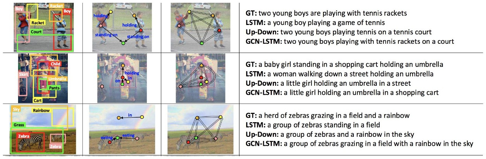

### 6.5 层级解析

第 86 页将表示进一步组织成**实例 → 区域 → 整图**的层次：实例分割给出对象实例；区域框组织局部组合；上层节点总结整幅图像。Tree-LSTM 沿层级结构整合信息，实例特征、区域特征与层级／全局特征共同支持描述。原图同时比较普通 Up-Down 和 GCN-LSTM 描述器接入层级表示的方式，保留其不同支路，不能把所有节点简化成同一层的对象图。

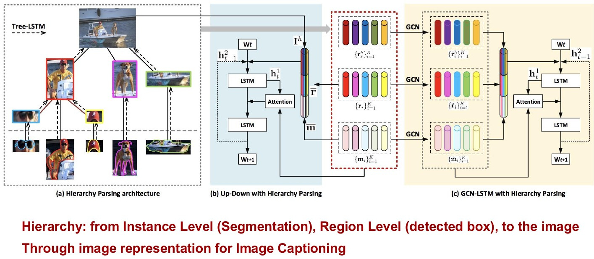

## 7. 图像描述的数据、评测与扩展任务

来源：第 87–92 页。

### 7.1 数据划分与词表

| 数据集 | 课件训练／验证／测试图像数 | 词表构造 |
| --- | --- | --- |
| MS COCO | 113K／5K／5K；另提到 40K 隐藏评测测试图像 | 训练集中出现至少 5 次的词，词表 9,587 |
| Flickr30k | 29K／1K／1K | 同样按最低词频筛选，词表 6,864 |

这里计数单位是图像，不是描述句数量。113K/5K/5K 是描述研究常见划分的课件近似数；40K 是另一个隐藏评测设置，不能相加后当作同一个训练划分。词表依赖分词和数据预处理，这两个大小是本课件实验配置。

第 88 页例子分别涉及：准备挥棒的击球手与裁判、停在高楼旁的大巴、马运草料并有两个人、狭窄房间中的上下铺与架子。原图保留对象、动作和空间关系的不同措辞，展示一幅图可以有多个合理参考句。

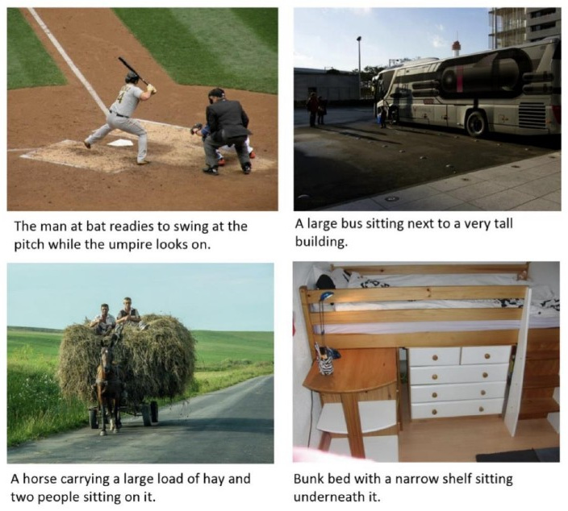

### 7.2 自动评测指标

| 指标 | 课件关注点 | 解读时的限制 |
| --- | --- | --- |
| BLEU | 生成句与参考句的 n-gram 匹配，重视精确率 | 措辞不同可能降低得分；不能当作视觉事实校验 |
| METEOR | 词级对齐，并考虑词序与匹配片段 | 比单纯匹配更细，但仍依赖参考句及匹配规则 |
| CIDEr | 用 TF-IDF 加权的 n-gram 衡量与多个人工描述的一致性 | 强调相对有信息量的词组，不等同于人工总体偏好 |
| SPICE | 把描述解析为对象、属性、关系等语义元组进行比较 | 更关注语义图，结果仍受解析器影响 |

应同时审查生成句是否覆盖关键对象、属性、动作与关系，是否出现幻觉和偏见。分数高也不保证每一句都忠实。

### 7.3 Dense Image Captioning

从“一幅图一句话”扩展为“多个区域各一句话”，同时输出区域定位与局部描述。课件餐桌图包括小碗酱汁、盘中食物、一碗汤、摆有食物的桌子、巧克力碗、盛红酱的蓝碗、一杯水、一片肉等；区域重叠并不意味着描述必然重复，因为对象层次和内容粒度不同。原图还有不完整的 “a silver metal” 文本，保留在图内，不补造缺失名词。

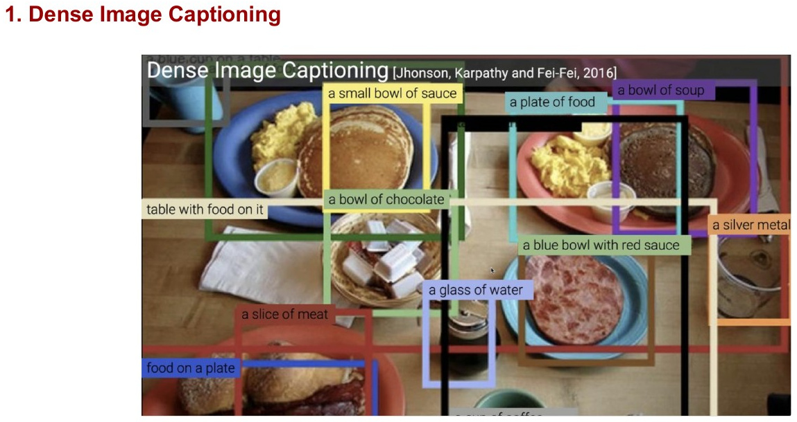

### 7.4 Novel Object Captioning 与 nocaps

训练描述数据未必包含测试时遇到的全部对象名称。课件比较 COCO 的 80 类、约 118K 训练图像，与 Open Images 的 600 类、约 1.9M 检测图像；后者用于对象检测知识，不能误当作同量的人工描述训练数据。

新增对象例子包括山羊、洋蓟、手风琴、海豚、华夫饼、气球。nocaps 将评测图像区分为：in-domain，以 COCO 对象为主；near-domain，已见与新对象混合，例如人与手风琴；out-of-domain，主要涉及 COCO 类别之外的对象，例如海豚场景。图中训练描述例为海滩长椅旁的狗、沙发上拿伞的小孩，借此对比检测知识与描述词汇覆盖的差异。

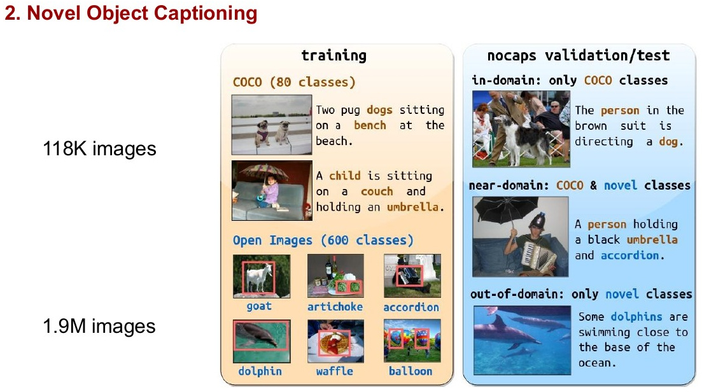

### 7.5 多风格描述

同一张狗在水边的图，课件给出事实、幽默、浪漫、正面、负面五种风格：

| 风格 | 原例中文整理 |
| --- | --- |
| Factual | 一只棕色的狗正在水边喝水 |
| Humorous | 狗把腿伸入池塘，好像害怕水 |
| Romantic | 棕色的狗小心踏进浑水，随后游回主人身边 |
| Positive | 可爱的狗在宁静的水边喝水 |
| Negative | “黑色、难看的狗在喝脏水” |

后几句带有主观修饰或图像未能支持的故事；负面句还把棕色改成黑色。“难看”等词是原课件的风格示例，不能作为客观标注。风格控制应与事实一致性分别评测。

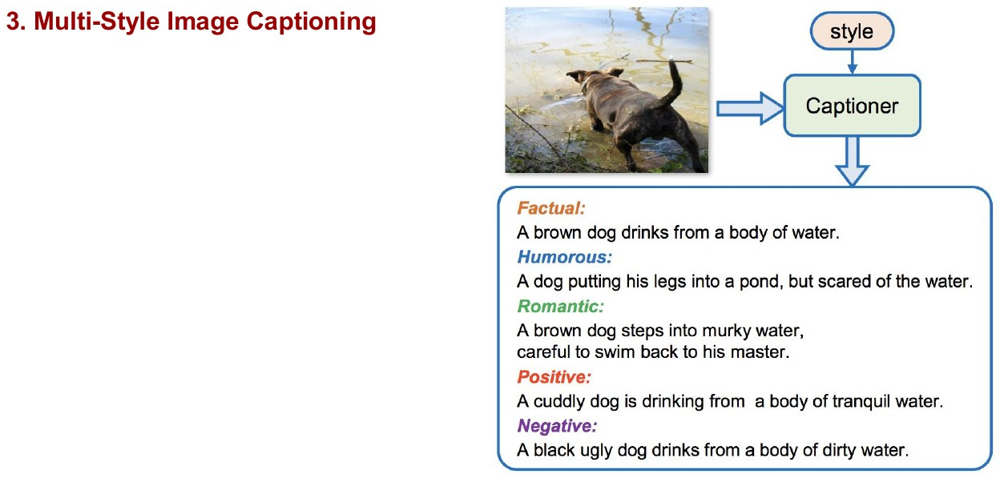

## 8. 视频描述与密集事件描述

来源：第 93–97 页。

### 8.1 从单帧内容到时空表示

课件视频的逐帧描述包括“一个人在弹钢琴”“一群人站在房间里”“一个男人在弹钢琴”“人们在鼓掌”；整个视频则可概括为“老人在大厅里、众人面前弹钢琴”。逐帧句子并置不会自动得到事件顺序、动作持续时间和全局故事。

常用组件包括：用 2D CNN 提取单帧特征，用 3D CNN 提取短片段时空特征；平均池化或时间编码聚合；空间／时间的软或硬注意力选择信息；LSTM 编码器和 Seq2Seq 建模时间顺序；语义属性作为辅助线索。视频特征既可在解码第一步注入，也可每步提供；描述器可采用堆叠 LSTM。不同支路是可选设计，不是每个模型都同时采用。

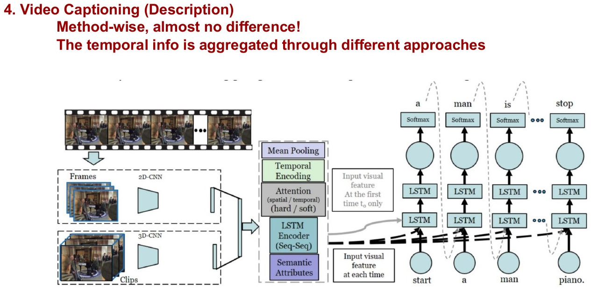

### 8.2 Dense Video Captioning

输出从整段视频一句话变为若干事件三元组 $`(t_{\mathrm{start}},t_{\mathrm{end}},\mathrm{caption})`$，要求找到事件的起止时间并给出描述。课件钢琴场景依次包含：老人面对人群弹琴；一位女士走近钢琴并说话；女士配合钢琴演唱；另一位男子跳舞吸引注意；老人演奏结束，拥抱女士，众人鼓掌。原图没有给出可可靠抄录的精确秒数，因此不添加时间戳数值。

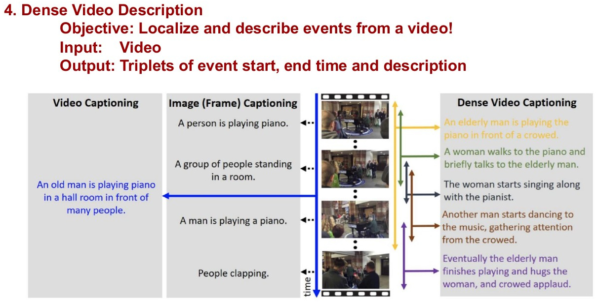

训练结构由事件 proposal 与 caption 两个模块组成：最初可分别训练；共享视觉编码器后可交替优化；更紧密的端到端训练让描述损失也影响事件提议分支。图中红色回传箭头表达这一目的，不足以说明任意离散裁剪或筛选操作都天然可微。

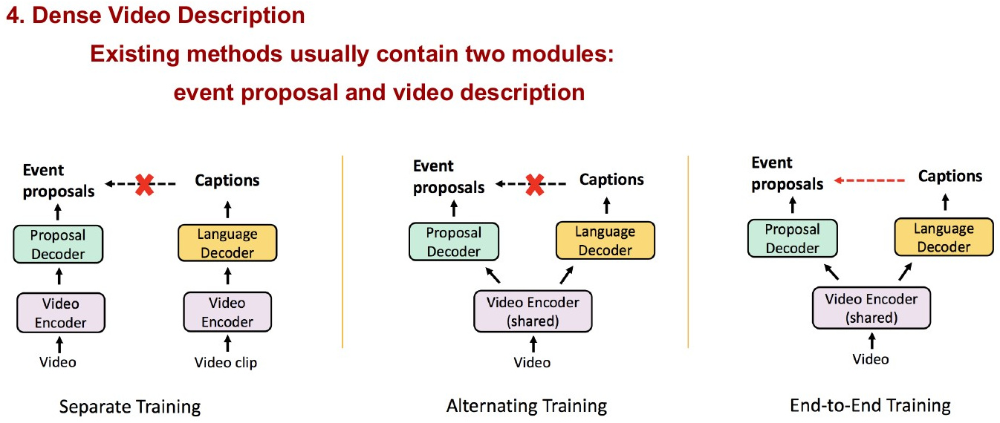

### 8.3 评估改进方向

课件总结的风险包括对象识别失败、语言幻觉、数据与表达偏见。改进需要更好的视觉表示与对象 grounding，检查关系和时间顺序，使用更贴近人类判断的评测，并审查可解释性与跨场景泛化。课件对当时实用成熟度的判断应视为课程讨论，不推广为所有后续模型的现状。

返回[笔记目录](../README.md)，继续[第八章：视觉 Transformer 与基础语言模型](08-视觉Transformer与基础语言模型.md)。
