# 第八章：视觉 Transformer 与基础语言模型

来源：`8_Introduction_MML_part3_26.pdf`，共 71 页；作者：刘洋（Yang Liu）。页码均为 PDF 页序号。分步出现的结构、训练过程和重复路线图合并。模型配置与实验数据保留其历史版本和实验条件，不作为当前产品规格或排行榜。

本章沿三条线展开：ViT 如何把图像变成 token；BERT 与 GPT 如何预训练、迁移和使用上下文；LLaMA 系列如何组织数据、对齐训练与高效适配。第 2、71 页列出的多模态模型只有名称，见章末说明。

## 1. 从像素到图像块：ViT

来源：第 3–20 页。第 3 页的 Pixels to language 与[第七章第 5 节](07-多模态对齐-注意力与图像描述.md)合并。

### 1.1 为什么不把每个像素都作为一个 token

R×R 图像有 $`N=R^2`$ 个像素 token。一个头的全注意力矩阵有 $`N^2=R^4`$ 个元素。按课件的 128×128、48 层、每层 16 个头，若保存 float32 注意力矩阵：

```math
N=128^2=16\,384,\qquad N^2=268\,435\,456,
```

```math
48\times16\times128^4\times4
=824\,633\,720\,832\ \mathrm{bytes}=768\ \mathrm{GiB}.
```

这是单个样本、全部层和头的一份稠密注意力矩阵的估算，不包含参数、梯度和其他激活；也未表示任何实现都一定同时保存这些矩阵。课件记为 768GB，按二进制单位应写 768GiB。若同样保存为 16 位，矩阵本身约 384GiB。

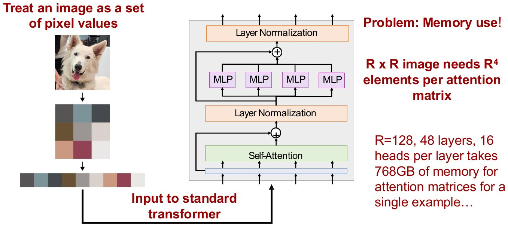

### 1.2 图像块、投影、位置与分类 token

ViT 将图像划成不重叠 P×P 图像块；每块有 C 个通道，展平为 $`P^2C`$ 维，再线性投影成 D 维 token。224×224×3 图像、P=16 时，一块为 16×16×3=768 维，共 14×14=196 块。D 是模型宽度，不必等于 768。

加入可学习的位置嵌入和一个可学习的 `[CLS]` token，送入 Transformer 编码器；用 CLS 的最终表示接 MLP／分类头，输出 C_class 个类别分数。原图把分类 token 画在一端，实际实现常放在序列首部；关键是训练和位置索引一致。ViT 是编码器分类模型，不需要语言解码器。

```math
z_0=[x_{\mathrm{cls}};x_p^1E;\ldots;x_p^NE]+E_{\mathrm{pos}},\qquad
N=(R/P)^2.
```

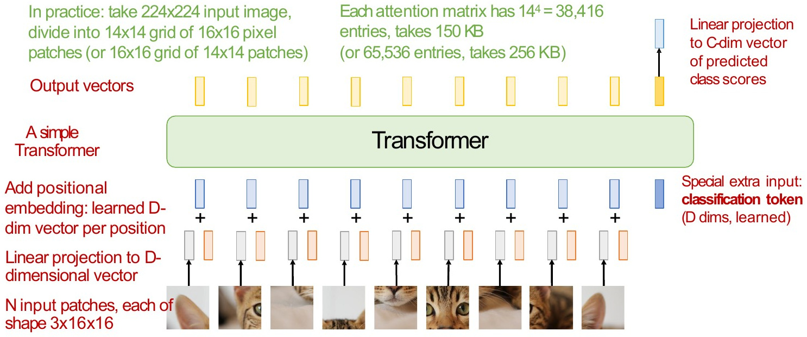

图像块使注意力矩阵大幅缩小：

| 224×224 图像的块大小 | 块网格／数量 | 不含 CLS 的单头矩阵元素 | float32 单头存储 | 48 层×16 头的矩阵存储 |
| --- | --- | --- | --- | --- |
| 16×16 | 14×14／196 | 14⁴=38,416 | 150.0625 KiB | 112.546875 MiB |
| 14×14 | 16×16／256 | 16⁴=65,536 | 256 KiB | 192 MiB |

加入 CLS 后分别是 197²=38,809、257²=66,049 元素。上表保留课件忽略 CLS 的比较口径。块越小、token 越多，全注意力计算和矩阵存储增加；这并不表示参数一定更多，同宽骨干的块投影输入维度反而随块面积减小。

### 1.3 ViT 的规模与数据依赖

模型名 ViT-B/L/H 分别指 Base、Large、Huge；斜线后是图像块边长，如 ViT-B/16。对比对象包含 BiT 的 ResNet-152×4。课件随训练数据规模展开结果：

- ImageNet-1K 约 1.2M 图像：在原始训练配方下，ViT 可能弱于具有局部归纳偏置的 ResNet。
- ImageNet-21K 约 14M 图像：大规模预训练缩小差距，大 ViT 可与大 ResNet 匹配。
- JFT-300M：进一步扩大数据后，ViT 显示更强的规模收益。
- 图中训练代价示例约为 ViT 2.5K、ResNet 9.9K TPUv3 core-days。这是特定硬件、配方和目标的历史实验，不能推出任何矩阵乘法都比卷积快，或所有数据规模下 ViT 都更省算力。

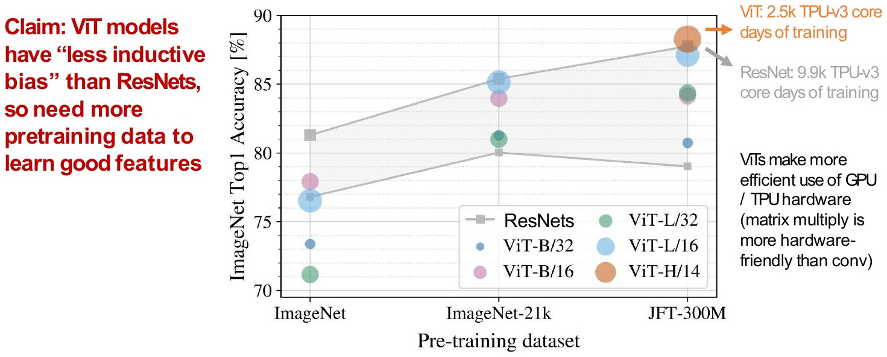

ViT 的局部性和层次结构先验弱于典型 CNN，因此数据量、增强和正则化尤其关键。它仍有图像块划分、位置编码等结构假设，不能称为“完全没有归纳偏置”。原始方法与配置见 [ViT 论文](https://arxiv.org/abs/2010.11929)。

## 2. 数据增强、正则化与知识蒸馏

来源：第 21–36 页。

### 2.1 强配方并非对所有模型都同样有利

课件讨论 weight decay、stochastic depth、FFN dropout、MixUp 和 RandAugment。Ti/S/B/L 表示 Tiny/Small/Base/Large；R+模型名表示 ResNet 与 Transformer 的混合骨干，例如 R26+S、R50+L，先用卷积块生成特征，再送入 Transformer。

第 27 页热图采用 ImageNet-1K、300 epochs；增强强度从 None、Light1/2、Medium1/2 到 Heavy1/2。两组分别是 No regularization 和 Regularization (0.1)。图没有逐项注明 0.1 对应哪项正则参数，不把它扩写成“所有正则化强度均为 0.1”。下表保留各格整数结果，单位为准确率百分数。

| 模型 | 无正则：None/L1/L2/M1/M2/H1/H2 | 正则 0.1：None/L1/L2/M1/M2/H1/H2 |
| --- | --- | --- |
| RTi | 69 / 73 / 73 / 72 / 70 / 69 / 68 | 71 / 70 / 67 / 65 / 63 / 62 / 61 |
| Ti/16 | 72 / 76 / 75 / 75 / 74 / 72 / 71 | 71 / 72 / 68 / 65 / 63 / 63 / 62 |
| S/32 | 64 / 71 / 76 / 76 / 76 / 74 / 74 | 70 / 72 / 72 / 71 / 71 / 69 / 68 |
| S/16 | 71 / 77 / 79 / 81 / 82 / 80 / 80 | 76 / 79 / 80 / 79 / 79 / 77 / 77 |
| B/32 | 63 / 70 / 73 / 75 / 76 / 75 / 76 | 69 / 74 / 77 / 77 / 78 / 77 / 77 |
| R26S | 72 / 76 / 78 / 79 / 80 / 80 / 80 | 75 / 78 / 81 / 82 / 82 / 81 / 81 |
| B/16 | 70 / 76 / 79 / 79 / 81 / 80 / 80 | 76 / 79 / 81 / 82 / 83 / 82 / 82 |
| L/16 | 69 / 76 / 77 / 78 / 78 / 76 / 74 | 74 / 78 / 78 / 78 / 79 / 77 / 77 |
| R50L | 70 / 75 / 76 / 77 / 77 / 76 / 76 | 75 / 78 / 78 / 78 / 79 / 77 / 77 |

原图另标出原论文 B/16 的 77.9、L/16 的 76.53。B/16 在图中可从无正则最佳约 81 提升到 83；小模型在过强增强与正则下也会明显下降。因此“通常有帮助”需要结合模型容量与配方选择，不是单调规律。

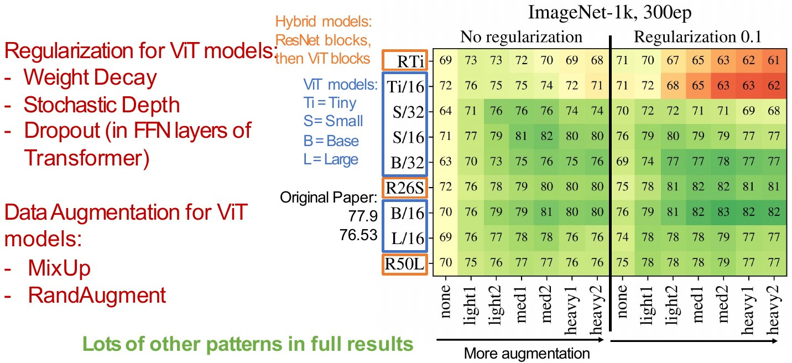

### 2.2 教师的软目标

知识蒸馏让学生同时学习人工标签和教师的输出分布。课件二分类例中，教师对猫给出 (0.9,0.1)，对狗给出 (0.1,0.9)；学生对狗给出 (0.2,0.8)。软分布还包含非目标类别的相对关系，比只给 argmax 更丰富。

设教师分布 p、学生分布 q，常用匹配目标是：

```math
\mathcal L_{\mathrm{KD}}=\mathrm{KL}(p\Vert q)
=\sum_c p_c\log\frac{p_c}{q_c}.
```

教师固定时，最小化该 KL 与最小化软标签交叉熵 $`-\sum_c p_c\log q_c`$ 对学生的梯度一致。上面的狗例中，KL≈0.036690；学生对人工狗标签的交叉熵为 $`-\log0.8\approx0.223144`$。教师对猫标签的交叉熵为 $`-\log0.9\approx0.105361`$。这三者含义不同，不能混用数值。

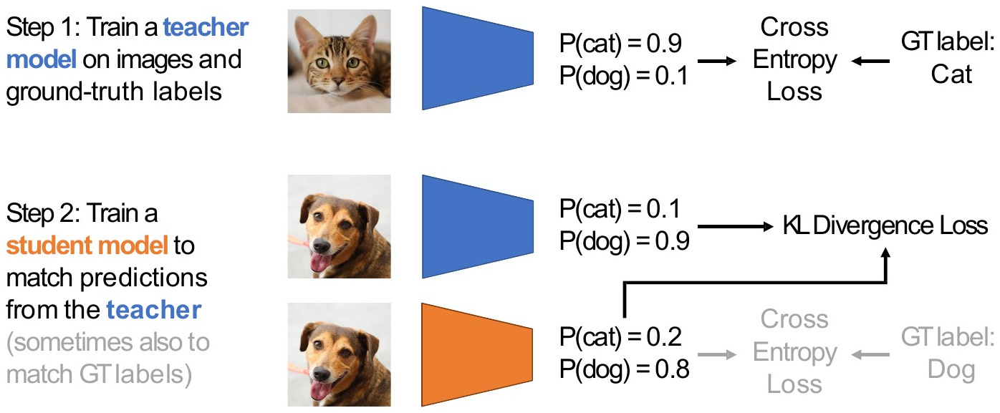

第 33 页的温度形式为：

```math
p_c^{(T)}=\frac{\exp(z_c^{\mathrm{teacher}}/T)}{\sum_j\exp(z_j^{\mathrm{teacher}}/T)},\qquad
q_c^{(T)}=\frac{\exp(z_c^{\mathrm{student}}/T)}{\sum_j\exp(z_j^{\mathrm{student}}/T)}.
```

T 较大时分布更平滑。**补充常用的联合损失写法**：$`\mathcal L=(1-\lambda)\mathrm{CE}(y,q^{(1)})+\lambda T^2\mathrm{KL}(p^{(T)}\Vert q^{(T)})`$。T² 是常用梯度尺度补偿，不是每种蒸馏都必须采用；训练应阻断教师梯度。教师／学生式学习也可用于无标签学习，但普通有监督教师蒸馏本身不等于自监督，后者可对照[第六章 DINO](06-多模态表示学习-融合协调与分解.md)。

### 2.3 分类 token 与蒸馏 token

ViT 可同时放入两个可学习 token：CLS 用人工类别监督；distillation token 用教师预测监督。它们共享视觉 Transformer，但各有预测头，使学生在共享表示中吸收教师知识。软目标或教师硬预测是不同蒸馏选择，不能把图简化为新增一个人工类别。

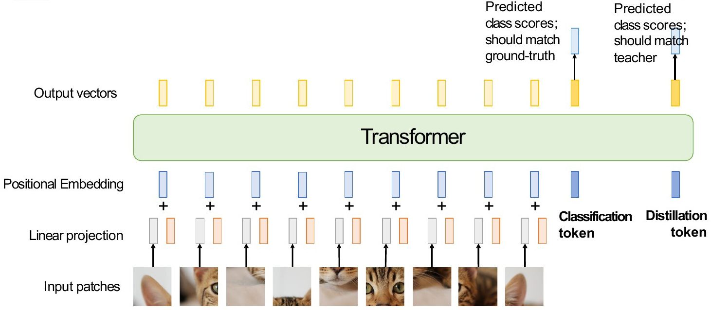

课件页脚把 token 结构也归到 Hinton 等人 2015 年的蒸馏论文；该论文介绍蒸馏思想，而此处专门的 ViT distillation token 对应 [DeiT 论文](https://arxiv.org/abs/2012.12877)。

第 35–36 页柱图依次加入蒸馏、更长训练和更高分辨率：原始约 77.9%，蒸馏后约 83%，训练由 300 延长到 1000 epochs 后约 84%，分辨率从 224² 增至 384² 后约 85%。中间柱没有精确数值标注，以上为读图近似；每一步同时改变了训练预算，不能归因成纯粹架构收益。

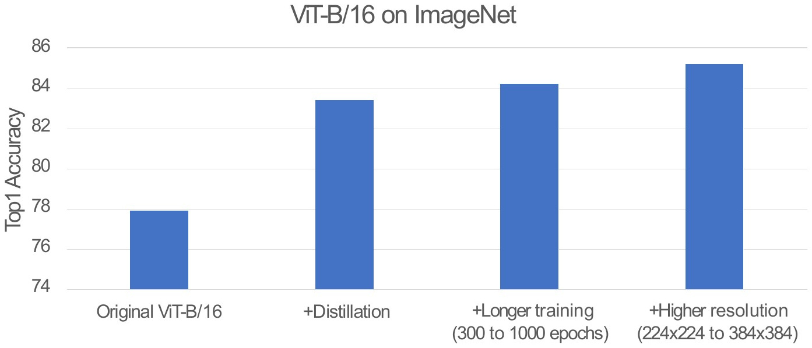

## 3. BERT：双向编码与任务迁移

来源：第 38–42 页；第 37 页为 NLP 路线分隔。

### 3.1 预训练和微调

BERT 用 Transformer **编码器**生成上下文相关的 token 表示。预训练采用 MLM 与 NSP；微调保留预训练参数，接任务头并更新参数，可用于自然语言推断、句子分类、问答、命名实体识别等。原图包括 NLI、NER、QA；同一个编码器的输出接法随任务变化。

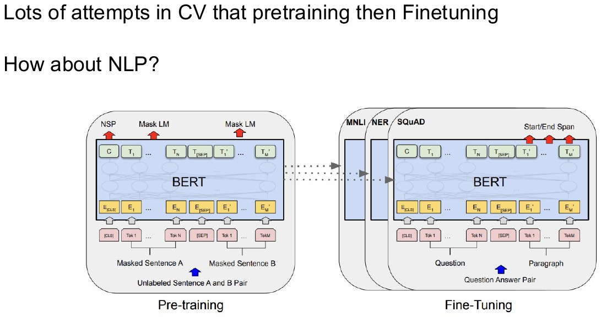

### 3.2 输入的三种嵌入相加

完整示例为 `[CLS] my dog is cute [SEP] he likes play ##ing [SEP]`，共 11 个 WordPiece token。每个输入向量为 token embedding、segment embedding、position embedding 之和：

```math
x_i=E_{\mathrm{token}}(u_i)+E_{\mathrm{segment}}(s_i)+E_{\mathrm{position}}(i).
```

位置 0–5 使用句段 A，位置 6–10 使用句段 B；位置嵌入为可学习查表，图中索引 0–10。`##ing` 是 WordPiece 子词，不是一个额外完整单词；CLS 汇总分类信息，SEP 分隔句段。

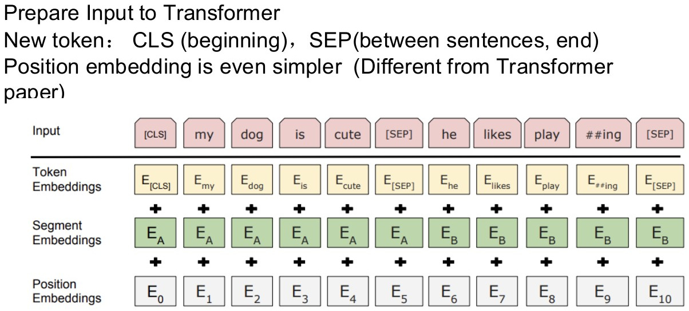

### 3.3 MLM 与 NSP 的监督位置

课件图以 BERT-Base 的 12 层编码器为例，不能推广为所有 BERT 都是 12 层。

**MLM** 先选约 15% 的输入 token 作为预测目标；在这些被选中的 token 中，80% 替换为 `[MASK]`，10% 换为随机 token，10% 保持原样。对应全部 token 的期望占比分别是 12%、1.5%、1.5%。损失只在选中的位置计算，包括其中保持原样的位置，而不是只计算真正出现 MASK 的位置：

```math
\mathcal L_{\mathrm{MLM}}=-\sum_{i\in\mathcal M}\log P(u_i\mid\widetilde U),
```

其中 $`\mathcal M`$ 是目标位置集合，$`\widetilde U`$ 是扰动后的输入。预测位置能读取左右上下文，因此它与单向下一词预测不同。

**NSP** 用约 50% 的真实后续句与 50% 随机句构造 IsNext/NotNext 分类，使用 CLS 的表示预测句对关系。MLM 预测头包含全连接变换、非线性、LayerNorm 和词表 Softmax。课件写 ReLU；原始 BERT 的默认激活是 GELU，见[官方模型实现](https://github.com/google-research/bert/blob/master/modeling.py)与[BERT 论文](https://aclanthology.org/N19-1423/)。

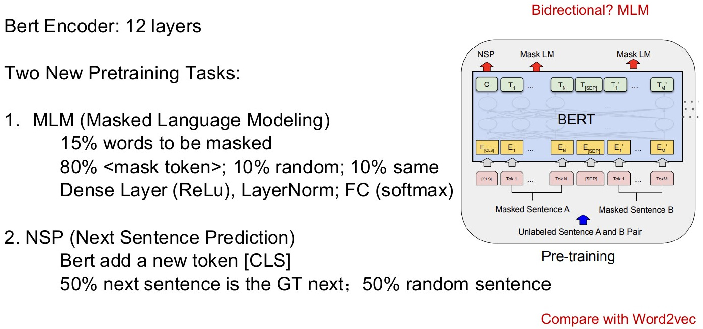

与 word2vec 的固定词向量相比，同一个词在 BERT 中会随上下文改变表示。双向上下文也不表示预测时可以看到未扰动的目标答案，目标 token 必须按训练规则处理。

### 3.4 不同下游任务的输出头

| 类型 | 课件任务 | 输入与输出 |
| --- | --- | --- |
| 句对分类／回归 | MNLI、QQP、QNLI、STS-B、MRPC、RTE；SWAG 采用候选配对 | 两段文本加 SEP，CLS 表示接分类／回归头 |
| 单句分类 | SST-2、CoLA | 单段文本的 CLS 接分类头 |
| 抽取式问答 | SQuAD v1.1 | 问题和段落联合编码，对段落 token 预测答案起点、终点 |
| 序列标注 | CoNLL-2003 NER | 每个 token 接实体标签头，例如 O、B-PER；保留子词与标签的对齐约定 |

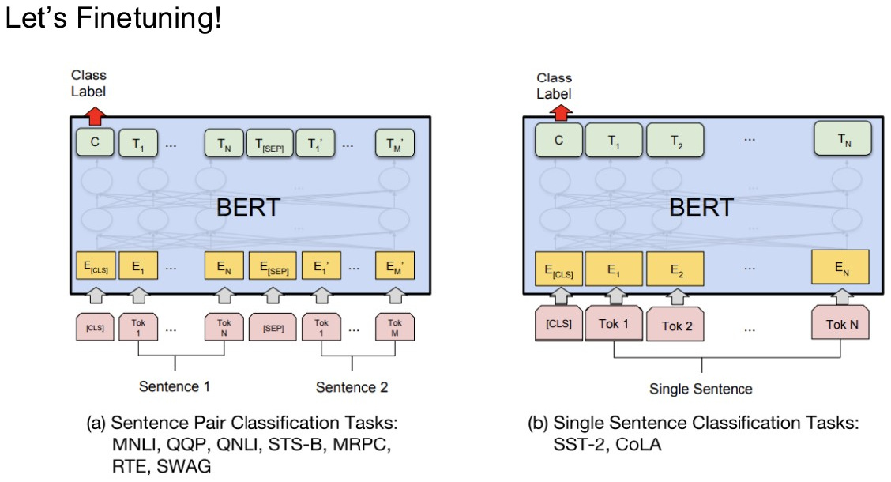

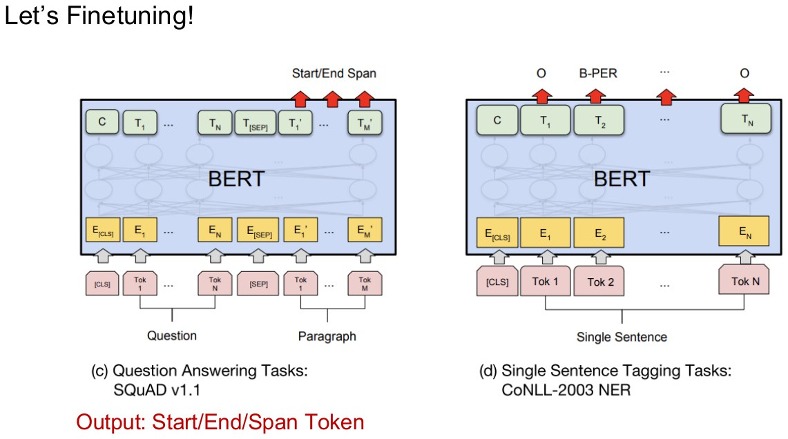

## 4. GPT-1 与 GPT-2：自回归预训练和文本任务接口

来源：第 43–48 页。

### 4.1 GPT-1 的目标与结构

GPT-1 使用 12 层 Transformer **解码器式因果网络**，宽度 768，使用 GELU，以预测下一个 token 做预训练，随后对分类等任务微调。课件把规模写为 1.17B；应为约 **117M=0.117B**，相差十倍。模型结构与预训练目标见 [GPT-1 原论文](https://cdn.openai.com/research-covers/language-unsupervised/language_understanding_paper.pdf)。

给定无标签序列 $`U=(u_1,\ldots,u_n)`$、上下文窗口 k，最大化：

```math
\mathcal L_1(U)=\sum_i\log P(u_i\mid u_{i-k},\ldots,u_{i-1};\Theta).
```

等价的训练损失是它的负数。课件使用的表示流程为：

```math
h_0=UW_e+W_p,\qquad
h_l=\mathrm{TransformerBlock}(h_{l-1}),\quad l=1,\ldots,L,
```

```math
P(u)=\mathrm{softmax}(h_LW_e^\top).
```

这里 U 在矩阵式中表示输入 one-hot 编码，$`W_e`$ 是词嵌入，$`W_p`$ 是位置嵌入；最后用转置嵌入做词表映射，体现权重绑定。块的层索引用 l，不能把逐层公式误写成对所有 token i 都是同一个下标。

训练语料为 BooksCorpus，约 7,000 本未出版图书、约 800M 词；上下文 512，batch 为 32 个序列。这些是课件的 GPT-1 历史配置。

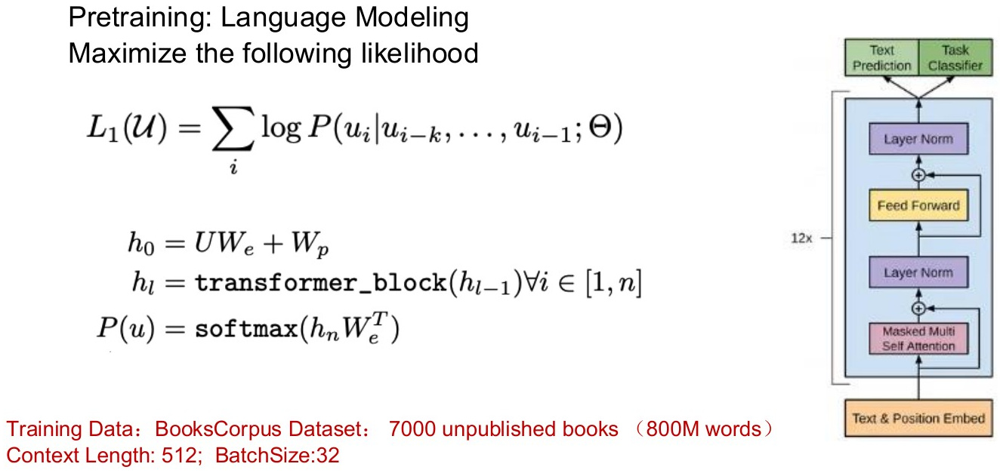

### 4.2 四种任务如何改写输入

| 任务 | 课件输入格式与预测方式 |
| --- | --- |
| Classification | `[Start] Text [Extract]`，Extract 位置的表示接线性分类器 |
| Entailment | `[Start] Premise [Delim] Hypothesis [Extract]`，预测蕴含关系 |
| Similarity | Text1/ Text2 和 Text2/ Text1 两种次序分别送入共享 Transformer，再合并表示做预测 |
| Multiple Choice | 每个候选分别构造 Context、Delim、Answer、Extract，使用共享模型评分，选择最高候选 |

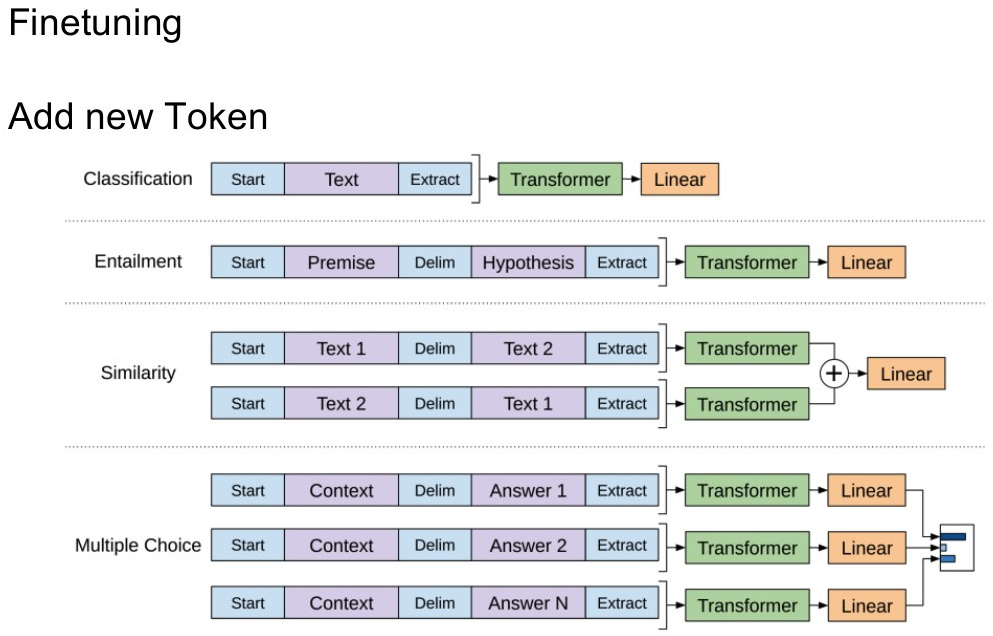

### 4.3 GPT-2 的改变

GPT-2 把任务条件也写进文本，学习 $`P(\mathrm{output}\mid\mathrm{input},\mathrm{task})`$。例如把翻译要求、法语文本和预期英语续写放在同一上下文内，使多任务行为由文本条件表达。任务条件不一定是独立的特殊 token；“GPT-1 不能使用提示”也不是网络结构上的硬性限制，差别在训练和评测范式。

结构与训练配置包括：将 LayerNorm 移到子层之前，即 Pre-LN；栈末尾再增加最终 LN；残差路径初始化按层数缩放，课件记 $`1/\sqrt N`$；词表 50,257；上下文从 512 扩到 1,024；batch 增至 512。最终 LN 位于最后的 Transformer 块之后，不是“每次自注意力之后额外做最终 LN”。

| 课件报告参数量 | 层数 | 模型宽度 |
| --- | --- | --- |
| 117M | 12 | 768 |
| 345M | 24 | 1,024 |
| 762M | 36 | 1,280 |
| 1,542M | 48 | 1,600 |

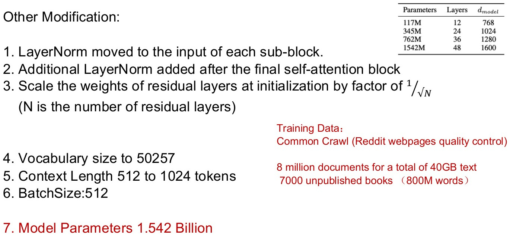

**训练数据校正**：GPT-2 使用 WebText，约 8M 文档、40GB 文本，由 Reddit 出站链接筛选网页构建；课件中的 Common Crawl 和“7,000 本图书”不能作为这次 GPT-2 训练语料描述，后者来自 GPT-1。依据 [GPT-2 原论文的数据章节](https://cdn.openai.com/better-language-models/language_models_are_unsupervised_multitask_learners.pdf)。

第 48 页的阅读理解 CoQA（F1）、翻译（BLEU）、摘要（ROUGE）和问答（准确率）曲线展示模型变大时多个指标改善。不同纵轴不能直接相加，几个规模点也不能单独证明所有任务都服从同一个精确幂律。

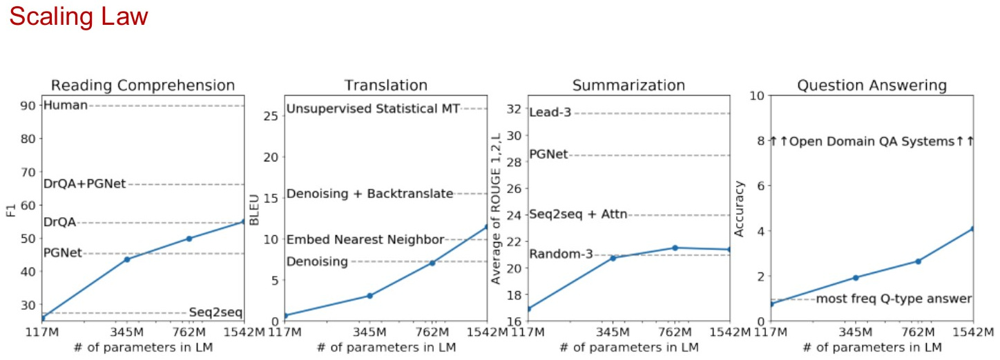

## 5. GPT-3：上下文学习、模型规模与评测

来源：第 49–54 页。

### 5.1 Zero-shot、One-shot、Few-shot 与微调

- Zero-shot：仅给任务说明与待回答输入，不提供该任务的示范答案。
- One-shot：上下文内加一组输入／输出示范。
- Few-shot：上下文内给多组示范，再让模型续写待回答项。
- Fine-tuning：用任务样本做梯度更新，改变参数。

前三者是上下文学习：改变当前输入，**不做该次任务的梯度更新**。课件英法翻译例中 “sea otter → loutre de mer” 用来说明任务条件和示范形式。上下文学习可帮助模型识别任务和映射规律，但不能仅由结果断定它是在推理时从零学会了整项能力。

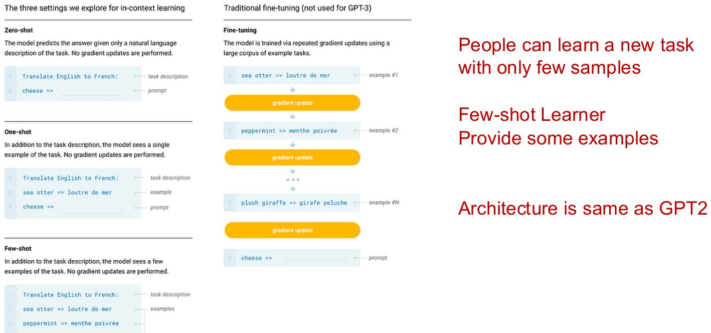

GPT-3 大体沿用 GPT-2 的架构、Pre-LN 与初始化，但原论文还交替采用稠密与局部带状稀疏注意力。因此课件的“same architecture”是概述，不表示每层配置完全相同。配置的来源为 [GPT-3 原论文表 2.1–2.2](https://arxiv.org/pdf/2005.14165)。

### 5.2 八种规模与数据混合

下表逐项保留课件及原论文所报告的配置；batch 单位是 **token**，M=百万，不是序列数。

| 模型 | 参数量 | 层数 | d_model | 头数 | d_head | batch token | 学习率 |
| --- | --- | --- | --- | --- | --- | --- | --- |
| Small | 125M | 12 | 768 | 12 | 64 | 0.5M | 6.0×10⁻⁴ |
| Medium | 350M | 24 | 1,024 | 16 | 64 | 0.5M | 3.0×10⁻⁴ |
| Large | 760M | 24 | 1,536 | 16 | 96 | 0.5M | 2.5×10⁻⁴ |
| XL | 1.3B | 24 | 2,048 | 24 | 128 | 1M | 2.0×10⁻⁴ |
| 2.7B | 2.7B | 32 | 2,560 | 32 | 80 | 1M | 1.6×10⁻⁴ |
| 6.7B | 6.7B | 32 | 4,096 | 32 | 128 | 2M | 1.2×10⁻⁴ |
| 13B | 13B | 40 | **5,140（原表）** | 40 | 128 | 2M | 1.0×10⁻⁴ |
| 175B | 175B | 96 | 12,288 | 96 | 128 | 3.2M | 0.6×10⁻⁴ |

13B 的原表宽度 5,140 与 40×128=5,120 不相等，GPT-3 原论文表中也印为 5,140；XL 的头数×头维度也不同于模型宽度。因此此处保留报告值并提示核对，**不把自行算出的 5,120 冒充已验证的原模型配置**。一般注意力投影维度本可与残差宽度不同，不能仅凭不相等就判定每一项必然错印。

全部模型的上下文为 2,048 token，训练总量约 300B token；175B 的 batch 是 3,200K=3.2M token。数据混合如下：

| 数据源 | 原始 token 量 | 混合权重 | 课件报告的训练遍历量 |
| --- | --- | --- | --- |
| 过滤后的 Common Crawl | 410B | 60% | 0.44 epochs |
| WebText2 | 19B | 22% | 2.9 epochs |
| Books1 | 12B | 8% | 1.9 epochs |
| Books2 | 55B | 8% | 0.43 epochs |
| Wikipedia | 3B | 3% | 3.4 epochs |

权重列为原表取整值，合计 101%，不能据此说采样概率本身不归一化；训练会重复采样部分高质量数据。不同列均为报告的近似统计，不用四舍五入值反推精确 epoch。

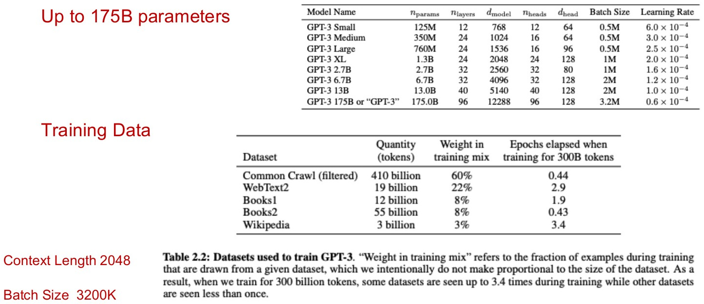

### 5.3 LAMBADA 与 TriviaQA 的示范数效应

LAMBADA 要根据较长语境预测最后一个词。第 52 页同时比较 zero-shot、one-shot、few-shot（K=15）、既有 SOTA 与人工水平；更大模型整体更好，少样本方式在大模型上尤为有效。课件指出 2.7B 的某些设置已越过旧 SOTA、175B few-shot 相对旧结果约提高 18 个百分点；应限定为该图的历史任务结果。one-shot 并不在每个规模上优于 zero-shot，不能把示范数当作严格单调保证。

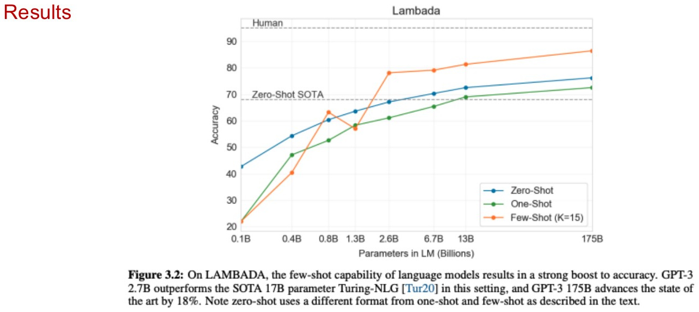

TriviaQA 的图采用 few-shot K=64，与 zero-shot、one-shot 和旧 SOTA 对比，展示闭卷知识问答也会从规模与示范中受益；收益大小依赖任务和提示。图上未逐点标出精确数值，因此保留曲线而不补出假精度。

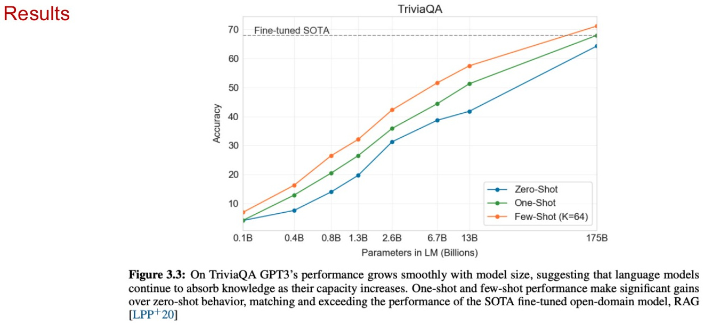

### 5.4 GPT-4 与对齐训练的边界

第 54 页用 GPT-4 讨论 RLHF。保留“基础预训练与人类反馈对齐分工不同”的知识点，去掉推文式宣传截图。RLHF 可改善模型遵循指令和人类偏好的表现，也可能让某些基准分数下降；课件“只会让输出符合人类偏好、不会让模型更好”的绝对说法不作为定理。是否提升能力取决于能力定义、训练目标与评价指标，不能用一项指标代替全部结论。[GPT-4 技术报告](https://arxiv.org/abs/2303.08774)也未披露足以在本章重建其架构和全部训练配置的信息。

## 6. LLaMA：数据、结构和对齐

来源：第 55–60 页。

### 6.1 LLaMA-1 的目标与训练数据

LLaMA 的一个动机是在给定推理预算下提高效果：较小模型接受更多训练 token，可能降低部署后反复推理的摊销成本。这与仅在固定训练 FLOPs 下寻找最佳参数／数据比是不同目标，不能认定“参数越小、数据越多”总最优。LLaMA-1 使用公开可获取来源构建训练集，并面向研究发布模型；“来源公开”也不意味着所有清洗后的训练文本逐条发布。

第 56 页数据表完整记录如下；大小列为原始文本规模，epochs 为表中遍历量。

| 数据源 | 混合比例 | epochs | 文本大小 |
| --- | --- | --- | --- |
| Common Crawl | 67.0% | 1.10 | 3.3 TB |
| C4 | 15.0% | 1.06 | 783 GB |
| GitHub | 4.5% | 0.64 | 328 GB |
| Wikipedia | 4.5% | 2.45 | 83 GB |
| Books | 4.5% | 2.23 | 85 GB |
| arXiv | 2.5% | 1.06 | 92 GB |
| Stack Exchange | 2.0% | 1.03 | 78 GB |

Common Crawl 选取 2017–2020 年数据并做语言与质量过滤，课件提到用 Wikipedia 相关高质量信号训练分类器。总训练量约 1.4T token，上下文 2,048；65B 大模型的历史训练示例为 2,048 张 A100 80GB、约 21 天。不能把这个用时套到每一种规模。数据与目标依据 [LLaMA 原论文](https://arxiv.org/pdf/2302.13971)。

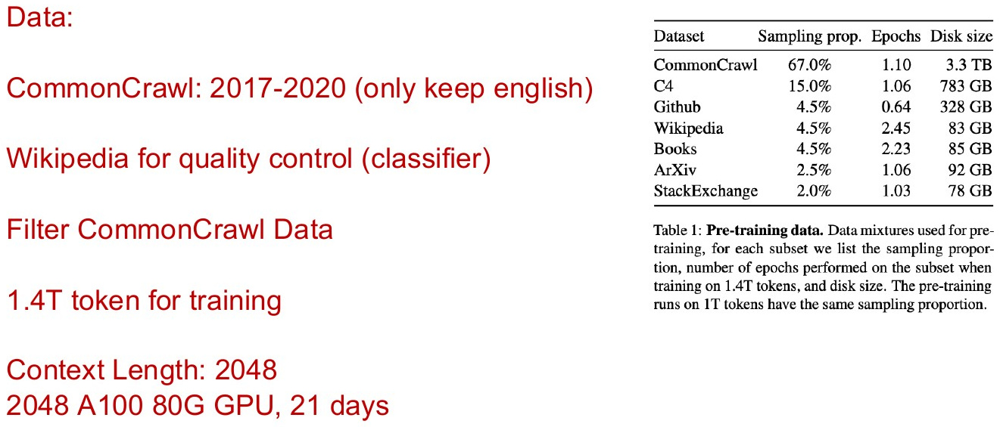

### 6.2 结构变化：RMSNorm、SwiGLU、RoPE

课件列出三项：Pre-normalization 并使用 RMSNorm；SiLU；旋转位置编码 RoPE。RMSNorm 不减均值，定义见第二章。SiLU 为 $`\mathrm{SiLU}(x)=x\sigma(x)`$；原模型前馈块实际上使用 **SwiGLU 门控**，不是只把普通 FFN 的 ReLU 换成一个 SiLU：

```math
\mathrm{FFN}(x)=\left[\mathrm{SiLU}(xW_g)\odot(xW_u)\right]W_d.
```

RoPE 对查询、键按位置施加旋转，使注意力相关性体现相对位移；它与前章把正弦向量直接加到输入上的方式不同。这里保留课件给出的三项结构名称，并用原论文澄清门控形式。

### 6.3 Llama 2 的规模和训练流程

Llama 2 的预训练 token 从约 1.4T 增至 2T，课件概括为多约 40%；上下文从 2,048 翻倍到 4,096。发布规模包括 7B、13B、70B。可用于研究和商业用途仍需遵守其具体许可；不能仅用“open source”推断所有使用条件或完整数据均开放。

课件概述超过 100K 的监督微调样本和超过 1M 的人类偏好标注。前者训练示范式回答，后者比较回答以训练奖励模型，两者不是同一种标签。

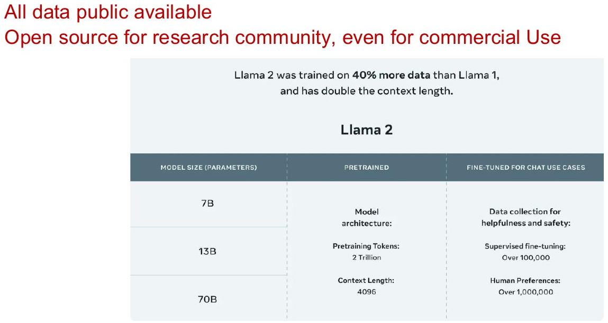

训练链路为：自监督预训练得到 base model → SFT 得到初步聊天模型 → 人类反馈形成偏好对 → 分别训练 helpfulness 和 safety 奖励模型 → 通过拒绝采样、PPO 等 RLHF 步骤优化 → 反复收集偏好与更新聊天模型。不同奖励维度与数据支路应分别保留。

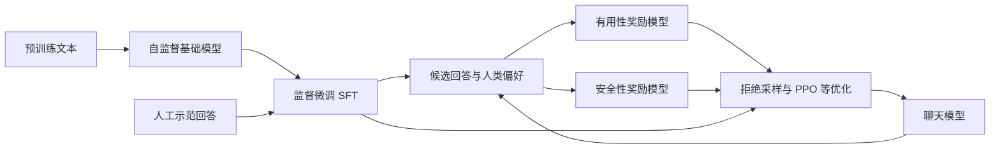

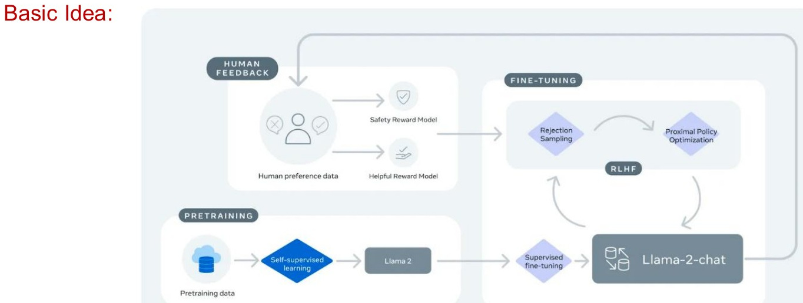

第 60 页画出 7B、13B、34B、70B 的预训练损失随 token 增加而下降，大模型在该设置下损失较低；34B 出现在研究曲线中，不表示它一定属于前述公开发布清单。曲线只覆盖约 2T 的已训练范围，不能据此外推永不饱和。

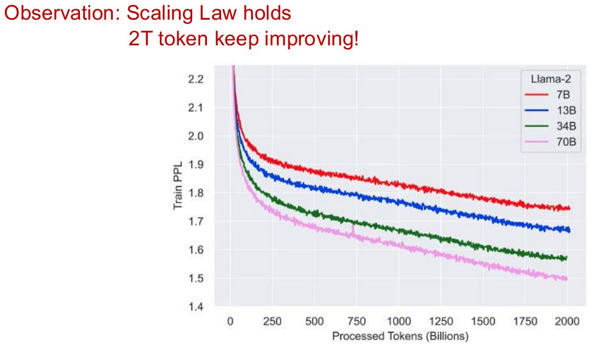

## 7. GQA：在质量和推理存储之间折中

来源：第 61–63 页。

MHA 中每个查询头各有自己的 K/V；MQA 的全部查询头共享一组 K/V；GQA 把查询头分组，每组共享 K/V。图中 8 个查询头、4 组 K/V，每两个查询头共享一组，但各自的查询投影与注意力分布仍可不同。

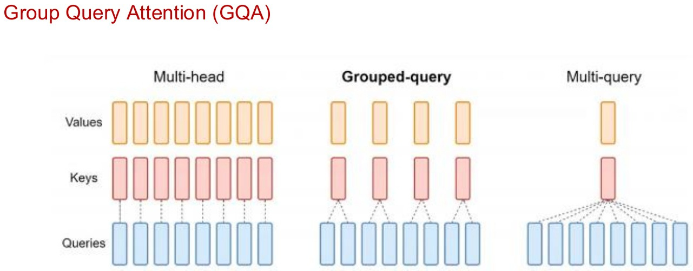

设有 h 个查询头、g 个 K/V 头；头 r 对应分组 $`\gamma(r)`$，则：

```math
o_r=\mathrm{softmax}\left(\frac{Q_rK_{\gamma(r)}^\top}{\sqrt{d_k}}+M\right)V_{\gamma(r)}.
```

自回归解码要缓存以往 token 的 K/V。忽略 batch、层数和精度字节，长度 T 的缓存元素数为 $`Tg(d_k+d_v)`$，MHA 对应 $`Th(d_k+d_v)`$。8 查询、4 KV 的例子，缓存是 MHA 的一半；MQA 为八分之一。GQA 并没有把 8 个查询头减成 4 个，也未消除所有注意力计算。

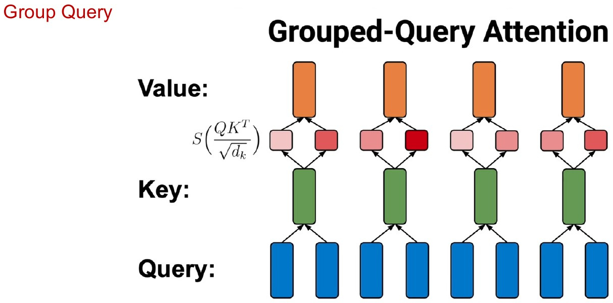

课件质量／每样本毫秒图中，GQA-XXL 的效果接近 MHA-XXL、时延明显较低；MQA-XXL 更快但效果下降；MHA-Large 在较低计算成本下也较低分。这是该实验的质量与速度折中，时延取决于硬件、实现和解码设置，不能把图中点当作通用倍数。

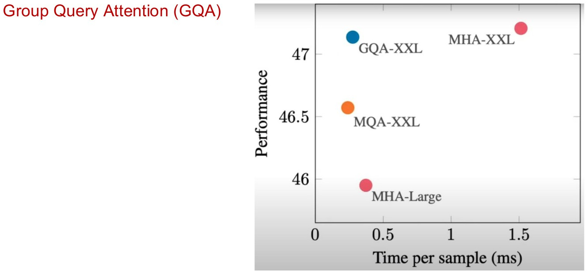

## 8. 初版 Llama 3：历史比较与训练成本

来源：第 64–67 页。本节对应 **2024 年 4 月初版 Llama 3**；不能与后续 Llama 3.1 等版本的上下文和模型大小混写。版本背景见 [Meta 初版发布说明](https://ai.meta.com/blog/meta-llama-3/)。

### 8.1 人工评测与原课件基准表

第 64 页为 Llama 3 70B Instruct 的聚合人类比较，单位为百分比：

| 对手（原图名称） | Win | Tie | Loss |
| --- | --- | --- | --- |
| Claude Sonnet | 52.9 | 12.9 | 34.2 |
| Mistral Medium | 59.3 | 11.4 | 29.3 |
| GPT-3.5 | 63.2 | 9.7 | 27.1 |
| Meta Llama 2 | 63.7 | 13.9 | 22.4 |

这是特定历史评测中的偏好比例，图中没有完整样本量、任务构成和置信区间，不能当作当前产品总体排序。

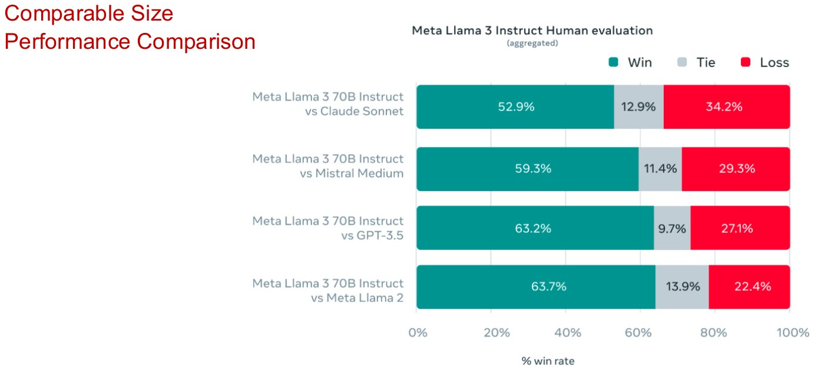

第 65 页各项数值按**原课件表**抄录，保留问题便于追溯：

| Benchmark | Llama2 7B | Llama2 13B | Llama2 70B | Llama3 8B | Llama3 70B | Llama3 400B | GPT-3.5 | GPT-4 |
| --- | --- | --- | --- | --- | --- | --- | --- | --- |
| MMLU | 34.1 | 47.8 | 52.9 | 68.4 | 82 | 86.1 | 70 | 86.4 |
| GPQA | 21.7 | 22.3 | 21.0 | 34.2 | 39.5 | 48 | 28.1 | 35.7 |
| HumanEval | 7.9 | 14.0 | 25.6 | 62.2 | 81.7 | 84.1 | 48.1 | 67 |
| GSM-8K | 25.7 | **77.4（原表，存疑）** | 57.5 | 79.6 | 93 | 94.1 | 57.1 | 92 |
| MATH | 3.8 | 6.7 | 11.6 | 30.0 | 50.4 | 57.8 | 34.1 | 52.9 |

注意：13B 的 GSM-8K=77.4 与同表其他 Llama 2 规模的趋势明显不同，原页没有足够设置可确认；表中 400B 是当时的预发布标记，不自动改成后来的 405B。页脚沿用了 Llama 2 论文，不能据此证明全部 Llama 3／GPT 跨模型数值。该表留作**课件原始记录，未当作统一条件下已验证的排行榜**。

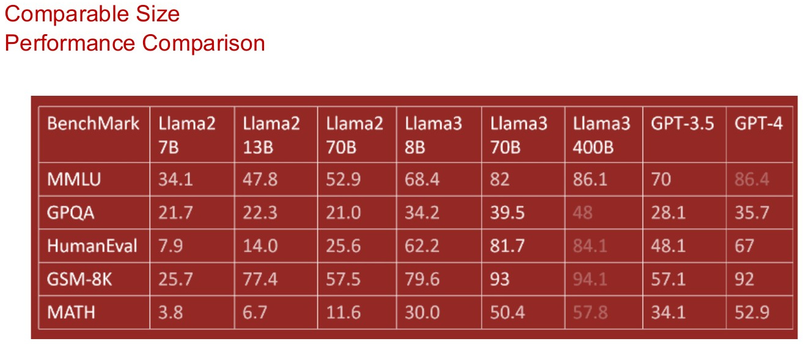

### 8.2 数据和 tokenization

第 66 页列出的初版变化包括：上下文 8,192；8B 也使用 GQA；词表由约 32K 增至 128K；预训练超过 15T token，约为 Llama 2 的七倍；代码数据约增至四倍；约 5% 为非英语，涵盖 30 多种语言；后训练包含约 10M 个人工标注样本。

更大词表可减少某些语言与代码的切分开销，但“所有汉字都恰好一个 token”不成立，具体由 tokenizer、字符串及上下文决定。预训练 token、人工标注条数和 GPU 数量也不能当作同一种训练规模单位。

### 8.3 训练资源与规模预测

课件提到 8B 在 15T token 后仍能改进，以及约 24K 张 H100 的训练资源规模。后者描述项目资源，不能不加条件地说每个 8B 训练都使用全部卡。用小模型实验预测大模型表现，需要明确拟合指标、规模范围和预算；课件没有给出可复现的完整预测方法，因此不把“没人知道怎么做”当作技术结论。

| 模型 | 训练 GPU 小时 | GPU | 训练 token |
| --- | --- | --- | --- |
| Llama1 65B | 1.0M | A100 80GB | 1.4T |
| Llama2 70B | 1.7M | A100 80GB | 2T |
| Llama3 70B | 7.7M | H100 80GB | 15T |

这些是课件报告的历史成本，不同代硬件的一个 GPU 小时不代表同等 FLOPs 或同等费用。Instruction tuning 是预训练之后的另一阶段，不应把聊天模型与 base 模型测试结果混在一起。

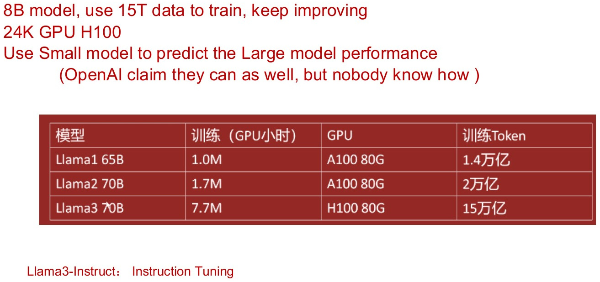

## 9. LoRA：低秩更新与部署合并

来源：第 68–70 页。

### 9.1 将权重更新分解为两个小矩阵

LoRA 利用适配更新可能具有较低有效秩的经验，冻结预训练权重，只训练低秩增量。低内在维度的动机不等于“任何任务的最优更新都已被证明低秩”。设：

```math
W_0\in\mathbb R^{d\times k},\quad
B\in\mathbb R^{d\times r},\quad A\in\mathbb R^{r\times k},\quad
\Delta W=BA,\quad r\ll\min(d,k).
```

于是课件前向为 $`h=W_0x+BAx`$。常见实现再乘缩放因子 $`\alpha/r`$，此时 $`h=W_0x+(\alpha/r)BAx`$；缩放是这里补充的实现约定，原图省略了它。需要训练的参数从 dk 变成 r(d+k)。例如 d=k=4096、r=8：原权重 16,777,216 个，LoRA 两矩阵共 65,536 个，是原矩阵的 0.390625%。该比例只比较这个线性层，不是整个模型的比例。

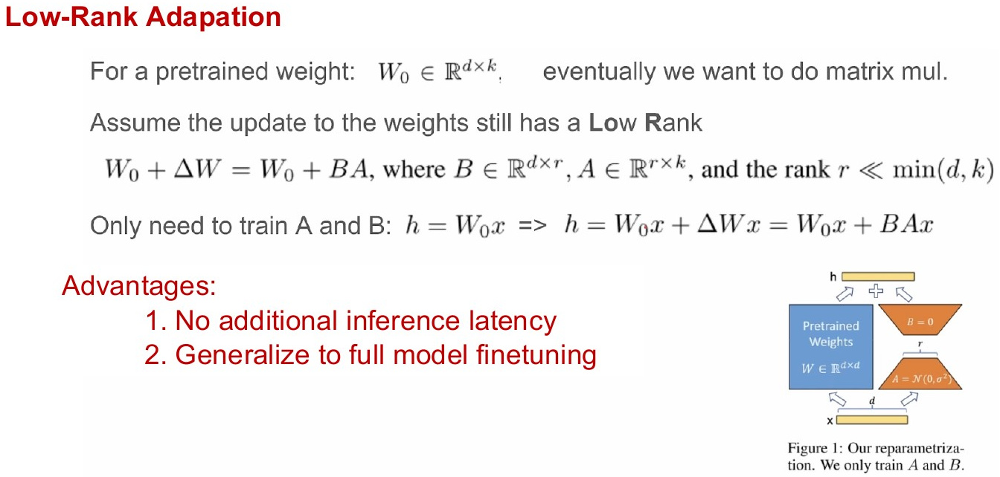

### 9.2 初始化、梯度与合并

课件采用 A 随机高斯初始化，B 初始化为 0，使初始 $`\Delta W=0`$，刚开始与原模型输出一致。初始对 A 的梯度为 0，但 B 通常可以得到非零梯度；随后 B 不再为零，A 也开始更新。若 A、B 同时初始化为零，则两个分支的梯度都为零，不能按通常的梯度下降学起来。

冻结的 W₀ 不接收更新。固定适配器部署时可合并成 $`W^*=W_0+(\alpha/r)BA`$，用一次普通线性映射计算，因此可消除低秩支路的额外矩阵乘法。这是课件“No additional inference latency”的条件；若保持分支独立或动态切换适配器，不能无条件保证没有额外开销。

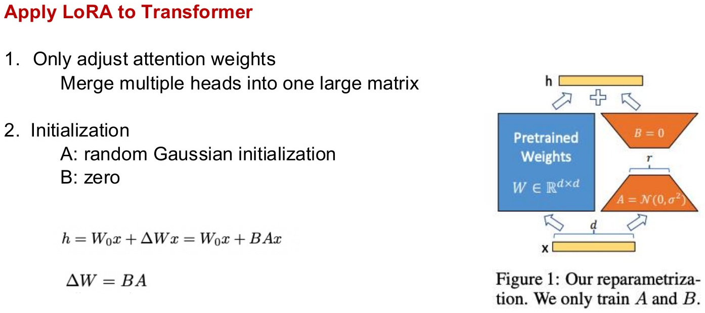

“只调整注意力权重”是课件选择的应用方案，LoRA 也可放在前馈等其他线性映射中；多头可由一个较大的投影矩阵统一表示，并不表示各头失去独立的投影切片。“推广到全模型微调”应理解为可对多层应用或提高秩扩大更新空间，不能说固定小 r 与任意全参数微调严格等价。方法依据 [LoRA 原论文](https://arxiv.org/abs/2106.09685)。

## 10. 与多模态基础模型的联系

来源：第 2、71 页路线图。课件列出 **LLaVA、BLIP-1、BLIP-2、InstructBLIP、MiniGPT-4**，作为后续 Multimodal Foundation Model 方向，没有给出足够的结构、损失、训练阶段或实验细节。本章保留这些名称与路线位置，不补写未出现的算法。

与已学章节的联系是：视觉编码器把图像变成可用表示；注意力连接文本与视觉上下文；语言基础模型提供生成能力；蒸馏与 LoRA 提供不同训练／适配手段；SFT 与偏好优化改变模型响应任务的行为。实际多模态系统如何连接这些模块，需要后续课件的具体设计。

返回[笔记目录](../README.md)，参阅[第七章：多模态对齐、注意力与图像描述](07-多模态对齐-注意力与图像描述.md)。
